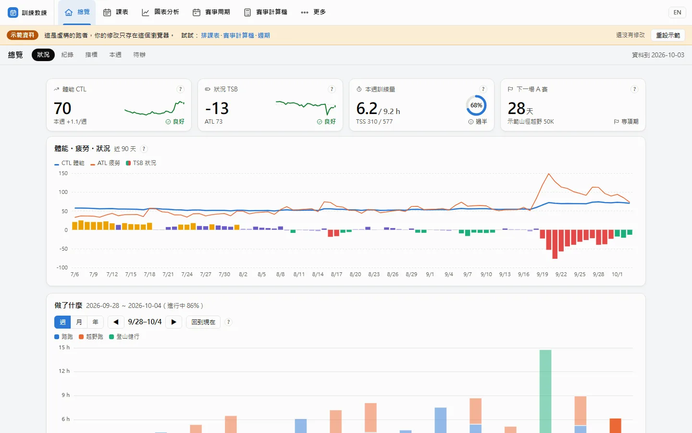
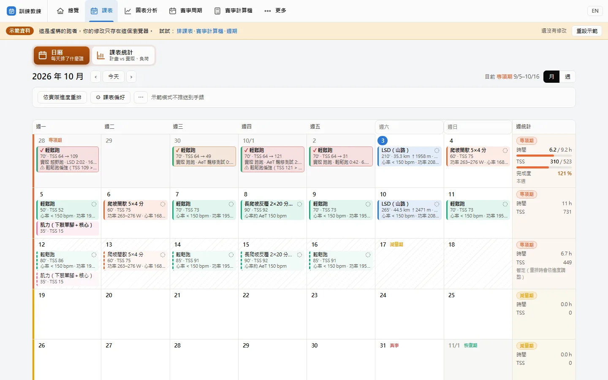
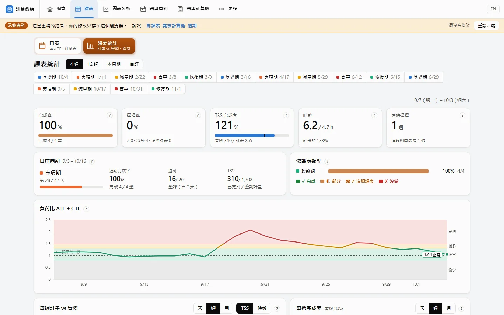
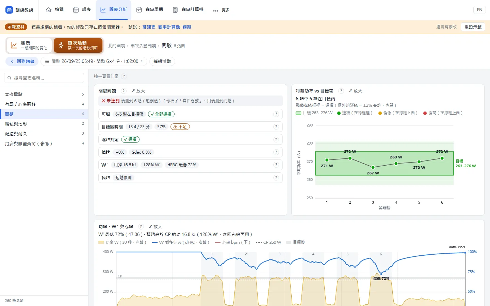
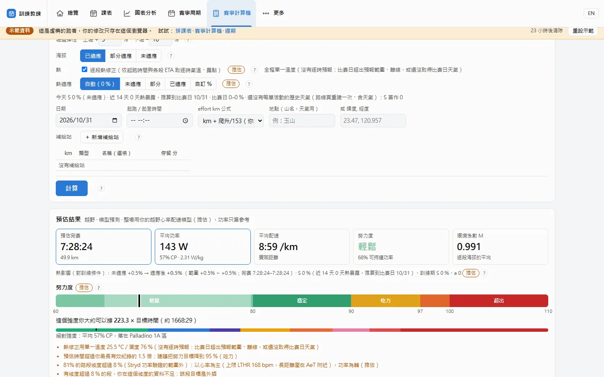
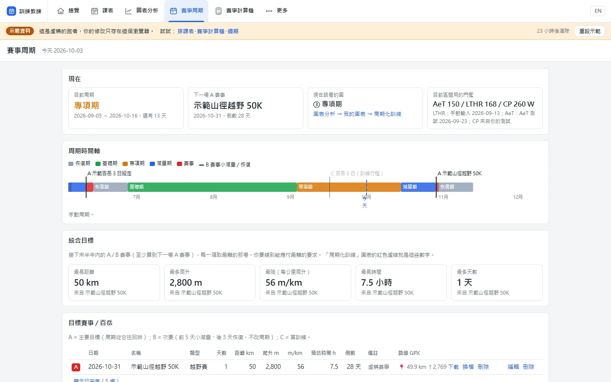
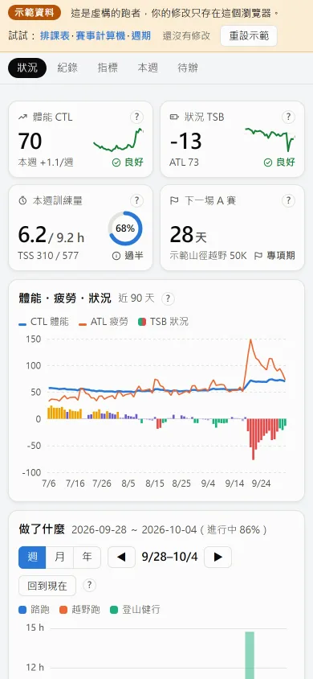

# TrailRunCoach

**給越野跑、百岳、路跑的訓練教練。** 讀你的手錶資料，告訴你現在的訓練狀況、幫你排課表（可以送到 COROS 手錶）、
判讀每一趟間歇和心率飄移，還能用賽道 GPX 預估比賽配速、功率和補給。自己架、資料留在自己的電腦。

> **公開版不含計算核心。** 完整程式在 private repo 開發；這個公開 repo（`vi000246/TrailRunCoach`）是它的自動鏡像，
> 拿掉了計算核心（圖表運算式引擎與資料集、指標算法、對照資料夾的檔案讀取、內建圖表定義）和相關測試、研究文件。
> 公開版照樣能啟動、每一頁都打得開，用到核心的地方顯示「核心未包含（公開版）」；用到核心的測試會自動跳過。



## 適合誰

- **越野跑者**：爬升、技術下坡、長距離；功率（Stryd）或只有心率都可以。
- **百岳／多日縱走**：背重、高海拔、連續多天的體能與配速估算。
- **路跑**：半馬、全馬的週期、配速和負荷管理。

## 主要功能

| | |
|---|---|
| **總覽 dashboard** | 長期訓練負荷（Chronic load）／短期負荷（Acute load）／負荷平衡（Load balance）的訓練負荷圖、負荷比、近期最佳、狀況卡，一頁看完。 |
| **自動排課** | 依週期、課表偏好、休息日自動排一週，拖曳調整；可以把課表送到 COROS 手錶。 |
| **間歇／飄移判讀** | 每趟間歇的功率對目標、心率飄移（白話說明），AeT／CP 測試自動辨識。 |
| **賽事計算機** | 賽道 GPX＋天氣＋你的體能 → 分段配速、目標功率、完賽時間、補給；可匯出 COROS 課表。 |
| **週期規劃** | A／B／C 賽事，基礎／強化／專項／減量期，課表跟著週期走。 |
| **課表統計** | 達成率、各種課的比例、各階段的負荷比。 |
| **傷病紀錄** | 疼痛標記、受傷事件與回歸建議（只在自己的電腦，不分享）。 |

<table>
<tr><td></td><td></td></tr>
<tr><td></td><td></td></tr>
<tr><td></td><td align="center"></td></tr>
</table>

截圖全部來自示範模式的虛構跑者。

## 資料來源

- **COROS**：帳號登入後匯入活動（FIT），也能把課表送到手錶（非官方介面，進階、風險自負）。
- **TrainingPeaks**：網站登入或你自己的 OAuth client（`TP_CLIENT_ID`／`TP_CLIENT_SECRET`）。
- **FIT 檔**：任何手錶匯出的 FIT。

## 隱私

資料（活動、心率、門檻、帳號 token）只存在你自己的電腦：`~/.trailruncoach/`（SQLite、快取、加密金鑰）。
舊版建的 `~/.wko5coach/` 會照用、不會搬（新資料夾不存在時）；環境變數的舊名 `WKO5COACH_*` 也照樣認，新名是 `TRC_*`。
token 和記住的密碼以 Fernet 加密。沒有雲端、沒有追蹤。線上示範只有虛構資料，訪客的修改只存在自己的瀏覽器。

## 在自己的電腦上跑

需要 Python 3.12。

```bash
python -m venv .venv
.venv/bin/pip install -r requirements.txt          # Windows: .venv\Scripts\pip
.venv/bin/python -m uvicorn backend.main:app --port 8000
```

打開 <http://localhost:8000>，到「設定 → 資料同步」登入 COROS 或 TrainingPeaks。
所有環境變數見 [`.env.example`](.env.example)，都是選填。

### Docker

```bash
docker compose up --build        # 掛載 ~/.trailruncoach（舊的 ~/.wko5coach：在 .env 設 TRC_DATA_FOLDER=.wko5coach）
```

這是在自己電腦上跑。放到比較弱的伺服器（例如 NAS）時，image 在電腦上建好再傳過去，伺服器不 build：
見 `docs/deploy/wko5coach.deploy.md`「正式環境：NAS」（只在完整版）。

### 示範模式（虛構跑者）

```bash
python -m backend.demo.build --root ~/trc-demo                    # 產生示範資料（約一年、幾分鐘）
TRC_MODE=demo TRC_HOME=~/trc-demo TRC_COOKIE_SECURE=0 \
  python -m uvicorn backend.main:app --port 8001
```

示範模式有自己的資料夾（拒絕使用 `~/.trailruncoach`），同步、上傳、分享都關閉；每位訪客第一次修改時
才建立自己的沙盒，24 小時後清除。

示範模式也可以打包成 Docker image（[`deploy/hf/Dockerfile`](deploy/hf/Dockerfile)），放在任何能跑 Docker 的雲端主機；
Hugging Face Docker Space（現在要付費）是其中一種，見 [`deploy/hf/`](deploy/hf/README.md)
（`python deploy/hf/make_space.py <space-repo>`）。沒有線上的公開示範（2026-10 起不再提供靜態示範網站）。

## 測試

```bash
pip install -r requirements-dev.txt
python -m pytest backend/tests -q -m "not golden" -n auto
```

預設只用合成資料，不碰 `~/.trailruncoach`。公開版沒有計算核心，用到核心的測試會顯示「核心未包含（公開版）」並跳過。`-n auto`（pytest-xdist）照 CPU 核心數平行跑：全套從單線的約 18 分鐘降到 2 分鐘左右（2026-10-13，18 核）；只跑幾個檔時不加比較快。

**瀏覽器冒煙測試**（`backend/tests/e2e/`，Playwright）：用示範跑者的合成資料在暫存資料夾起一個本機伺服器，
用 Chromium 打開每一頁，檢查沒有 JS 錯誤、主要區塊有畫出來、主要按鈕按得動。預設的 `pytest` 會跳過它們；
要跑時：

```bash
pip install -r requirements-dev.txt && python -m playwright install chromium   # 第一次
./e2e.sh                       # = python -m pytest backend/tests/e2e -m e2e；其他參數照傳（例 -k templates）
TRC_E2E_HEADED=1 ./e2e.sh -x   # 開視窗看它跑
```

頁面的 ECharts／Leaflet 從 cdnjs 載入，所以要有網路；地圖圖磚在測試裡以空白圖回應，不連圖磚伺服器。
不會連 COROS（「抓活動」的同步由測試自己回應）。

**驗收截圖**（`backend/tests/e2e/shots.py`）：同一個示範跑者、同一套環境，照一份 JSON 截圖清單拍下 UI 單改到的畫面
（桌機／手機寬度、先點開對話框、示範資料沒有的狀態用 mock 假造），存成 WebP 放進單上的「驗收截圖」。清單格式見檔頭。

```bash
./shots.sh SP-396.json --out <資料夾>                         # 自己起伺服器（約 30 秒）
python -m backend.tests.e2e._server --serve                    # 或先起一個，給好幾份清單共用：
./shots.sh a.json b.json --out <資料夾> --url http://127.0.0.1:<port>
```

---

## English summary

TrailRunCoach is a self-hosted training coach for trail runners, mountain hikers (Taiwan's 百岳)
and road runners. It reads your watch data (COROS, TrainingPeaks or plain FIT files) and gives you
an overview dashboard (training load chart: chronic / acute load and load balance, load ratio, status), an automatic weekly schedule you can send to a
COROS watch, interval and heart-rate-drift analysis per activity, a race calculator (GPX + weather +
fitness → pacing, power, finish time, fuelling), season periodisation, schedule statistics and an
injury log. Your data stays on your machine.

This public repository is an automatic mirror of the private repository where the program is
developed, **without the calculation core** (the chart expression engine and dataset, the metric
algorithms, the comparison-folder file readers, the built-in chart definitions, and their tests and research
notes). It starts and every page opens; whatever needs the core answers "核心未包含（公開版）"
(core not included), and the tests that need it are skipped.

There is no hosted public demo (the static demo site was retired in 2026-10). The demo mode
(`TRC_MODE=demo`, a synthetic athlete, per-visitor sandboxes) runs locally or as a Docker
image (`deploy/hf/Dockerfile`) on any Docker host, e.g. a (paid) Hugging Face Docker Space
(`deploy/hf/`). The UI is Traditional Chinese first, with an English catalog.

## 商標聲明／Trademarks

TrainingPeaks®、TSS®、Training Stress Score®、NP®、Normalized Power®、IF®、Intensity Factor®、WKO+® 是 TrainingPeaks, LLC 的註冊商標；WKO5 是 TrainingPeaks 的產品名稱。COROS、Garmin、Stryd、Strava 及其他名稱是各自所有人的商標。TrailRunCoach 與上述公司沒有任何關係，也沒有獲得它們的授權或背書。本服務的「訓練負荷（Training load）」「強度比（Intensity）」「加權功率（Weighted power）」「長期訓練負荷（Chronic load）／短期負荷（Acute load）／負荷平衡（Load balance）」是我們自己的指標；提到上述名稱，只是為了說明資料來源、檔案相容性，或讓你對照數字。

TrainingPeaks®, TSS®, Training Stress Score®, NP®, Normalized Power®, IF®, Intensity Factor® and WKO+® are registered trademarks of TrainingPeaks, LLC; WKO5 is a TrainingPeaks product name. COROS, Garmin, Stryd, Strava and other names are trademarks of their respective owners. TrailRunCoach is not affiliated with, authorised or endorsed by any of these companies. Training load, Intensity, Weighted power and Chronic load / Acute load / Load balance in this service are our own metrics; the names above are mentioned only to identify a data source, a compatible file format, or to let you compare numbers.

## License

Since 2026-10 the program is developed in a private repository (SP-500). This public repository
is a mirror of it without the calculation core; the core is not published, and using it needs an
agreement with the author.

- This repository's contents: [PolyForm Noncommercial 1.0.0](LICENSE) — personal use, study,
  research, hobby projects and non-profit use are free; any commercial use needs a separate
  license from the author.
- Versions published before 2026-10-05 were released under the MIT license and stay under it.

Pull requests outside the calculation core are welcome under the
[Contributor License Agreement](CLA.md); see [CONTRIBUTING.md](CONTRIBUTING.md) for what is
taken and how.

Third-party data: GoldenCheetah OpenData and the Lovdal dataset used by the
validation scripts are CC0; they are fetched or placed outside the repo, not bundled.
