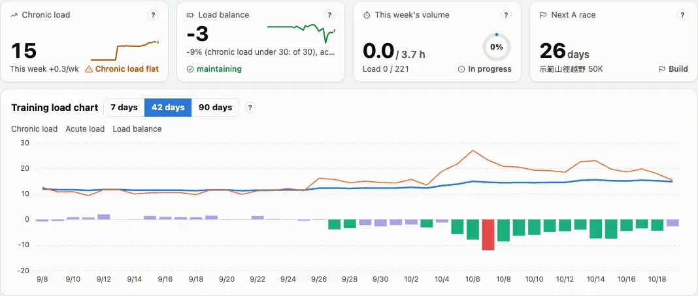
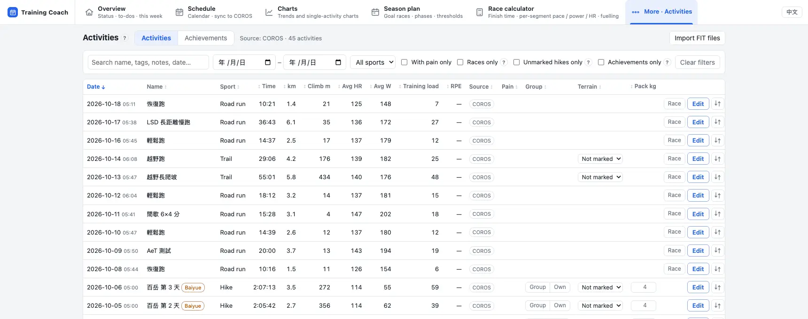
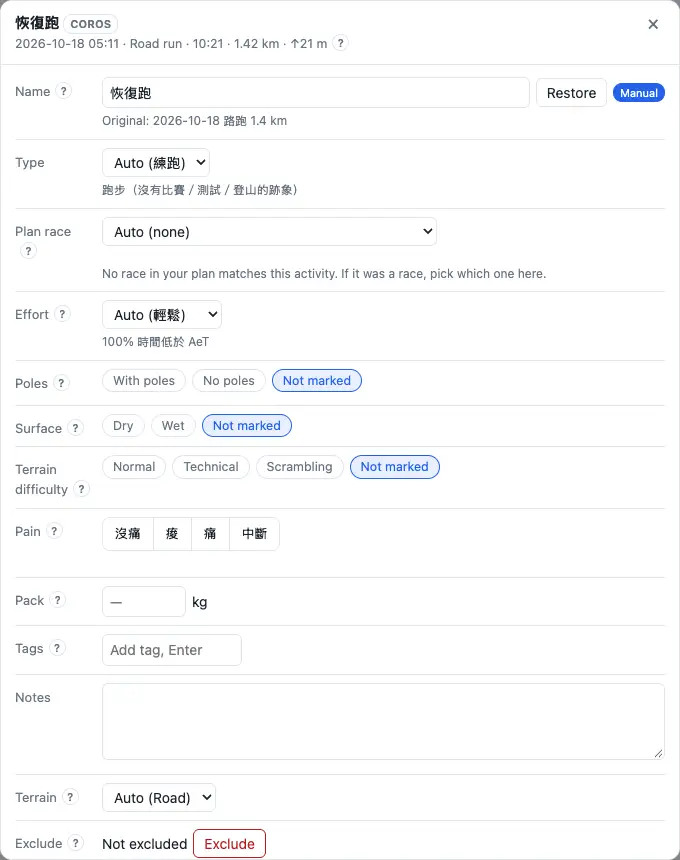
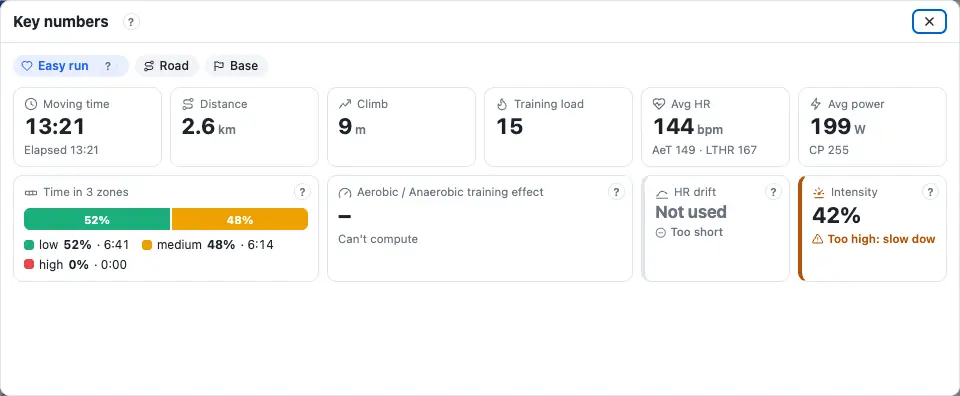

Analysis lives in three places: the **Overview** answers "how am I doing, how is this week going", **Activities** lists every activity and lets you add what the watch doesn't know, and **Charts** shows the trend over a period or the detail of one activity. Every card's and chart's `?` says how to read it.

## Overview: the four status cards {#status}

The four cards at the top of the Overview answer four questions: are you training enough over the long run (Chronic load), how tired are you now (Load balance), how much have you done this week (This week's volume), and how long until the race (Next A race). The word on each card is the verdict: Good, Watch, Act on it, Info, Not enough data.

1. Look at the verdict first: only "Act on it" and "Watch" call for something; otherwise train as planned.
2. Press a card's `?`: why it says so, → what to do, and where the number comes from.
3. "This week ±x/wk" under Chronic load is how much it has moved this week.

:::deep
### How Chronic load is judged
By this week's change (today's chronic load − 7 days ago). The watch line is 10 % of the value 7 days ago (at least 3); the limit is 15 % (at least 5, at most 10). Above the limit is "Act on it", above the watch line "Watch", a rise of 1 or more "Good" (a rise you can keep up). Flat or falling in the base or build phase is "Watch"; falling in the taper or recovery phase is normal. The first 28 days are not judged. See [Chronic load](glossary.md#chronic-load) and [Chronic load ramp](glossary.md#ramp).

### How Load balance is judged
The number is yesterday's chronic load − yesterday's acute load; in brackets, its share of the chronic load (a chronic load under 30 counts as 30). Below −30 % "Act on it" (risk of overreaching), −30 to −10 % Good (productive training), −10 to +10 % Good (holding), +10 to +35 % "Watch" (not enough training to improve), above +35 % "Watch" (losing fitness). Within 3 days of an A race the aim is +10 to +35 %. See [Load balance](glossary.md#load-balance).

### This week's volume
Hours done ÷ this week's target hours (strength not counted); underneath, training load done / planned, converted from your training load per hour over the last 6 weeks.
:::

## Training load chart {#load-chart}

The Overview's "Training load chart" turns each day's training load into three things: the **blue line** is the chronic load (roughly the last 6 weeks' average), the **orange line** the acute load (roughly the last week), the **bars** the load balance. Show the last 7, 42 or 90 days. The chart below is drawn by the same code: drag the sliders and see what two big weeks in a row do.

:::chart pmc
Drawn by the same code as the Overview; the data is a demo season. A bar's colour is the load balance as a share of the chronic load.
:::

:::deep
### Formula and colours
For each day's training load x: chronic ← chronic + (x − chronic) ÷ 42, acute ← acute + (x − acute) ÷ 7. Bar colours: below −30 % high risk, −30 to −10 % optimal, −10 to +10 % grey zone, +10 to +35 % fresh, above +35 % transition. A dashed line on the chart marks the day the default lactate threshold heart rate (LTHR) was replaced by your own number — a new threshold changes the load of every activity after it.

### Starting point
Both lines start from the "starting chronic load" in Settings, or, without one, from the average of the first 28 days with a training load (see [How the weekly amount is set](schedule.md#weekly-load)). When it says "calculating", see the [FAQ](faq.md#calculating).
:::

## What you did, indicators, this week {#overview-more}

Further down the Overview: **What you did** (time, distance and climb by week / month / year, against the period before), **Indicators** (a dozen or so training indicators, problems first) and **This week** (this week's session cards and notes). "To-dos and warnings" at the bottom holds the intensity unlock conditions and the warnings to deal with.

1. What you did: ◀ ▶ to change the period, press a bar to jump to it; hover a tile to see "usual" (the average of the periods before).
2. Indicators: usually only "Watch" and "Act on it" are open; the rest fold into "Other indicators fine: N". Open "Details" for the reason, the advice and the source.
3. This week: the cards are the schedule's (see [Reading a session card](schedule.md#read-card)); at most 3 notes show at once.

:::deep
### Intensity distribution
Low = heart rate below the aerobic threshold (AeT), moderate = AeT to LTHR, high = LTHR and above; moving time of endurance activities only. The "Intensity distribution" indicator looks at the low share of the last 4 weeks: 75 % or more Good, 65–75 % Watch, under 65 % Act on it (the target on screen: floor 75 %, aim 80 %, base phase 90 % or more).

### Other indicators
- Weekly hours: running time up more than 20 % on the week is Act on it, 10–20 % Watch.
- Aerobic efficiency EF: the last 6 weeks against before; only a change of ±2 % or more counts.
- HR drift: under 5 % steady, 5–10 % creeping up, 10 % or more a lot (see [Heart rate drift](glossary.md#drift)).
- Climbing speed VAM: 8 weeks against before, ±3 %.
- Downhill load: the last 7 days 1.5 times the 28-day level or more is Watch.
- Durability: drift late in long sessions under 5 % Good, 5–15 % Watch, 15 % or more Act on it.
- Longest session: in the build phase it should reach 70 % of the race time; a run 10 % longer than the longest of the previous 30 days gets a note.

### How much is open
With "How many tips" at Full everything is open, at Standard only Watch and Act on it, at Lean only Act on it; anything already in the to-do list is folded. See [How many tips](settings.md#hints).
:::

## Activities {#activities}

More → "Activities" lists all your activities: search (name, tags, notes, date), filter (dates, sport, races only, with pain only …), sort by any column. On hike rows you can type "Group", "Terrain" and "Pack kg" straight in.

1. Find the activity; on a phone, ＋ opens group, terrain and pack.
2. The buttons on the right: "Race" marks a run as a race, "Edit" adds marks, the compare icon picks two to compare, the chart icon "Open in Charts".
3. The "Achievements" tab lists the mountains you have climbed (by height class) and their totals.

:::deep
### Columns
Date, Name, Sport, Time, km, Climb m, Avg HR, Avg W (hidden when "use power" is off in Settings), Training load, RPE, Source, Pain. A dashed source means your main data source doesn't have this activity and another source filled it in. Next to the name: "race", achievement badges, "excluded" and so on.

### The three hike cells
- Group / Solo: one press saves, a second press clears; a pale one with "?" is the app's guess.
- Terrain: unmarked, normal, technical, scrambling; it can follow the route's setting.
- Pack kg: 0–40; blank uses the default pack (see [Estimated parameters](settings.md#advanced)).

### Comparing two
Press one activity's compare icon (A), then another's: "Compare two activities" opens with the overall result (B − A, negative = B was faster), per-km splits, pace / heart rate / power traces, pace by gradient and the stretches both went through; on the same route they are aligned point by point.
:::

## Adding marks {#mark}

"Edit" on an activity lets you add what the watch doesn't know: **Effort**, **Poles**, **Surface**, **Pain**, **Pack**, **Tags**, **Notes**, or **Exclude** the activity. The marks make the analysis and the schedule more accurate — the effort, for one, decides whether an activity can be used to estimate your ability.

- Effort: all-out, pushed with breaks, normal, easy (the options are still written in Chinese on the English screens).
- Pain: No pain, Sore, Pain, Stopped; "Pain" or "Stopped" opens an entry in the injury log (see [Marking pain on an activity](injury.md#pain)).
- Exclude: the activity is left out of the training load chart, the power curve, race power and the charts (say, a car ride the watch recorded).

:::deep
### Which effort wins
Your mark > the RPE the watch recorded > the COROS post-run rating > the heart-rate rules. RPE: 1–4 easy, 5–8 normal, 9–10 all-out. How an RPE becomes a training load when there is no heart rate or power: [RPE](glossary.md#rpe).

### Other fields
- The name can be changed; "restore" brings back the watch's name.
- Type: race, training run, hike, guided Baiyue trip, test, other; runs and hikes can be matched to a plan race ("Plan race").
- Terrain: auto, road, trail.
- Tags: up to 30 characters each, up to 20; the search finds them.
- A duplicate activity (recorded by two sources) can be split or merged.
:::

## Charts {#charts}

"Charts" in the menu has two modes: **Trends** shows a period (the last 90 days by default), **Single activity** the second-by-second detail of one. Pick a tab in the contents on the left ("My training", "Periodization"); "Filters and activities" on the right sets the dates and the sport — press an activity to switch to single activity.

1. Pick a tab, e.g. "My training › Training load".
2. Set the dates on the right (7 days, 42 days, 90 days, 1 year, this year, all; or ahead to the target race).
3. "⤢ Enlarge" on a card's title opens the chart large, with a link you can share; its `?` says how to read it.

:::deep
### The tabs
- My training: Training load (the training load chart, daily load, chronic load ramp, load balance, load ratio, aerobic / anaerobic training effect), Volume, Intensity, Capacity.
- Periodization: one page of checks each for the transition, base, build and taper phases, plus "Zones and session intensity".

### Why a chart is missing
Power charts are hidden when "use power" is off in Settings; charts for one discipline show only in it (the "discipline" chip on top: trail, road, marathon); some need a condition first — "poles vs no poles" needs 5 marked activities of each in the last year.

### Daily load and load ratio colours
Daily load against the chronic load: grey below it, green up to 30 above, yellow 30–60 above, red more than 60 above. Load ratio (7 : 42 days): under 0.8 grey, 0.8–1.3 green, 1.3–1.5 yellow, above 1.5 red (see [Load ratio](glossary.md#load-ratio)).
:::

## Activity review {#review}

Open one activity (the chart icon in Activities, or press one on the right in Charts) to get the "Activity review": the "Key numbers" on **Highlights** say what kind of session it was, how much of the plan you did, whether the aerobic work was steady and whether you held up late on; the other tabs cover drift, intervals, climbing, pacing and durability, running form.

1. First the session type and completion: matching the plan is what you want.
2. Easy and long runs: look at drift and intensity — did the heart rate creep up, did you run too hard?
3. Intervals: the "Intervals" tab shows whether each rep was in the target band.

:::deep
### Key numbers
- Completion: time and load both within ±20 % of the plan count as done; intensity at 80 % of the plan or more is done, 50–80 % short of intensity, under 50 % ran easy (as in [How completion is judged](schedule.md#read-card)).
- Three zones: low < AeT, moderate AeT to LTHR, high ≥ LTHR.
- Aerobic / anaerobic training effect: 1–10 (not the watch's 0–5), needs power (see [Training effect](glossary.md#training-effect)).
- Intensity (easy and long runs): time above the easy ceiling + 3 bpm should be 10 % or less.
- Durability: in the last 20 % of the time, power or speed at the same heart rate against just after the warm-up: 95 % or more held up, 90–95 % tiring, under 90 % adjust fuelling or pacing.

### Drift
Judged only on easy runs, long runs and AeT tests. The first 10 minutes don't count; it is not used with 20 m or more of climb per km, more than 5 % stopped, uneven power (VI above 1.04) or above 90 % of CP; under 40 minutes after the warm-up it is only a reference. Under 5 % steady, 5–10 % some drift, above 10 % a lot.

:::chart drift
Drag the early heart rate and the rise, and see how drift is worked out and judged.
:::

### Intervals
Time in the target zone of 85 % of the plan or more is achieved, 60–85 % partly, under 60 % not achieved. The "Power, anaerobic reserve and heart rate" chart shows how much anaerobic reserve each rep used (see [Anaerobic reserve](glossary.md#anaerobic-reserve)).
:::

## Ability {#ability}

"Charts › My training › Capacity" is **the evidence of progress**: the power curve, the modelled threshold power and VO2max trend, aerobic efficiency, heart-rate drift, uphill and downhill speed, climb density, durability. Read it over weeks, not from a single activity.

1. Running power curve: the yellow line is the best average power for each duration in the period, the red line the model, orange blocks the durations with a new best in the last 14 days.
2. Modelled threshold power and VO2max trend: fitted every 30 days — is it going up?
3. Trail runners: uphill speed (metres climbed per hour) and durability as well.

:::chart cp
Drag CP and anaerobic capacity and see the power–duration curve change: CP sets what you can hold for a long time, anaerobic capacity how high you can go for a short one.
:::

:::deep
### Power curve and model
The modelled threshold power is the CP the schedule uses (value and date at the right end); it is fitted on the last 90 days of Stryd power, watch-estimated power is not used, and with too little data nothing is drawn. VO2max is converted from the modelled threshold power and the anaerobic capacity ((anaerobic capacity ÷ 589 + modelled threshold power) ÷ 84.5 + 0.656 L/min, divided by body weight) — an estimate. See [Critical power](glossary.md#cp), [Modelled threshold power](glossary.md#mtp), [Anaerobic capacity](glossary.md#anaerobic-capacity).

### Other ability charts
- Aerobic efficiency EF (easy road runs): road runs of 30 minutes or more at an average heart rate ≤ AeT + 3.
- HR drift on easy road runs: green < 5 %, orange 5–10 %, red > 10 %.
- Uphill speed: metres climbed per hour on gradients of 5 % or more below LTHR (see [VAM](glossary.md#vam)).
- Durability: heart-rate drift late in trail runs over 90 minutes, grey line 5 %, red line 15 %.
- The thresholds themselves (LTHR, AeT, CP) are set in Settings: see [Thresholds](start.md#thresholds).
:::
