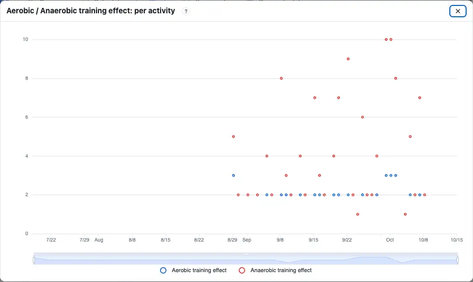
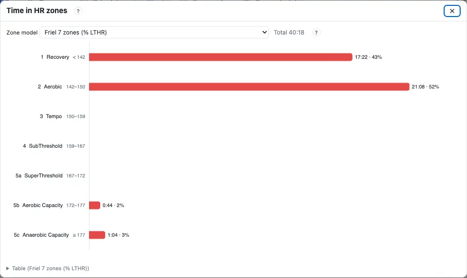
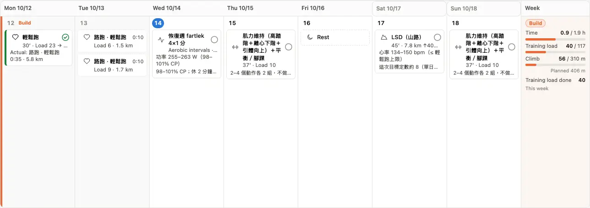

When a `?` on a page mentions one of these terms, its last line says “Glossary:” and links here. Each term starts with one plain sentence and a chart (most of them you can drag); open “In depth” for the definition, the formula and the sources.

| Group | Terms |
|---|---|
| Load | [Training load](#training-load), [Chronic load](#chronic-load), [Acute load](#acute-load), [Load balance](#load-balance), [Chronic load ramp](#ramp), [Load ratio](#load-ratio) |
| Power | [Weighted power](#weighted-power), [Intensity](#intensity), [Critical power (CP)](#cp), [Modelled threshold power](#mtp), [Anaerobic capacity](#anaerobic-capacity), [Anaerobic reserve](#anaerobic-reserve), [Aerobic / Anaerobic training effect](#training-effect) |
| Heart rate | [LTHR](#lthr), [AeT](#aet), [Heart rate reserve](#hrr), [Zones](#zones), [Time in zones](#time-in-zones), [HR drift](#drift), [RPE](#rpe) |
| Trail | [GAP](#gap), [VAM](#vam), [Effort distance (EP)](#effort-distance) |
| Phases | [Base, Build, Taper, Recovery](#phases) |

## Training load {#training-load}

:::terms
Training load
training load
Power load
Pace load
HR load
:::

A score for how hard one session was: **one hour at threshold = 100**. The longer and the closer to threshold, the higher; an hour of easy running is about 50–60. Drag the average power and the swing below: at the same average power, the bigger the swings, the higher the Training load.

:::chart power
Example: one hour, switching between fast and slow every 2 minutes, CP 250 W. Blue = 30-second power, grey dashes = average power, orange = Weighted power.
:::

- You see it on the Overview's Training load chart, on the Schedule cards (“Load planned → done”) and in Activities.
- A run with power uses power; without power, pace or heart rate; with neither, you can enter it by feel ([RPE](#rpe)).

:::deep
### Definition
Training load per hour = [Intensity](#intensity)² × 100; for a session = seconds × Intensity² × 100 ÷ 3600. So one hour at threshold (Intensity 1.0) is exactly 100.

### Three ways to compute it
- **Power load**: Intensity = [Weighted power](#weighted-power) ÷ the CP in effect that day (a CP test when you have one, otherwise the [Modelled threshold power](#mtp)).
- **Pace load**: Intensity = threshold pace ÷ this session's pace (faster is higher).
- **HR load**: time with heart rate × (average HR ÷ [LTHR](#lthr))², with the LTHR in effect that day.

Only moving time counts, and climbing adds to it, so the numbers are roughly comparable with similar scores on other platforms but not identical. A planned session's load is estimated from the target intensity of each step.

### Sources
“An hour at threshold = 100, per hour = Intensity² × 100” is Coggan's published definition (Allen & Coggan, *Training and Racing with a Power Meter*, 2010); the conversion from feel follows Foster et al.'s session RPE (2001).
:::

## Chronic load {#chronic-load}

:::terms
Chronic load
chronic load
:::

The average daily Training load of roughly the last six weeks — think of it as your fitness base: it rises slowly while you train and falls slowly when you stop. Drag the next two weeks below and watch the blue line.

:::chart pmc
The Training load chart of the Overview, drawn by the same code, with a made-up season. Blue = Chronic load, orange = Acute load, bars = Load balance.
:::

:::deep
### Formula
For each day's Training load x: Chronic load ← chronic + (x − chronic) ÷ 42 — an exponentially weighted average with a 42-day time constant: about a third of one day's training is still there 42 days later.

### Starting value
If you entered a “Starting chronic load” (Settings › Physiology) it starts from that day; otherwise from the average daily load of the first 28 days with Training load. While older activities are still being added it shows “calculating”, because it builds up over your whole history.

### Sources
Seeing the effect of training as two quantities that fade at different speeds comes from the impulse–response model of Banister et al. (1975, *Australian Journal of Sports Medicine* 7:57–61); 42 and 7 days are the usual constants Coggan applied to power training.
:::

## Acute load {#acute-load}

:::terms
Acute load
acute load
:::

The average load of roughly the last week — the fatigue you have built up lately: it jumps when you train a lot and drops after two or three easy days. It is the orange line; move the sliders and it reacts much faster than the blue one.

:::chart pmc
Orange = Acute load (7 days), blue = Chronic load (42 days). A big week sends the orange line up first.
:::

:::deep
### Formula
Acute load ← acute + (x − acute) ÷ 7 (an exponentially weighted average with a 7-day time constant). It starts like the [Chronic load](#chronic-load).

### How to read it
Orange above blue = lately you trained more than usual; that alone is not bad — every build week of the schedule looks like that. What matters is the gap between the two: see [Load balance](#load-balance).

### Sources
The “fatigue” term of Banister et al.'s impulse–response model (1975); the constants as for the [Chronic load](#chronic-load).
:::

## Load balance {#load-balance}

:::terms
Load balance
load balance
:::

**Yesterday's Chronic load minus Acute load**: positive = room to spare, fresher; negative = still building fatigue. Hard training pushes it well below zero; tapering before a race brings it back above.

:::chart pmc
Bars = Load balance, coloured by its share of the Chronic load. Drag two big weeks in a row: the bars turn red (High Risk) and the schedule plans a recovery week.
:::

| Colour | Load balance ÷ Chronic load | Name |
|---|---|---|
| Red | < −30 % | High Risk |
| Green | −30 to −10 % | Optimal |
| Light purple | −10 to +5 % | Grey Zone |
| Purple | +5 to +25 % | Fresh |
| Yellow | > +25 % | Transition |

:::deep
### Formula
Load balance (today) = yesterday's Chronic load − yesterday's Acute load. “Yesterday” because today's training is not done yet: the number you see in the morning is how you head out.

### How the schedule uses it
- Load balance < −30: the next week becomes a recovery week (60 % of the last 4 weeks' average).
- Load balance < −20: the volume is held, not increased.
- The colours use the share, but the recovery-week rule uses the **value** (−30). See [Where each week's volume comes from](schedule.md#weekly-load) in the Schedule chapter.

### Sources
Banister's model (1975): performance = fitness − fatigue; the five colour bands are an industry-common split (Friel's rule of thumb) — a direction, not a diagnosis.
:::

## Chronic load ramp {#ramp}

:::terms
Chronic load ramp
:::

**How much the Chronic load went up in a week.** Adding too fast invites injury and illness, so the schedule caps the weekly increase. Drag the sliders below: the “vs this Monday” box is the increase over two weeks.

:::chart pmc
“vs this Monday” = the Chronic load two weeks on minus this Monday's; half of it is the average weekly ramp.
:::

:::deep
### The schedule's caps
- Base: Chronic load +5 % a week (at least +2).
- Build: +7 % a week (at least +2.5).
- Weekly hours at most 110 % of the reference (or +0.5 hours).

The Overview's “this week +x/wk” is this number. Over the cap, the schedule does not add volume the next week.

### Sources
Joe Friel's advice on the weekly increase (*The Triathlete's Training Bible*); the actual limits are estimates.
:::

## Load ratio {#load-ratio}

:::terms
Load ratio
:::

**Acute load ÷ Chronic load**: 1 means this week is as much as usual, 1.5 means half again as much. The chart below has an extra “Load ratio” box; drag the weeks up and see how high it goes.

:::chart pmc ratio=1
The “Load ratio” box = Acute load ÷ Chronic load at the end of the two weeks.
:::

| Range | Meaning |
|---|---|
| < 0.8 | Low (normal in a recovery week or taper) |
| 0.8–1.3 | Normal |
| 1.3–1.5 | High |
| > 1.5 | Spike |

:::deep
### Where
The Load ratio chart in Charts › My training; the line's colour is the range above. A big multi-day trek sends it up — that is expected.

### Only a direction
The ratio is often linked to injury risk (Gabbett 2016, *British Journal of Sports Medicine* 50:273–280), but later work showed fundamental statistical problems and does not support using it to predict injuries (Impellizzeri et al. 2020, *International Journal of Sports Physiology and Performance*). Here it only shows a direction; the schedule decides nothing with it.

### Sources
The ranges are borrowed from Runalyze; Gabbett 2016; Impellizzeri et al. 2020.
:::

## Weighted power {#weighted-power}

:::terms
Weighted power
weighted power
:::

Turns uneven power into one number: “as hard as holding this many watts steadily”. The bigger the swings, the further Weighted power sits above average power, because the surges cost the body more.

:::chart power
Drag “swing”: the average stays, and the bigger the swing, the further the orange line (Weighted power) from the grey dashes (average).
:::

:::deep
### Formula
1. Take the 30-second rolling average power;
2. raise each value to the 4th power and average them;
3. take the 4th root.

The 4th power gives the hard stretches more weight, close to the non-linear way lactate and glycogen use rise with intensity.

### Used in
[Intensity](#intensity), the power [Training load](#training-load), and an activity's EF (Weighted power ÷ average HR).

### Sources
Coggan's published definition (Allen & Coggan, *Training and Racing with a Power Meter*, 2010).
:::

## Intensity {#intensity}

:::terms
Intensity
:::

**This session's intensity as a share of threshold**: 1.0 = threshold, about 0.75 is an easy run. With power, Intensity = Weighted power ÷ CP.

:::chart power
The “Intensity” box = Weighted power ÷ CP (250 W in the example). An hour at Intensity 0.9 is a Training load of 0.9² × 100 = 81.
:::

:::deep
### Formula
- Power: Intensity = [Weighted power](#weighted-power) ÷ the CP in effect that day.
- Pace: Intensity = threshold pace ÷ this session's pace.
- By feel ([RPE](#rpe)): each level has a default Intensity (Easy 0.74, Somewhat hard 0.82, Hard 0.88, Very hard 0.95, Max 1.10 — the ranges are sourced, the points are estimates), later calibrated on your own rated activities.

### Sources
Coggan's published definition (Allen & Coggan 2010).
:::

## Critical power (CP) {#cp}

:::terms
CP
critical power
Critical power
:::

**The highest power you can hold for a long time** (roughly a 30–60-minute race). Every second above CP spends [Anaerobic capacity](#anaerobic-capacity); when it is gone, you have to slow down. Drag CP and Anaerobic capacity and see how many watts each duration allows.

:::chart cp
The power–duration curve: the shorter the time, the higher the power you can hold; the longer, the closer to CP (orange dashes). The last box is how long you last at 110 % of CP.
:::

:::deep
### Model
P(t) = CP + W′ ÷ t: at a power P above CP you last t = W′ ÷ (P − CP). W′ is a fixed amount of work (joules) you can do above CP; this app calls it [Anaerobic capacity](#anaerobic-capacity).

### This app's CP
The CP of the schedule, the zones and the power load: a CP test (Settings › Physiology › Threshold tests) when you have one, from the test date on; otherwise the [Modelled threshold power](#mtp) from Stryd power. The test protocol is chosen in the schedule preferences (quick 20 min, standard 12 + 3 min, or a race).

### Sources
Monod & Scherrer 1965 (*Ergonomics* 8:329–338); for running and endurance sport see Jones et al. 2010 (*Medicine & Science in Sports & Exercise* 42:1876–1890). Power zones follow Palladino's % CP table.
:::

## Modelled threshold power {#mtp}

:::terms
Modelled threshold power
modelled threshold power
:::

The threshold power fitted to **your best power at every duration in the last 90 days**. No special test needed: whenever you run a few hard stretches, the model updates. Without a CP test, the schedule's CP is this.

:::chart cp
The idea of the fit: a curve laid against the best power at each duration; its long end is the Modelled threshold power (shown here with the simplest, two-parameter model).
:::

:::deep
### How it is computed
A power–duration (PD) model is fitted to the power curve (the best average power at each duration) of the last 90 days of Stryd power: short durations are dominated by an anaerobic term that falls with time, long ones level off near threshold. The Modelled threshold power, the [Anaerobic capacity](#anaerobic-capacity) and the time it can be held are read from that fit. It is fitted every 30 days and on the day of your latest run; watch-estimated power is not used; the schedule switches only when it moves 3 W or more.

### Why it can be off
A duration you have not run all-out in 90 days does not reach your real limit, so the Modelled threshold power comes out low; a CP test or a race corrects it.

### Sources
Power–duration models covering every duration exist in the published literature (e.g. Morton's three-parameter model, 1996, *Ergonomics* 39:611–619; Peronnet & Thibault 1989, *Journal of Applied Physiology* 67:453–465). It is an estimate, not a lab measurement.
:::

## Anaerobic capacity {#anaerobic-capacity}

:::terms
Anaerobic capacity
anaerobic capacity
W′
:::

**The “savings” you can spend above CP** (in kJ). Sprints, steep climbs and intervals spend it; when it is gone you can only go below CP. Drag “Anaerobic capacity” in the CP chart and see the short-duration power move.

:::chart cp
The bigger the Anaerobic capacity, the higher the left of the curve (power for a few minutes); with CP unchanged, long-duration power barely moves.
:::

:::deep
### Definition
The W′ of the CP model P = CP + W′ ÷ t: the total work you can do above CP. The sports-science literature writes it W′ (W prime).

### This app's value
Read from the same fit as the [Modelled threshold power](#mtp). When there is not enough data to fit, a prior: 6.4 kJ for women, 13.1 kJ for men (which is why the basic profile asks for sex).

### Sources
Monod & Scherrer 1965; Jones et al. 2010.
:::

## Anaerobic reserve {#anaerobic-reserve}

:::terms
Anaerobic reserve
anaerobic reserve
:::

**How much of the Anaerobic capacity is left, in %**: each interval above CP takes some, the recoveries put some back. Drag the interval power and the recovery time below and watch how low the blue line goes.

:::chart wbal
Example: CP 250 W, Anaerobic capacity 15 kJ; 10 minutes easy → 5 × 3 minutes → cool-down. Orange = power, blue = Anaerobic reserve (right axis, %).
:::

:::deep
### This chart's model
An illustration with Skiba et al.'s published model: above CP, 1 J spent per joule; below CP it refills at (CP − power) × (capacity − current) ÷ capacity, so the emptier it is and the easier the recovery, the faster it refills (Skiba et al. 2015, *European Journal of Applied Physiology* 115:703–713; an earlier form: Skiba et al. 2012, *Medicine & Science in Sports & Exercise* 44:1526–1532).

### This app's own
The activity chart “Power, Anaerobic reserve and HR” refills in a fast and a slow part (30 % in about 25 s, 70 % in about 300 s). Not validated for running — an estimate.

### How to read it
Every rep dropping about the same and coming back = targets and recoveries fit; deeper and deeper drops that do not come back = not enough recovery, or targets too high.

### Sources
Skiba et al. 2012 and 2015 (above); the idea comes from the W′ of the CP model (Monod & Scherrer 1965).
:::

## Aerobic / Anaerobic training effect {#training-effect}

:::terms
Aerobic / Anaerobic training effect
Aerobic training effect
Anaerobic training effect
training effect
:::

How much a session worked your **aerobic** and your **anaerobic** system, each on a 1–10 scale. Long sessions near threshold score high aerobic; only intervals and races above threshold score high anaerobic.

:::deep
### How it is computed
Against the [Modelled threshold power](#mtp) (aerobic) and the [Anaerobic capacity](#anaerobic-capacity) (anaerobic) of the 90 days before the activity, the smoothed power is weighted and added up second by second. The anaerobic score grows only above 85 % of the Modelled threshold power, so an easy run is usually 1. It needs power; activities without power have no score.

### Unlike the watch
The watch's training effect runs 0–5, this one 1–10; the two do not compare directly. The score has no official named levels: read the number against your own usual sessions.

### Sources
Splitting a session into an aerobic and an anaerobic stimulus is an idea watch makers' “training effect” shares; this score is an estimate, not validated in the published literature.
:::

## Lactate threshold heart rate (LTHR) {#lthr}

:::terms
LTHR
lactate threshold heart rate
:::

**Roughly your average heart rate for an all-out hour.** The heart-rate zones, the HR load and the threshold sessions' targets come from it. Drag LTHR and see the three zone sets move.

:::chart zones
The schedule's three heart-rate zone sets (COROS's): lactate threshold, heart rate reserve, max HR; the numbers are the zone edges (bpm).
:::

:::deep
### How to test
The LTHR test (Friel): 30 minutes all-out, alone; the average HR of the last 20 minutes. Record it in Settings › Physiology › Threshold tests; it takes effect from the test date.

### Without a test
In order: an estimate from your own data → the watch's value → 90 % of max HR (an estimate; Nuuttila 2025: the second lactate threshold at about 90.6 ± 2.5 % of max HR).

### Sources
Friel, *The Triathlete's Training Bible* (the LTHR test and % LTHR zones).
:::

## Aerobic threshold (AeT) {#aet}

:::terms
AeT
aerobic threshold
Aerobic threshold
:::

**The highest intensity at which you can still breathe through your nose and speak in full sentences.** Easy and long runs stay below it. The test: 40 minutes at a steady power, comparing how far the heart rate drifts in the second half; drag the HR rise below and see the reading change.

:::chart drift
The AeT test: 40 minutes at a steady 200 W; “power ÷ HR” of the first 20 minutes against the last 20.
:::

:::deep
### How to test (the HR drift test)
1. Treadmill at 2–3 % or a flat loop; warm up 10 minutes.
2. Start at the HR you guess is your AeT and hold a steady power for 40 minutes, without stopping or speeding up.
3. Compare “power ÷ HR” of the first and second 20 minutes: drift < 3.5 % = your AeT can go higher; 3.5–5 % = the starting HR is your AeT; > 5 % = set too high.

Without a test it is estimated as 0.89 × LTHR. A measured AeT is always the easy-run cap.

### AeT and LTHR
AeT ≈ the first lactate threshold (LT1), the first ventilatory threshold; LTHR ≈ the second. With a measured AeT, a gap (LTHR ÷ AeT − 1) ≤ 10 % = aerobic base in place, and the base phase may start intervals (the “interval gate” in the schedule preferences).

### Sources
Uphill Athlete's HR drift test (Johnston & House, *Training for the Uphill Athlete*, 2019); the three-zone model: Seiler & Kjerland 2006 (*Scandinavian Journal of Medicine & Science in Sports* 16:49–56).
:::

## Heart rate reserve (HRR) {#hrr}

:::terms
HRR
heart rate reserve
Heart rate reserve
max HR
Max HR
resting HR
Resting HR
:::

**Max HR minus resting HR** — the room your heart rate has to rise. Heart-rate-reserve zones are “resting HR + a share of the reserve”, so the same % lands lower for someone with a low resting HR. Drag max and resting HR and try it.

:::chart zones
The middle bar = heart-rate-reserve zones; move only the resting HR and the other two bars stay put while it moves.
:::

:::deep
### Formula
Reserve = max HR − resting HR; a zone edge = resting HR + share × reserve (the schedule uses 59 / 74 / 84 / 88 / 95 %). With max minus resting under 40 it is not computed — check your settings.

### Where max and resting HR come from
Max HR: yours → the watch's → the highest HR held 5 seconds or more in the last 365 days of running → the age formula 208 − 0.7 × age (an estimate; individuals can be 10 bpm or more off). Resting HR: yours → the watch's. See [Max and resting heart rate](start.md#heart-rate) in Getting started.

### Sources
Karvonen et al. 1957 (the heart-rate-reserve method); Tanaka et al. 2001 (*Journal of the American College of Cardiology* 37:153–156, the age formula).
:::

## Zones {#zones}

:::terms
HR zones
Workout HR zones
heart-rate zones
Power zones
power zones
:::

Heart rate (or power) cut into bands, each standing for a kind of training: Z1 recovery, Z2 easy and long runs, Z3 tempo, Z4 threshold, Z5 and up intervals. Drag the numbers below and compare the Z2 range of the three sets.

:::chart zones
Six zones in three sets; the boxes give each set's Z2 (easy and long runs).
:::

:::deep
### Which set the schedule uses
Settings › Physiology › Heart rate › Workout HR zones is “Auto” by default: a believable LTHR → lactate-threshold zones; otherwise believable max and resting HR → heart-rate-reserve zones; neither → max-HR zones.

| Set | Top of Z1 / Z2 / Z3 / Z4 / Z5 |
|---|---|
| Lactate threshold (% LTHR) | 80 / 90 / 95 / 102 / 106 % |
| Heart rate reserve (% HRR) | 59 / 74 / 84 / 88 / 95 % |
| Max HR (% max HR) | 50 / 60 / 70 / 80 / 90 % |

### The charts' zones
Each chart picks its own heart-rate zones, Friel's 7 zones (% LTHR) by default; power zones are Palladino's % CP table by default, or Stryd's 5 zones (Easy 65–80, Moderate 80–90, Threshold 90–100, Interval 100–115, Repetition 115–130 % CP). They do not change the schedule: its power targets use Palladino's zones.

### Sources
Friel (% LTHR); COROS's heart-rate zone guide; Karvonen 1957 (% HRR); Stryd Help Center, "Power Zones" (Stryd's 5 zones). At the same % of max HR, people's lactate threshold ranges from 60 to 90 % (Iannetta et al. 2020), which is why max-HR zones are the least accurate.
:::

## Time in zones {#time-in-zones}

:::terms
Time in zones
time in zones
:::

**How long you spent in each zone.** It shows whether the easy sessions were really easy: most of the time should be in Z1–Z2.

:::deep
### How it is computed
Moving time only: each second goes to the zone its heart rate (or power) falls in, with the LTHR and CP in effect on the activity's day.

### Where
An activity's “HR time in zones” and “Power time in zones”; Charts › My training › Intensity for hours per zone and the low-intensity share each week.

### Sources
Splitting training time by intensity and watching the low-intensity share is how Seiler and colleagues study endurance athletes' intensity distribution (Seiler & Kjerland 2006).
:::

## HR drift {#drift}

:::terms
HR drift
drift
:::

**At the same pace or power, how much higher the heart rate is in the second half.** The better your aerobic base and the cooler the day, the less it drifts. Drag the HR rise and watch the drift %.

:::chart drift
At a steady power, every few beats more in the second half add to the drift; the last box is the drift %.
:::

:::deep
### Formula
Drift = (first half's “speed or power ÷ HR” − second half's) ÷ first half's. The first 10 minutes are left out.

### How to read it
The activity's drift reading: green < 5 % steady, orange 5–10 % some drift, red > 10 % a lot. Easy runs, long runs and the AeT test should be green. Hills (20 m or more of climb per km), long stops, big swings in pace or power, or too high an intensity are not used; under 40 minutes after the warm-up it is only a hint.

### Sources
Friel's and Uphill Athlete's drift reading (the 5 % line: Uphill Athlete); the physiology of the heart rate creeping up in long exercise: Coyle & González-Alonso 2001 (*Exercise and Sport Sciences Reviews* 29:88–92).
:::

## Rating of perceived exertion (RPE) {#rpe}

:::terms
RPE
perceived exertion
:::

**How hard it felt to you**, 0–10. Sessions without power or heart rate, and the technical or downhill steps of a workout, can be entered by it. Pick a level and drag the minutes to see the load it makes.

:::chart rpe
Training load per hour of the five levels (the defaults); the chosen level is orange.
:::

:::deep
### Five levels
Easy / Somewhat hard / Hard / Very hard / Max, Borg CR-10's 2 / 4 / 5 / 7 / 10. Load per hour = the level's [Intensity](#intensity)² × 100 (default Intensity 0.74 / 0.82 / 0.88 / 0.95 / 1.10 — the ranges are sourced, the points are estimates).

### Calibrated on your data
Activities with an RPE the watch recorded, or COROS's post-run rating, are fitted level by level against their real load: from 3 activities per level, leaning on the defaults while data is scarce, and a higher level never below a lower one. Only used to plan sessions; the Overview and the Training load chart always use the watch's recording.

### Sources
The Borg CR-10 scale (Borg 1982); session RPE (Foster et al. 2001, *Journal of Strength and Conditioning Research* 15:109–115); Seiler & Kjerland 2006 count three zones by session RPE.
:::

## Grade-adjusted pace (GAP) {#gap}

:::terms
GAP
grade-adjusted pace
:::

**Your pace on a slope turned into the flat pace of the same effort**: 8:00/km uphill may cost what 6:00/km does on the flat. Drag the grade and the pace.

:::chart grade
The curve = how many times the flat's effort one metre costs at this grade (Minetti's formula); the orange dot is your grade.
:::

:::deep
### Formula
Energy cost Cr(i) = 155.4 i⁵ − 30.4 i⁴ − 43.3 i³ + 46.3 i² + 19.5 i + 3.6 (J/kg/m, i = grade), grade limited to ±45 %. GAP = actual pace ÷ (Cr(i) ÷ Cr(0)). Downhill counts at most 10 % faster, because braking and landing keep runners from the speed the curve promises.

### A reference only
A study pooling 674 data sets found Minetti's error largest uphill, and no grade formula has data for technical terrain (Looney 2025); steep, downhill and technical stretches are all off.

### Sources
Minetti et al. 2002 (*Journal of Applied Physiology* 93:1039–1046).
:::

## Vertical ascent speed (VAM) {#vam}

:::terms
VAM
:::

**Metres climbed per hour** (m/h). On a climb it says more than pace: on the same hill, a higher VAM is a faster climb. The “VAM” box of the GAP chart above is your grade and pace converted.

:::chart grade
VAM = horizontal speed × grade; at the same pace, the steeper the grade, the higher the VAM.
:::

:::deep
### How this app computes it
An activity's climb analysis uses a 60-second rolling window (an estimate); a climb = at least 80 m of continuous ascent at 3 % or steeper. Charts also has VAM ÷ HR (climb per heartbeat), compared on the same route only.

### Sources
VAM (velocità ascensionale media) is a climbing measure common in cycling, popularised by Michele Ferrari; VAM ÷ HR is an estimate.
:::

## Effort distance (EP) {#effort-distance}

:::terms
EP
effort distance
Effort distance
:::

**Climbing turned into distance**: every 100 m up counts as 1 km more. Trail, hiking and road can then be compared on one total.

:::chart grade
“Effort km per km”: at 10 % each horizontal kilometre climbs 100 m, so it counts as 2 km.
:::

:::deep
### Formula
EP = distance (km) + climb (m) ÷ 100. Descent does not count.

### Used in
The weekly effort distance in Charts › My training; with a GPX, time is converted to route distance using effort distance on trails (an estimate).

### Sources
The method of Hiking Biji (健行筆記) and ITRA.
:::

## Phases (Base, Build, Taper, Recovery) {#phases}

:::terms
Base phase
Build phase
Taper
Recovery week
recovery week
:::

A season comes in parts, each with its own focus: **Base** builds the aerobic foundation, **Build** trains for the race, **Taper** cuts volume before the race so you arrive fresh, **Recovery** rests after it. The coloured strip at the left of each schedule week is its phase.

:::deep
### How the schedule plans it
- Phases are on the Season plan page, counted back from your A race.
- In Base, 1 recovery week after every 3 (70 % of the 3 weeks' average); in Build, counted back from the race, at most 6 weeks without one.
- A [Load balance](#load-balance) below −30 also turns a week into a recovery week.

### Sources
Periodisation: Bompa & Haff, *Periodization* (2009); Friel's 3 + 1 cycle.
:::
