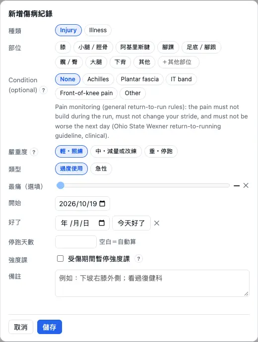

Pain, illness and coming back from a break all change the schedule — as long as you **mark pain on the runs you do** and keep the "Injury log". This chapter goes through each step and what the schedule actually does. It is not a medical diagnosis: see a doctor or physiotherapist for pain that persists or gets worse. (The injury log page itself is still in Chinese on the English screens; the labels below are translated.)

## Marking pain on an activity {#pain}

After each run, answer "Any pain this time?" on the activity: **No pain**, **Sore**, **Pain**, **Stopped**. "Sore" is the normal soreness after training, not an injury; "Pain" affects your form or pace, or is still there afterwards; "Stopped" means it hurt enough to stop. "Pain" or "Stopped" opens an entry in the injury log for you; add the details later.

1. Activities → "Edit" → "Pain", or open the activity in Charts and press "Pain?" at the top.
2. Pick a level; from "Sore" up you can add the body part, from "Pain" up left / right.
3. Optionally the worst pain while running (0 = none, 10 = the worst imaginable); with a score the light is judged more precisely.

:::tip
Blank is not the same as "No pain": only "No pain" counts as surely fine. Pressing the lit button again clears the mark.
:::

:::deep
### When an entry is opened
- "Sore" opens nothing.
- "Pain" or "Stopped": the activity joins an open entry for the same body part (or one without a body part) that started within 28 days; failing that, a new **draft** opens — overuse, severity mild ("Stopped": moderate), starting on the day of the activity. The 28 days are an estimate.
- A new entry for the same body part within 42 days of the last one healing is marked "recurrence" (an estimate).
- Changing the mark back to sore, no pain or blank deletes the draft that only this activity opened. Deleting an injury entry leaves the pain marks on the activities.

### Which marks count for the light
Only marks on **runs** change the light; marks on walks and hikes are used only for the "walk 30 minutes without pain" check after a red light (see walk-run below).
:::

## The injury log {#log}

More → "Injury log" holds every injury and illness: a timeline on top, cards below. A draft opened for you has a **yellow frame**; fill in the details and save to make it "ongoing"; press "healed" when it is. Nothing on this page goes to your watch or another platform, and it never appears in a share link.

1. Press "＋ add", or "fill in" on a yellow draft.
2. Pick the category (injury / illness), body part, side, severity and start date; if a doctor or physiotherapist named the injury, pick the "condition".
3. To have no intervals until it heals, tick "pause intensity sessions while injured".
4. Healed: press "healed" (or set the healed date); the schedule realigns.

:::warn
A draft counts as ongoing too: the light and the condition rules already apply. For a trip or days you can't train, you don't need an injury entry: use the schedule's "⋯ → Set no-training days" (see [Replanning and automatic changes](schedule.md#replan)).
:::

:::deep
### What severity actually does
Severity mostly doesn't change the schedule by itself; what does is the pain light, the condition, "pause intensity" and the illness rules:
- Mild (train as usual): the schedule is unchanged, the week's notes get a line.
- Moderate (less or different training): still no automatic cut; baseline tests are no longer suggested and the race readiness "injury" check turns red.
- Severe (no running): the light is red from the start date (next section), and the suggestions box offers to make the next 7 days no-training days.

The grading follows the OSTRC questionnaire's "effect on training" (Clarsen 2013); the three-level mapping is an estimate.

### Condition: sessions to avoid
Applies while the entry is open, whatever the severity:
- Front-of-knee pain, IT band: no downhill, technical terrain or long hill repeats; trail long runs move to flat ground (Esculier 2016; Fredericson 2005).
- Achilles: no hill repeats, steep hiking, weighted climbing or strides; long runs keep their terrain (coaches' advice, no measuring study found — an estimate).
- Plantar fascia, other: nothing avoided.

An avoided session becomes "an easy run on the flat, same time", so the week's volume stays. The condition must fit the body part (front-of-knee pain is the knee); the app does not diagnose.

### Other fields
- Days off running: blank = automatic — the days before the first run of 20 minutes or more without pain (or only sore) after the start, less your usual share of rest days (an estimate).
- Type: overuse / acute. Acute injuries stay out of the "before the injury vs usual" analysis.
- "Before the injury vs usual" compares the 21 days before each injury with your usual 21 days and shows what was above usual (at or above the 75th percentile, an estimate). Medians appear from 5 injuries; it is a personal look back, not a prediction (Lövdal 2021: the best single measure reached an AUC of only 0.57).
:::

## The pain light {#lights}

Each open injury has a light: **green** as usual, **yellow** no more load for now, **red** no running for now. The light follows **the last run with a pain mark**; with several open injuries the worst one counts. The light is never folded away by the hint level.

1. Mark pain honestly after each run and the light follows; a run without a mark doesn't change it.
2. Yellow: the rest of the week is shortened automatically, no intervals.
3. Red: no running this week, strength and cross-training as planned; then walk-run (next section).

:::deep
### How one run is judged
- **Red**: marked "Stopped"; or a score of 7/10 or more; or two yellows in a row; or severity "severe".
- **Yellow**: marked "Pain" (without a score); or a score above the condition's limit — Achilles 5/10 (Silbernagel 2007), front-of-knee pain 2/10 (Esculier 2016); or 2 points or more above the previous run; for a condition without a limit, any rise on the previous run.
- **Green**: anything else, e.g. no pain or sore.
The 7 and 2 points are estimates.

### What each light does (this week, sessions from today not yet done)
- Green: as usual; sessions the condition avoids are still avoided.
- Yellow: intervals and tests become easy runs on the flat (load × 0.8); long runs × 0.75 (an estimate); the week's remaining running minutes are capped at "last week's actual − already run this week", every session shrinks in proportion and one under 15 minutes is dropped. This week only, applied straight away.
- Red: all the week's remaining runs (hikes too) are removed; strength stays, "skip the moves that hurt"; the weeks ahead are planned without running until a run's mark changes the light.

Basis: Achilles follows Silbernagel's pain-monitoring model (≤ 5/10 while running, back to the usual level the next morning; the study covered the Achilles only); front-of-knee pain Esculier 2016's 2/10; other injuries the general return-to-run rules "no pain that builds during the run, no change of form, no worse the next day" (Ohio State Wexner return-to-run guide, a clinical institution). Shin / calf pain can be a bone stress injury: see a doctor first.
:::

## After a red light: walk-run {#walk-run}

After a red light the schedule starts with **walk-run**, adding running back stage by stage: walk 4 / run 1 → walk 3 / run 2 → walk 2 / run 3 → walk 1 / run 4 minutes, 6 rounds a session, 3 sessions a stage; then 3 continuous easy runs of 30 minutes, followed by the comeback block.

1. First be able to walk 30 minutes without pain: a walk or hike of 30 minutes or more marked "No pain" or "Sore", or press "Ready to walk-run" on the injury card.
2. Do the walk-run sessions on the schedule and mark pain afterwards.
3. To go straight back: during the red light, one run marked "No pain" skips walk-run and returns to green.

:::deep
### Moving on and stepping back
- A run marked no pain, sore, or not marked: one session done.
- Marked "Pain": it doesn't count; repeat the stage.
- Marked "Stopped" or a score of 7 or more: back to red; walk 30 minutes again (or press "Ready to walk-run" again).
Walk-run sessions go on free days, with at least a day off between runs, never on no-training days; the fastest way through is about 4 weeks. The card says e.g. "walk-run stage 2: 1/3 done".

### Basis
Walk-run, walking 30 minutes without pain first, finishing with continuous 30-minute runs: the Ohio State Wexner return-to-run guide (a clinical institution). The guide says 2–3 sessions a stage and 3–6 rounds; 3 sessions and 6 rounds here are an estimate.

### Healed?
When the last 7 days' running reaches 75 % of the 4 weeks before the injury and the last 3 runs were all marked no pain or sore, spread over 14 days or more, the suggestions box asks whether it has healed: "Healed" records today, "Not yet" waits 7 days before asking again. An entry is never closed on its own. The 75 % comes from Wexner (normal training from 75–80 % of the pre-injury volume); 3 runs and 14 days are estimates.
:::

## Illness {#illness}

Illness goes in the injury log too: category "illness", then **mild cold** (runny or blocked nose, sore throat, no fever) or **fever or whole-body symptoms** (fever, chest cough, aching all over, stomach bug). The start is the first day with symptoms; "symptoms gone" is the first day without any.

1. Injury log → "＋ add" → category illness → pick the type, set the start.
2. When it's over, press "no symptoms today".
3. The schedule follows the rules below on the days with symptoms; nothing to change by hand.

:::deep
### What the schedule does
- Mild cold: on days with symptoms every run becomes a "Recovery run (HR zone 1)", at most 45 minutes, flat, no strides (an estimate).
- Fever or whole-body symptoms: no running and no strength on the days with symptoms and on the day they are gone; then the first session is a "Recovery run (first after a fever)", at most 30 minutes (an estimate), and after that as usual.
- No intervals while ill (including the day of the first run after a fever).
- A break of 6 days or more gets the comeback block for its length (next section); illness never moves it up a level.

### Basis
Cold: Kaulback 2023 (a mild respiratory infection has little effect on cardiorespiratory endurance); Wallenfels (symptoms above the neck allow a heart-rate zone 1 recovery run; coach level). Fever: wait at least a day after the symptoms are gone (Wallenfels), 24–48 hours without symptoms (Watson); coach level. "Above / below the neck" is only a rule of thumb to help you pick the type (Ruuskanen 2024: not scientific, may be partly useful).
:::

## Coming back after a break {#comeback}

After some time without running (injury, illness or travel alike), the schedule doesn't jump back to your usual volume: it builds back in stages by **how many days you stopped**. 1–5 days: straight back to the usual volume; from 6 days there is a comeback block as long as the break.

1. Nothing to set: the app sees the break in your activities (hikes and rides don't count as running).
2. Run the block as scheduled and mark pain afterwards.
3. Pain again during the block: the suggestions box says to hold this week's volume, not add to it.

:::deep
### The levels (Daniels' table 9.2, coming back after time off)
- 6–13 days: first half 50 %, second half 75 %; no Zone 3 or Zone 5 inside it, then one Zone 3 session before Zone 5; long runs at most 90 minutes (an estimate).
- 14–28 days: 50 % → 75 % as well, with Zone 3 and Zone 5 targets scaled down (VDOT O2's time-off factor: 0.973–0.931 without cross-training; less when you hiked, rode or walked 45 minutes or more on at least half the days off — an estimate).
- 29–56 days: three stages 33 % → 50 % → 75 %; Zone 5 waits until the aerobic base is confirmed again (Mujika & Padilla 2000: more than 4 weeks off loses the recent gains).
- More than 56 days: a 15-week restart in 3-week steps 33 → 50 → 70 → 85 → 100 %; CP and AeT are retested.
"The usual volume" = the average week of the 4 weeks before the break (an estimate).

### An injury break goes up a level
When the break overlaps an injury entry, the block of the next level is used (10 days off is planned like 14–28), because tissue needs longer to heal (an estimate; the injury log's advanced settings can switch it off, it is on by default). The block doesn't start while the light is red or walk-run is under way: it starts the day after walk-run is done.

In the season's phases, "recovery" means the recovery after a race (see [Phases](glossary.md#phases)) — not this comeback block.
:::
