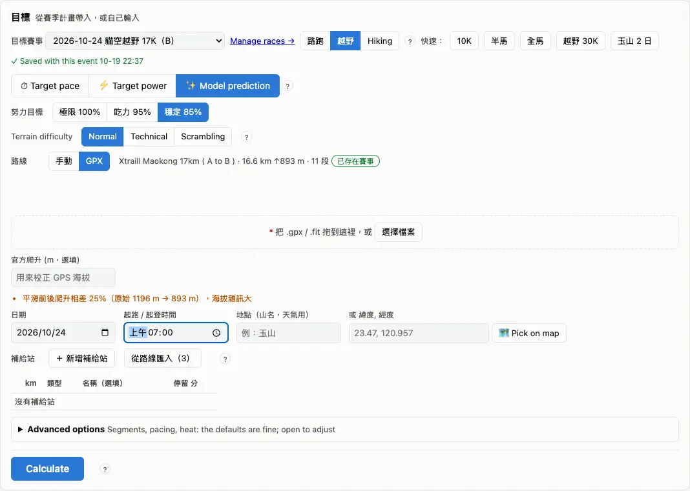
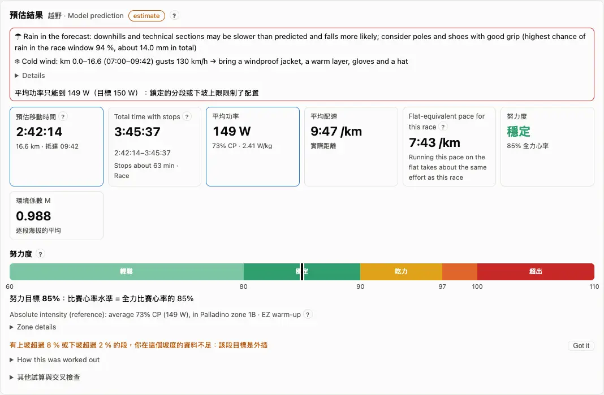
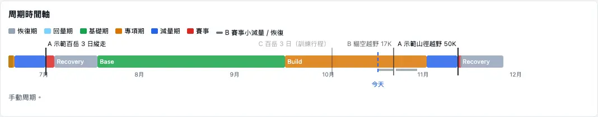

The **Race calculator** answers "how long will this take, how do I run each part, how much do I eat and drink"; the **Season plan** decides the phases and whether there is time to get ready; the **Race manager** holds each race's details, GPX and result. All three are in the menu (the Race manager under More). Many of the calculator's and season plan's labels are still in Chinese on the English screens; the labels below are translated.

## The calculator: working out a race {#calculator}

The quickest way in is to pick a race of your season plan under "target race": distance, climb, date and GPX come with it, and once the fields marked with a red * are filled it calculates on its own, again after every change. For a race that isn't in the plan, choose "manual" and type the distance and climb, or use a preset: 10K, half, marathon, 30K trail.

1. "Target race": pick one, or "manual".
2. "Type": road, trail, hiking (low hills, mid-altitude and high mountains are all hiking).
3. The target: "Model prediction" (the default), "Target pace / time" or "Target power".
4. The course: type distance and climb, or drop in a GPX; only a GPX gives per-segment gradients.
5. Read the "Prediction" below.

:::tip
Adding a race, swapping its GPX and a group's timetable live in the Race manager ("Manage races →" on the calculator). A GPX uploaded on the calculator is used for this calculation only.
:::

:::deep
### Missing fields
"Still missing: …" lists what is needed. Without a body weight, hiking capacity, energy and fuelling and W/kg can't be worked out; road and trail fall back to speed and still work. With "road" as your main discipline, the trail and hiking types and the trail presets are hidden.

### Manual course or GPX
A manual course has no gradients, so one model covers the whole race; a GPX is cut into gradient segments (by gradient, per km or not at all, at most 15), each with its own targets. An "official climb" corrects the GPS elevation. Only with a GPX is the ground looked up (OpenStreetMap ways within 60 m: dirt, laid, unknown); if it can't be, the calculation is unaffected.

### The accuracy tab
"Accuracy" back-tests your past races: each one only with the data from before it, showing how far the prediction was from the result. Re-running it needs a paid plan.
:::

## Target and effort {#goal}

There are three kinds of target: **Model prediction** (how fast you can go, at "max 100 %", "hard 95 %" or "steady 85 %"), **Target pace / time** (how fast you want to go) and **Target power** (average watts or % CP). The **effort** on the result says how hard that target is for you: easy, stable, hard, max, over.

1. "Roughly how long will it take?": model prediction at steady or hard.
2. A time in mind: switch to target pace and see whether the effort lands on "over".
3. With model prediction you can drag the effort bar on the result (60–105 %).

:::deep
### The five effort levels
- Easy < 80 %, stable 80–90 %, hard 90–97 %, max 97–100 %, over > 100 % (the cut points are estimates).
- Road, target pace, target power: average power ÷ "the power you can hold that long" (Riegel's formula and CP); the pale band is the uncertainty of CP ± 3 %; below it, "you could hold this for about N × the target time".
- Trail with model prediction: race heart rate ÷ your all-out race heart rate.
- Only model prediction lets you drag the bar; in the other modes it is a result, greyed out.

### Targets that are too fast
3 % or more faster than the model's 100 %: "may not hold"; 8 % or more: "very likely won't hold"; 10 % or more slower: "very conservative" (estimates).

### The absolute-intensity line
Under the effort: the average power as % CP and Palladino zone (or the heart-rate zone) — a reference; for racing, the effort is what counts. With "enter power at training conditions" the watts are multiplied by the conditions factor M (e.g. 250 W at M 0.96 → 240 W on race day). See [Critical power](glossary.md#cp).
:::

## Course, aid stations and weather {#course}

How good the result is depends on the course and the conditions. A **start time** gives each segment's arrival time (ETA), the after-dark flags and the hour-by-hour heat correction; the minutes at **aid stations** go into the total; the **date** and **place** look up the weather.

1. Set the date and the start time.
2. Add aid stations: km, kind (water, aid, big aid, medical, own drop bag), minutes stopped; when a GPX's waypoints look like aid stations, "import from the route".
3. Trail: "Trail surface" dry / wet appears when you have marked surfaces before; "Terrain difficulty": normal, technical, scrambling.
4. "Conditions" fill in the altitude and temperature of your training and of race day; ✎ to change them.

:::deep
### Default stops
Water 0.5 min, aid 2, big aid 5, medical 0 (carry enough water from the station before), own drop bag 2; non-stop multi-day races also have sleep points (predicted < 36 h: 20 minutes each, 36–60 h: 30, > 60 h: 90). The km must lie within the course and not repeat, or that row is left out.

### Terrain difficulty
Normal × 1.00, technical × 1.15, scrambling × 1.35, applied to the trail heart-rate model's effort distance; once you have marked terrain on activities, your own data is used (shrunk towards the default, which counts like 2 marks).

### Weather and the conditions factor M
Race-day weather comes from the Central Weather Administration's forecast, else Open-Meteo; beyond 16 days, the 10-year average for the month. M = 1 − (difference of the altitude factors) − (difference of the heat penalties ÷ 100), altitude by air pressure, heat by the Hadley heat index; on a GPX each segment's temperature follows its altitude (about 0.65 °C less per 100 m up). Heat and altitude acclimatisation are judged automatically, nothing to set (see [Heat acclimation](faq.md#heat)).

### Advanced options
Segmenting, pacing strategy (even / negative / positive split, 0–5 %), gradient elasticity, per-segment heat correction (on by default, an estimate), slowing at night (0 % by default), the trail effort-distance formula (by default your fitted km + climb ÷ 153). The defaults are fine; unfold to change them.
:::

## The result and segment targets {#segments}

The top of the "Prediction" is the **predicted moving time** and the **total time with stops** (a median, with the 25–75 % range beside it), then average power, average pace, the trail "flat-equivalent pace", the effort and the conditions factor. Further down, "Segment targets" draws what to watch in each segment over the elevation profile.

1. "Segment targets": switch pace / power / heart rate; yellow = walking segments, dark = after dark, pins = aid stations.
2. The table below has a row per segment: gradient, pace, power, heart rate, elapsed time and ETA, fuelling.
3. With a race chosen, "📅 Export to plan" turns race day into a session you can push to the watch (exporting again replaces it).

:::deep
### What to watch in each segment
- Runnable climbs (3–8 %): power, a ±3 % band.
- Steep climbs (over 8 %, or walked): a heart-rate ceiling and metres climbed per hour (VAM); power only as a reference.
- Descents (−3 % or steeper): neither power nor heart rate.
- Flat: power; heart rate when there is no CP.
The heart-rate ceiling: the trail heart-rate model's race heart rate when there is one; otherwise LTHR up to 3 hours, AeT beyond.

### Flat-equivalent pace
The grade-adjusted pace of the segments, weighted by time; descents count at most 10 % faster (see [Grade-adjusted pace](glossary.md#gap)).

:::chart grade
Drag the gradient and the pace and see grade-adjusted pace and climbing speed.
:::

### Total time with stops
Stops as a share of moving time grow with the duration and stop growing after 2.5 hours; races, long solo outings and hikes each have their own (starting from 30 %, 40 % and 60 %, then corrected with your data). Minutes you typed at aid stations are used as they are; stations without minutes count your median past stop each.

### All columns
"All columns" lets you type a power target to lock a segment while the others are re-balanced, and shows each segment's M, temperature and heat penalty.
:::

## Fuelling {#fuel}

"🍽 Fuelling" is a suggestion you prepare yourself: **carbohydrate, water and sodium** per hour for the length of this race, total energy, carbohydrate loading and the expected dehydration, plus a fuelling timetable — on walking or climbing stretches where possible, never on steep descents, and at an aid station when one is near.

1. See the class (short, half-marathon, long, ultra, hiking) and the amounts per hour.
2. Water to carry between aid stations: water per hour × time × 1.2.
3. A predicted dehydration above 2 % of body weight gets a warning: carry more or stop at more stations.

:::deep
### The amounts
| Class | Carbohydrate g/h | Water ml/h | Sodium mg/h |
|---|---|---|---|
| Short (< 1.25 h) | 0–30 | drink to thirst | nothing extra |
| Half-marathon | 30–60 | drink to thirst (planned drinking at 25 °C or more) | nothing extra |
| Long (trail 2–6 h, road > 25 km) | 60–90, glucose + fructose | 400–800 | 300–600 |
| Ultra (trail > 6 h) | 30–90 | 450–750 | 300–600 |
| Hiking | 30–50 | 0.7–0.8 ml per kcal | 200–300 |

At most 90 g of carbohydrate an hour; water moves within the range with the temperature from 10 to 30 °C.

### Energy
By power: power × time ÷ (22.1 % × 4.184), with Minetti's energy cost on steep, walked and downhill parts; hiking by Pandolf's formula. About ±10–15 %. Carbohydrate loading: for races over 90 minutes, 10–12 g per kg the day before; otherwise an ordinary high-carbohydrate 6 g/kg.
:::

## Hiking {#hike}

With the type "Hiking" the calculator uses your **walking capacity**: effort distance per hour (EP/h) from your past hikes, the pack and the altitude. "**Guided group**" or "**On my own**" must be chosen — rests and pace differ a lot between them.

1. "Trip": guided group or on my own; days, a day-by-day plan (manual course) or a GPX.
2. A blank pack uses the default pack (4 kg single-day, 9 kg multi-day, or the median of the ones you recorded).
3. Read the "capacity time" and the "group time", and the day-by-day table.

:::deep
### Two times
- Capacity time: your walking capacity at AeT, with a p10–p90 range.
- Group time: from your speed on past guided days (needs 3 or more), with a p25–p75 range. With "guided group" chosen, the group time is the main number.
"Following the group" marks each segment as waiting for others (< 80 %), easy, just right, hard, or can't keep up (above your ceiling or 10 % slower than the group).

### Stops by the route's highest point
Low hills < 1500 m, mid-altitude 1500–2999 m, high mountains (Baiyue) ≥ 3000 m; stops come from your past hikes of the same class. With fewer than 3 trips or 5 days in a class it falls back to "above / below 3000 m", then to all hikes; the result says which class and how many trips. The total = each day's moving time + stops, nights not included.

### Pack and snow
The default pack: the manual value in Settings > the median of your recorded packs of that kind once there are 3 trips > 4 kg single-day, 9 kg multi-day (see [Estimated parameters](settings.md#advanced)). On multi-day trips the pack is 0.7 kg lighter each day from day 2 (food eaten, an estimate). Snow: with a track × 1.5, without × 2–3, on climbs only.
:::

## Season plan: A / B / C and the phases {#season}

The "Season plan" page shows your races and phases for the season: base, build, taper, race and recovery on a timeline, and where today is. A race's **priority** decides the phases: **A** is the main goal and the phases are planned back from it; **B** gets a small taper and leaves the phases alone; **C** is a training session.

1. To add or change a race, follow "in the Race manager →".
2. Back here, read the timeline; the colour strip on the left of each schedule week is the same phase.
3. To set the phases yourself, switch the phase table to manual; "back to automatic planning" undoes it.

:::deep
### The order of the phases
Base → build (8 weeks) → taper → race → recovery → transition → (rebuild) → base. With no A race in the next 24 weeks, base becomes "maintenance"; two A races less than 12 weeks apart get a warning. The words: [Phases](glossary.md#phases).

### Taper and recovery
- The taper is 10 days by default; 7 for a 2–3-day hiking trip.
- Recovery after a race follows its size (by the predicted time, the calculator's first, then yours): short and medium 7 days; marathon-size 7 days + 1 rebuild week; ultra 14 days; 100-mile 14 days + 2 rebuild weeks. A race with far more descent than your last 6 weeks gets one level more.

### B and C
- B (with an A race): no intervals in the last 5 days, no tempo or long runs in the last 4, recovery by size afterwards; the phases stay. Without an A race, a B race gets 4 weeks of light preparation and a 7-day taper (an estimate).
- C: replaces one intensity session or long run that week; the phases stay.
:::

## Race check {#feasibility}

The season plan's "Race check" has a card for each A and B race answering two things: **Time to get ready?** (on track, a bit tight, too hard, too late) and **Ready now?** (ready, almost, not yet). It is advice only; the plan doesn't change.

1. Read the card's verdict; "Details" lists each check and its basis.
2. "A bit tight" usually means weekly volume or climb is short; "too hard" usually a jump of too many levels or a predicted time over the cut-off.
3. Less than 21 days to go says "too late": by then the taper and race strategy are what matter.

:::deep
### Time to get ready?
- Weekly volume: the last 4 weeks projected to 3 weeks before the race (+10 % a week, an easier week every 4th) against the effort distance of the race's hardest day; long races (multi-day or 6 hours and more) need 90 %, shorter ones 100 %.
- Climb: projected the same way; under 50 % is a bit tight.
- Level jump: the ITRA level of your biggest day in 24 months; jumping 2 levels or more is too hard.
- Ultra hours (Koop): from 50 km, 6 hours a week for 3 weeks; from 100 km, 9 hours for 6 weeks.
- Cut-off: predicted finish ÷ cut-off ≤ 90 % fine, ≤ 100 % a bit tight, above it too hard.
- Hiking also checks the turn-around time and climbing speed.

### Ready now?
The longest session at 80 % of the race is ready, 70 % almost; races that need back-to-back long days need 2 or more in the last 10 weeks. The race-readiness board is on the build and taper pages of Charts (see [Charts](analysis.md#charts)).
:::

## Race manager {#races}

More → "Race manager" lists every race: the races of your season plan, plus activities you marked as races that aren't in the plan. Add or edit races, upload GPX files, look at a finished race's result and its day, or tick two to compare.

1. "+ Add a race": name, date, type, priority, days, distance, climb, predicted time, cut-off (turn-around time for hiking) and the GPX.
2. Open a finished race: the day's numbers, predicted vs actual, elevation and traces, per-km splits.
3. Tick two finished races and compare them.

:::deep
### More fields in the editor
- Format: trail races of 2 days or more ask "stages / non-stop".
- Advanced: trail share % (50 % or more puts a technical-terrain session in each build week), pack kg for the trip, using poles.
- A group timetable: tick that the club or group made the timetable, and the calculator takes each day's start time from it.
- Import from or push to Cairn.

### Predicted vs actual
A positive difference = slower than predicted. A finished A race shows its race readiness as of the day before. When comparing two, negative time or pace = B was faster; on the same route there is a link to the full comparison (see [Activities](analysis.md#activities)).
:::
