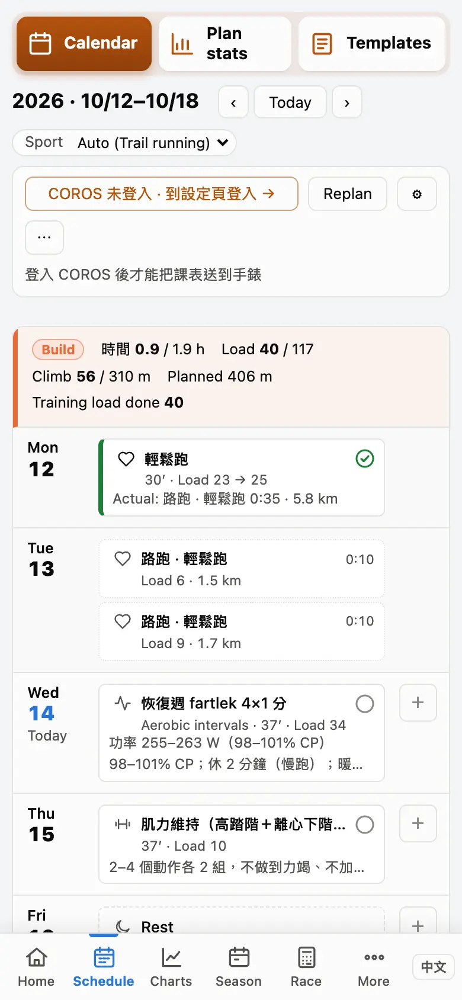
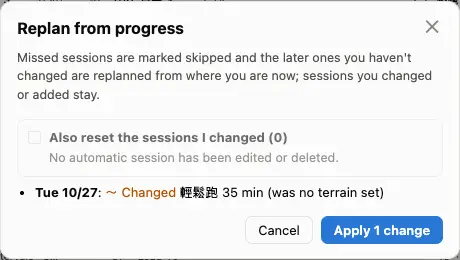
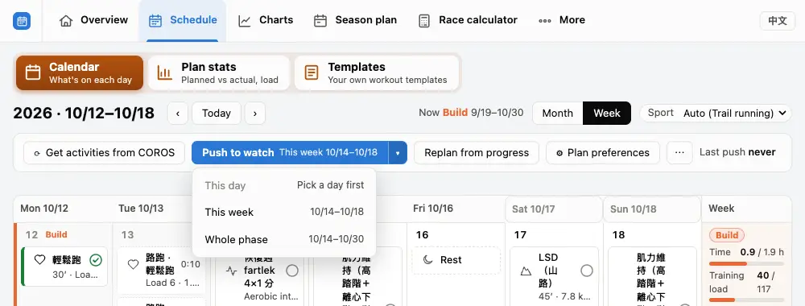

The schedule is planned for you from your races, the season's phases and your recent training; change it whenever you like — the sessions you change are remembered as yours.

## The schedule page {#overview}

"Schedule" in the top bar: on a computer switch between "Month" and "Week"; on a phone it is a list, one week after the other. The bar left of each week is its phase (Base, Build, Taper, Recovery); the "Week" column on the right says how much is done and how much is left.

.")

1. ‹ › change the week (or month); "Today" goes back to this week.
2. Click a session card to see it; click an empty part of a day to add a session (today and later only).
3. The buttons on top: get activities, push to watch, replan from progress, ⚙ plan preferences, ⋯ more.

:::deep
### The week's totals
"Time" is done / planned hours, "Training load" done / planned load; trail runners also get "Climb". Weeks after this one that are not settled yet say "Provisional (adjusted to your progress when re-planned)".

Hover the phase name at the top of the week's totals (tap it on a phone) to see why the week is planned this way: how its volume was worked out, why it is a recovery or taper week, which shares are estimates. This week and the planned weeks ahead have it; with hints set to "Lean" the reasons sit under "Details" in the reminders above the calendar.

### Phase marks
The first day of a phase (or a Monday) carries its name; "Now" at the top says which phase you are in and until when. On an A race's day the race mark replaces the race phase's name. The phases themselves are set on the "Season plan" page.
:::

## Reading a session card {#read-card}

A card answers four questions: **what session** (the icon in the tile on the left), **done or not** (an outline, or a bar on the left), **how it went** (the ring on the right), **how much** (minutes, distance, climb, Training load).

- First line: type icon, title, completion ring.
- Second line: minutes′ · km ↑climb · Load N; once done "Load planned → actual".
- Third line: the target (e.g. an HR zone); once done, what you actually did.
- In the tile's corner, ↻ = changed by the app, ✎ = changed by you.

:::tip
On a computer, rest the pointer on a card for the whole story: how it went, the target, how to run it, why it changed, the watch's status.
:::

:::deep
### How completion is judged
A session is "done" only when an activity is matched to it — automatically by day and type, or by you in the session's window ("match an activity…" / "move the match to…"). There is no "tick as done" button.

- **Done**: time and Training load within ±20 % of the plan, intensity at least 80 % done.
- **Partly**: time or load off by more than 20 %, intensity only 50–80 % done, or the wrong intensity; the ring fills to actual ÷ planned.
- **Different session**: a sport other than running / walking, or the wrong intensity with time or load off as well.
- **Skipped**: no matching activity that day.

Intensity: with a session class, the larger of Zone 3 time (10 min threshold) and the equivalent T@VO2max (4 min threshold); without one, the time above threshold. The 80 % and 50 % are estimates; "partly" with time and load right is an estimate too (intervals.icu and TrainingPeaks also judge completion by load / time).
:::

## Colours and symbols {#colors}

**The icon says what, the colour says how it went**: type icons are never coloured; green is done, yellow partly done or a different session, grey skipped. The only red on the whole schedule is "push to the watch failed". The legend below is drawn by the same code as the schedule page's "? Legend".

:::legend
The schedule page's "? Legend": types, completion, other symbols.
:::

:::deep
### Why these colours
One visual channel per question: the type = the icon, how far off = the colour of the bar and the ring, what happened = the ring's shape, done or not = an outline or a bar. Completion has both a colour and a shape (✓, a pie, a slash, empty), so colour-blind eyes can tell them apart too (WCAG 2.2 SC 1.4.1). Red is kept for a failed push, so the session that needs you is found at a glance.

### Other marks
- A dotted card: an activity with no session (click it for its summary and to match it to a session).
- A small dot: an easy run a bit too hard; ⚠: an easy run that became a hard session.
- "≥ X% walk": a session with a lot of walking.
- 45° hatching: blocked dates; a soft green wash: a rest day.
:::

## Changing a session {#edit}

Click a card to open it, change the type, day, minutes, target or "Structure", and save. Or simply **drag** a card to another day; drop it on another card and the two swap. A changed session gets ✎, and the automatic adjustments leave its content alone.

 — what the watch gets.")

1. Click the card (or right-click / long-press → "Edit").
2. Change it and save (儲存); to drop it, delete (刪除, press twice to confirm).
3. Changed it wrongly: right-click → "Revert to automatic" brings back the planned version.
4. To add a session: click an empty part of today or a later day, or that day's ＋.

:::deep
### Structure and targets
The structure editor inserts templates, adds steps and repeats; each step's target is automatic, power, heart rate, pace, RPE + climb or none, filled as a zone, a % of CP or your own numbers. With a structure, the minutes come from it. The structure is saved only when you changed it, and then it counts as your change. A quality session can be swapped for an equivalent one (progression unaffected) or a different one; a long run can be "Made a long aerobic climb (same time)".

### What happens to your sessions
Automatic adjustments and replanning leave their content alone, with two exceptions: when your CP changes, their power numbers are recalculated from the new CP; and when that week is replanned as a recovery, taper or race week, which has no place for a long run / quality session / test, your session is still removed. A deleted automatic session does not come back by itself until you choose "Revert to automatic".

### Sessions on the watch
Changing, moving or deleting a session that was pushed to the watch updates the watch's copy right away.
:::

## Replanning and automatic adjustment {#replan}

Missed a session, ill, ran more: no need to change them one by one. "Replan from progress" **shows you first which sessions would change**, and applies only when you agree. And whenever a sync brings a new activity, the automatic adjustment makes the small reductions itself; big changes wait for you.

1. Press "Replan from progress".
2. Read the preview: missed sessions become skipped, later sessions you haven't changed are planned again from where you are now.
3. To also put your changed sessions back to automatic, tick "Also reset the sessions I changed" (sessions you added and done ones stay).
4. Apply the changes ("Apply N changes").

:::deep
### What the automatic adjustment does
It runs after a sync that brings at least one new activity: reductions (fatigue protection, a missed session not made up, an easy run cut after one that was too hard) are applied and pushed at once; your changed sessions, your own sessions and blocked dates are never touched. After an easy or long run rated very hard on COROS (RPE ≥ 7) with a quality session or a test within 48 hours, that session moves to the next free day, or one step down when there is none.

### Which changes wait for you
- a week's planned load more than 20 % above the version last pushed;
- removing a long run, quality session or test within 14 days of an A race, or moving a quality session in that time;
- a phase change;
- more than 3 changes that are not reductions within the push range.

The schedule then shows "Plan to confirm"; agree (apply and push) or refuse (keep the sessions as they were). Every automatic adjustment is in the "Automatic adjustment log", with an undo button.

### Blocked dates and rest days
Travelling: ⋯ → "Set no-training days": no sessions those days, and the week's target hours go down with them (at most 62 days). A "Rest day" is different: that day is kept free and the week's volume moves to the other days.
:::

## Where each week's volume comes from {#weekly-load}

How much the schedule adds each week depends on your **Chronic load** and your **Load balance**. Move the two sliders below (this week's and next week's volume): two weeks of too much and the Load balance drops below −30 — the schedule then plans a recovery week by itself.

:::chart pmc
This is the overview's Training load chart, drawn by the same code; the data is a made-up season. Blue line = Chronic load, orange line = Acute load, bars = Load balance (coloured by its share of the Chronic load).
:::

:::deep
### The formulas
With each day's Training load x:

- Chronic load ← chronic + (x − chronic) ÷ 42
- Acute load ← acute + (x − acute) ÷ 7
- Load balance (today) = yesterday's Chronic load − yesterday's Acute load

It starts from your own value (Settings › Physiology › the starting Chronic load, counted from its date), else the mean daily load of the first 28 days with a Training load.

### How the schedule uses it
- Load balance < −30: a recovery week at 60 % of the last 4 weeks' mean (not in a week with a planned B2B).
- Load balance < −20: the volume is held, not raised.
- In Base, a recovery week after every 3 weeks (70 % of their mean); in Build the recovery weeks count back from the race, with one at least every 6 weeks.
- The cap on adding (the Chronic load ramp): Chronic load +5 % a week in Base (at least +2), +7 % in Build (at least +2.5); weekly hours at most 110 % of the reference (or +0.5 h).

### The colour bands
A bar's colour is the Load balance ÷ yesterday's Chronic load: < −30 % High Risk, −30 … −10 % Optimal, −10 … +5 % Grey Zone, +5 … +25 % Fresh, > +25 % Transition (bands common in the industry). Note that the recovery-week rule looks at the Load balance **number** (−30), not at this share.
:::

## Pushing to the watch {#push}

The schedule can be pushed to a **COROS** watch's calendar: "Push to watch" pushes this week; ▾ next to it chooses "this day", "this week" or "the whole phase". A preview says first how many sessions go and which do not.

1. Sign in to COROS in "Settings" → "Data & sync" first (pushing works with COROS only for now).
2. Press "Push to watch" (or choose a range with ▾).
3. Check the preview and push; the sessions appear in the calendar once the watch app syncs.

:::tip
With "push to the watch automatically" on in the plan preferences, the automatic adjustment pushes the next N days (7 by default) by itself.
:::

:::deep
### What is pushed
Each session's structure (warm-up, main set, cool-down), one target per step; running power as absolute watts. Not pushed: strength (COROS strength workouts are built from its own exercise library), rest, races without steps. Missed sessions are removed from the watch.

### Removing from the watch
⋯ → "Remove from COROS": this day, this week or the whole phase; only what was pushed from here is removed, never a session already done on the watch.

### Status
The watch icon on a card appears only for "needs an update" or "push failed"; a failed push is the only red on the schedule. Where the schedule is pushed to is chosen in "Settings" → "Data & sync" → advanced → push the schedule to (課表推送到); Garmin and intervals.icu are not available yet.
:::

## Calendar subscription {#calendar}

To see the schedule in Google Calendar or on an iPhone: "Settings" → "Data & sync" → "Plan calendar", press "Create the subscription URL" and add the address to your calendar app as a subscription. When the schedule changes, the calendar follows.

 address to subscribe.")

1. "Settings" → "Data & sync" → "Plan calendar (Google Calendar / iPhone)".
2. Press "Create the subscription URL".
3. Google Calendar (on a computer): ＋ next to "Other calendars" › "From URL", paste the "Subscription URL". iPhone: tap the "For iPhone / Mac" address on the iPhone.

:::warn
The address is the key: anyone with it can read your schedule. Shared it by mistake? "Reset URL" — the old address stops working at once; "Turn off" when you no longer need it.
:::

:::deep
### What the calendar shows
One all-day event per session, from two weeks back to eight weeks ahead; done sessions marked ✓, skipped ✗. An event holds the time, load, distance / climb, target, structure, notes and a link that opens the session. Not in it: rest days, blocked dates, "Plan to confirm" notices, deleted sessions.

### How often it updates
The subscription is the schedule as it is stored (reading it never replans). The file asks calendars to refresh hourly; in practice Google Calendar takes a few hours up to a day, an iPhone about 5–15 minutes (with "Fetch" every 15 minutes).
:::

## Plan preferences {#prefs}

The schedule has to fit your life: which days you can train, how many hours a week, which day the long run is — all in "⚙ Plan preferences". Saving previews the changes before they apply.

1. Press "⚙ Plan preferences". The settings are in five tabs: Days & time, Sessions, Strength, Races & tests, Auto-adjust; next time it opens on the tab you looked at last.
2. Weekly time, in the Days & time tab: training days, runs per week, weekly hours, the caps for a weekday session and the long-run day.
3. Preferred weekdays, on the same tab: add a row to fix the LSD, intervals, a test or the rest day on certain days.
4. Press "Save and preview", check the changes, then apply. All five tabs are saved together; when a setting is out of range its tab gets a red dot and Save takes you there.

:::deep
### What "automatic" means
- Runs per week "automatic": follows the weekly volume (an easy run is about 50 minutes), at most 6 days and at least 1 day of rest; training days without a run are rest days, placed after the long run and between quality sessions.
- Weekly hours "automatic": raised by the Chronic load ramp rules (see "Where each week's volume comes from").
- Over the cap: "Try to stay under" puts what does not fit on the long-run day; "Never exceed" trains less that week and tells you.

Preferences only change the sessions the app plans; your changed and added sessions stay as they are.
:::
