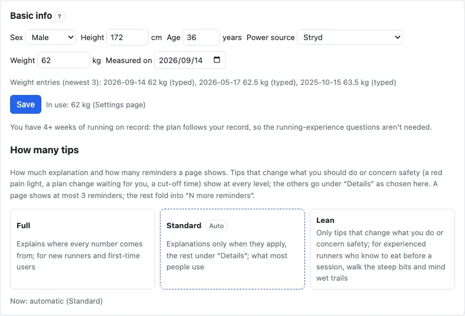
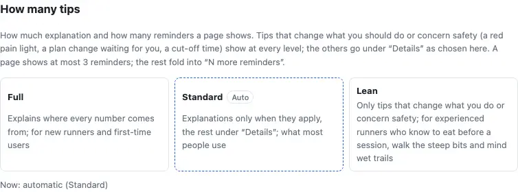
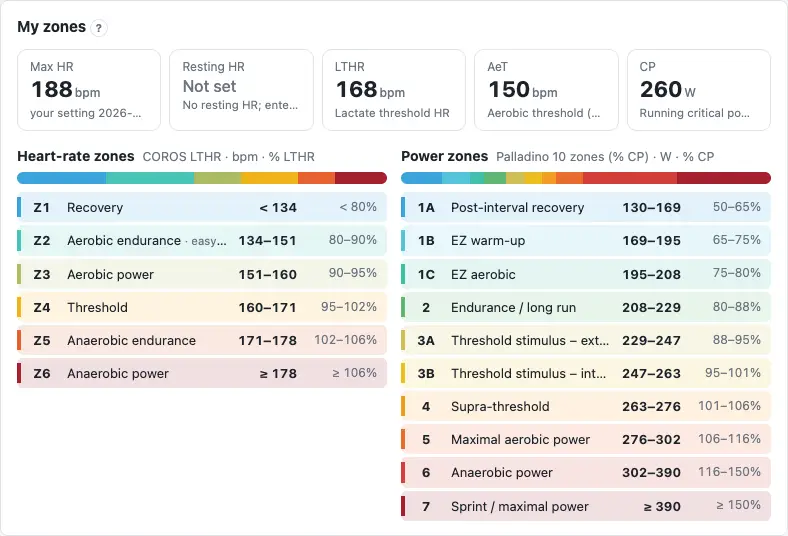
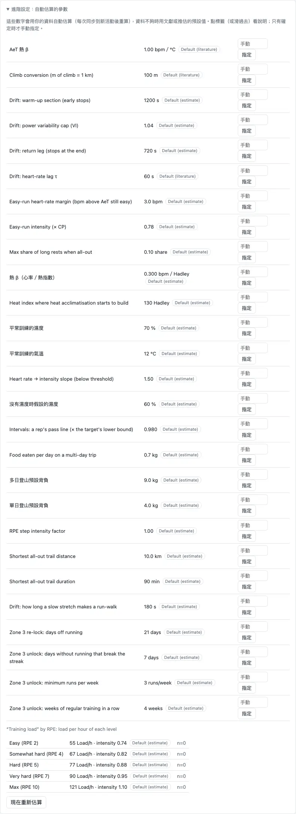

More → "Settings" has five tabs: **Personal**, **Preferences**, **Physiology**, **Data & sync** and **Advanced** (with sign-in there is also "Cairn"). Most fields have an automatic value: when in doubt leave it automatic, and only type a value in when you know better than the app. The demo has no settings page. (Some sections are still in Chinese on the English screens; the labels below are translated.)

## Personal {#personal}

"Personal" is about you: basic info and your main discipline. Only **sex, age and weight** are required; the rest can stay blank or automatic.

1. "Basic info": sex, height, age, power source, weight and the date measured; press "Save".
2. "Main discipline": auto, trail, road, marathon — leaving it on auto is best.

The appearance (colours) and the default map are in the "Preferences" tab.

:::deep
### What each field is for
- Sex: the default anaerobic capacity (women 6.4, men 13.1 kJ) and the energy estimate.
- Height (100–250 cm): the energy estimate.
- Age (10–100): the energy estimate; with no maximum heart rate data at all, the estimated maximum (208 − 0.7 × age). The year of birth is stored, so it goes up by one each year.
- Power source: automatic, Stryd, watch-estimated power, no power meter. Automatic = Stryd when 5 or more Stryd runs in the last 90 days, otherwise watch power if there is any. Only Stryd power goes into the power model.
- Weight (25–250 kg): each day uses the latest entry on or before it; this field changes the newest entry, an entry on the same day is replaced, older ones stay. A weight you type wins over weight sync (see [Keeping your weight up to date](start.md#weight)).

### Your running
Until there are 4 weeks of running on record, four questions appear under basic info (runs a week and minutes, longest session, can you run 30 minutes non-stop, a race result from the last year). With none answered, the schedule starts from 1.5 hours a week, 3 easy runs.

### Main discipline
Automatic = the next A race, else the next B race; with neither, trail when trail and hiking make up 25 % or more of the last 12 weeks' time (C races don't count). It decides which charts show, whether the schedule has steep hiking and back-to-back long days, whether build-phase long runs get marathon pace, and the race calculator's defaults.

### Tests no longer suggested
CP / AeT test suggestions you declined are listed here; "Restore" makes them suggested again.
:::

## How many tips {#hints}

"How many tips", at the bottom of "Personal › Basic info", decides how much explanation and how many reminders a page shows: **Full** (where every number comes from), **Standard** (explanations only when they apply; what most people use), **Lean** (only what changes what you do or concerns safety). Not chosen = automatic; the automatic card has a dashed frame.

1. Press a card to save it: Full, Standard or Lean.
2. To let the app decide again, press "Back to automatic".
3. Too many reminders on a page? "Too many tips?" under its reminders leads here too.

:::tip
Tips that change what you should do or concern safety — a red pain light, a plan change waiting for you, a cut-off time — show at every level.
:::

:::deep
### How automatic chooses
No 4 weeks of running on record and answers that say you are starting out (not answered, can't run 30 minutes, fewer than 3 runs a week, or a longest session under 60 minutes) → Full; everyone else Standard. Automatic never picks Lean. With a running record, a race in the last year and a session of 2 hours or more in the last 12 weeks, it asks once whether to switch to Lean; "No thanks" and it never asks again.

### How each tip is filtered
1. Tips that change what you do or concern safety: shown at every level, outside the count.
2. The others by level: shown, shown when their condition holds, under "Details", or not shown.
3. A tip you marked "got it" goes under "Details"; it comes back when its condition changes.
4. A page shows at most 3 reminders; the rest fold into "N more reminders".

It applies to the Overview, the schedule, the season plan's race check, the race calculator, Activities, Charts and the settings page itself; the injury log doesn't follow it. On the settings page: the tab notes show only at Full; Standard and Lean fold the fixed explanations into `?`. More in [Too many tips](faq.md#too-many-hints).

### The Cairn introduction
After "No thanks" on the "Plan this trip in Cairn" card of a multi-day trip, the last line here, "The Cairn introduction: turned off", brings it back with "Show it again" (see [Cairn](race.md#cairn)).
:::

## Preferences {#prefs}

"Preferences" is how the site shows things — nothing about you, and nothing here changes a calculation:

1. "Appearance": the colours — Trig cream, Trig deep green, Classic (follow system), Classic dark. A choice applies at once; there is nothing to save.
2. "Maps": the base map and overlays an activity's route map starts with; press "Save map settings".

:::deep
### Where the appearance is kept
The colours are kept in this browser: choose again on another computer or phone. Not chosen yet: Trig cream when your phone or computer is light, Classic dark when it is dark.

### The default map and switching for now
At the top right of a map you can switch the base map or overlays for now, and this browser remembers it; after you change the default here, maps go back to the new default. The Rudy map and contour servers sometimes don't respond, so if a map doesn't load, pick another base map.

### Old links
Links that went to the appearance or map block under "Personal" (ending in `#appearance` or `#map`) now open that block in "Preferences".
:::

## Physiology {#body}

"Physiology" holds your heart rate, thresholds and zones: **My zones** (display only), **Heart rate**, **Threshold tests** (with the starting chronic load and a race result) and **Power**. The schedule's targets and the training load of every activity come from here.

1. Start with "My zones": the numbers the app uses now.
2. After a test, add a row to "Threshold tests" (see [Thresholds](start.md#thresholds)); each row applies from the test day on, never backwards.
3. Max and resting heart rate usually stay blank; fill them in under "Heart rate › Advanced" only when the watch's are clearly wrong.

:::deep
### Heart rate
- Max HR: yours > the watch account's > the best 10-second average heart rate in the last 365 days of running > 208 − 0.7 × age (an estimate).
- Resting HR: yours, else the watch's.
- Schedule heart-rate zones: auto (by which numbers are believable), lactate threshold, heart-rate reserve, max heart rate (COROS's 6 zones each). Auto = lactate threshold zones when LTHR is believable, else reserve when max and resting are, else max; you are told once when it changes. It affects only the schedule's heart-rate targets.
- Under "My zones", the app's numbers next to the watch's; it opens only when they differ by 5 bpm or more (see [Numbers that differ from the watch](faq.md#watch-numbers)).

### Thresholds and power zones
- The estimate cards have an "Apply" button; a red frame appears when the confidence is low and there is a strong signal.
- Schedule power zones: Palladino 10 zones (default), Stryd 5 zones, classic 7 levels, personalised zones (needs Stryd runs in the last 90 days).

### Starting chronic load
Fill it in only when you have just a few weeks of data but know your chronic / acute load from another platform: everything restarts from that date. Blank = the average of the first 28 days with a training load (see [How the weekly amount is set](schedule.md#weekly-load)).

### Race result (E pace)
Used only for the E pace of the 90-minute test; not used after 180 days, and trail races don't count. Enter your latest all-out road or track race.

### Power
"Use power" is automatic: on with Stryd; switching it off only hides the power charts and cards, the calculations stay the same. "Advanced › power model also uses watch-estimated power" is off by default — keep it off: a CP fitted on watch power can come out much too high; to train by watch power, add a CP test you did with it yourself (see [No power meter](faq.md#no-power)).
:::

## Data & sync {#data}

"Data & sync" is how activities come in and how long they are kept: the data source and sign-in (see [Connecting a data source](start.md#connect)), when to sync automatically, weight sync, activity retention, offline data on this device and the plan calendar (see [Calendar subscription](schedule.md#calendar)).

1. "Data & sync": daily sync (off by default), sync when you open the site (on by default, after 6 hours), sync in the background when there are new activities (on by default).
2. Press "Save sync settings".
3. "Activity retention": how many years of original files to keep (3 by default).

:::deep
### Sync options
- Daily sync: set a time and tick "on".
- Sync on opening the site: 1–168 hours.
- Background sync: checks for new activities about every 30 minutes (see [Background sync](faq.md#background-sync)).
- The "Advanced" fold: time zone (blank = automatic), region (automatic / Taiwan / outside Taiwan), which platform the schedule is pushed to, the load per RPE level, activities that failed to download, a full check (see [A missing activity](faq.md#missing-activity)).

### Weight sync (Apple Health)
Make an address and token (shown once) and let an iPhone Shortcut or Health Auto Export send your weight each day. Once a day at 3 a.m. the day's last reading is taken; a new entry is added only when it differs by 0.5 kg or more, or 7 days have passed. A weight you type wins.

### Activity retention
2, 3, 5 or 10 years (the free plan keeps 1). On the 1st of each month original FIT files past the limit are removed; summaries and long-term charts stay. "Download all my FIT files" saves them first. Shortening from a longer limit is announced at least 28 days ahead.

### Offline data on this device
How much this device keeps for offline use and whether the storage is persistent; how to add the app to an iPhone's home screen.
:::

## Advanced: estimated parameters {#advanced}

"Advanced › estimated parameters" lists the coefficients the calculations use: each row shows the value in use and where it comes from (**own n=…** from your data, **Manual**, **Default (literature)**, **Default (estimate)**). Leave them alone normally; **set one only when you are sure**, and "back to automatic" undoes it.

1. Open the "Advanced" tab and unfold "estimated parameters".
2. Type a number on the row and press "set".
3. To hand it back, press the row's "back to automatic"; "re-estimate now" re-estimates at once.

:::deep
### Commonly used rows
- Default pack, single-day / multi-day hike: used when the calculator's pack is blank and for past hikes without a recorded pack. Order: the value here > the median of the packs you recorded, once there are 3 trips of that kind (an estimate) > 4 kg single-day, 9 kg multi-day. Best left blank: after 3 recorded trips your own number takes over.
- Food eaten per day on a multi-day trip: 0.7 kg by default (the pack gets that much lighter from day 2).
- Zone 3 unlock: weeks of regular training in a row (4), runs a week at least (3), longest gap that still counts as regular (7 days); Zone 3 re-lock: days off running (21, Coyle 1984). The re-lock days can't be shorter than the longest gap. Changing them replans the schedule.
- Heat index where heat acclimatisation starts to build: 130 (Hadley) by default. Heat acclimatisation itself needs no setting: see [Heat acclimation](faq.md#heat).
- Climb conversion: how many metres of climb count as 1 km (100 m by default).
- Easy-run intensity (× CP, 0.78 by default) and the easy-run heart-rate margin (bpm above AeT that still counts as easy, 3 by default).

### Also
Below the table: "load per hour for each RPE level" (display only, with counts and sources; see [RPE](glossary.md#rpe)). For the source labels see [Estimates](faq.md#estimate). Manual-only rows (such as the drift heart-rate delay or the Zone 3 unlock) are never re-estimated.
:::

## Advanced: data fixes and calculation mode {#fixes}

Two more sections under "Advanced": **data fixes** repair broken data (power spikes, activity files that look like a car or bike ride), and **calculation mode** chooses "my formulas" or "comparison mode". Neither changes the original files.

1. Power spikes: "scan", tick the ones to fix, "apply"; applied fixes can be undone.
2. Excluding broken activity files: activities that look like transport or cycling are excluded automatically by default; for a single one, "this one is fine, don't exclude it".
3. Calculation mode: "my formulas" for everyday use.

:::deep
### What counts as a broken file
Faster than the world-record average speed for the same duration by 15 % over a minute or more, or an average power above 10 W/kg (an estimate). An excluded activity is left out of the training load, the power curve, race calculations and the charts; you can also exclude a single activity in Activities (see [Adding marks](analysis.md#mark)).

### Calculation mode
"Comparison mode" leaves out the data fixes and your test values, for comparing with another platform's numbers; with sign-in only an administrator sees it, and it changes only that administrator's own screens. Power-spike fixes apply only in "my formulas".
:::

## Account {#account}

With sign-in, "Personal › Account" has **Download my data**, the consent to cross-user analysis, linked services and **Delete account**. The single-user app has no account section.

1. Download my data: one zip with settings, season plan, schedule, marks, injury log, GPX files, activities and FIT files, account and consent records (no sign-in credentials).
2. Delete account: confirm with Google again first (valid 10 minutes), then type the confirmation word.
3. The "Cairn" tab: the link status and what Cairn may read or write (each ticked separately).

:::warn
Deleting the account disconnects COROS, Garmin and TrainingPeaks first and can't be undone; download your data first if you want to keep it.
:::

:::deep
### Export and retention
Download my data covers the whole account; for the original activity files only, use "Data & sync › Activity retention › Download all my FIT files" (see [Importing or exporting files](faq.md#import-export)). The site administrator's own account can't be deleted from the web page.

### Cross-user analysis and linked services
Accepting the terms at sign-up includes letting your data, de-identified, be used in cross-user analysis to improve the algorithms; you can withdraw at any time (no cross-user analysis uses the data yet). "Linked services" are other services you sign in to with the same Google account: they can read only what is listed, never your activities, heart rate or other health data, and you can unlink them at any time.
:::
