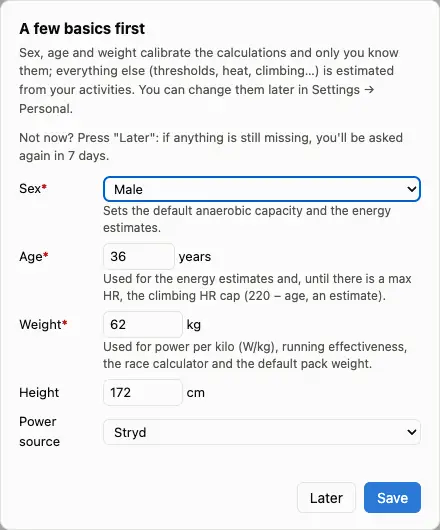
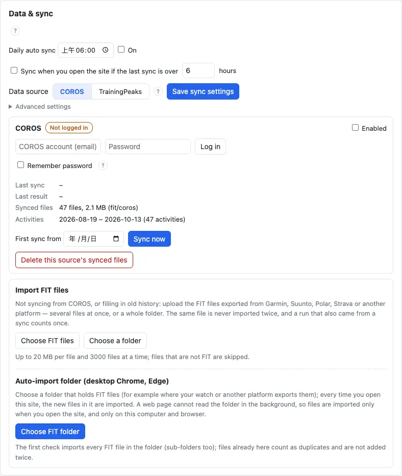
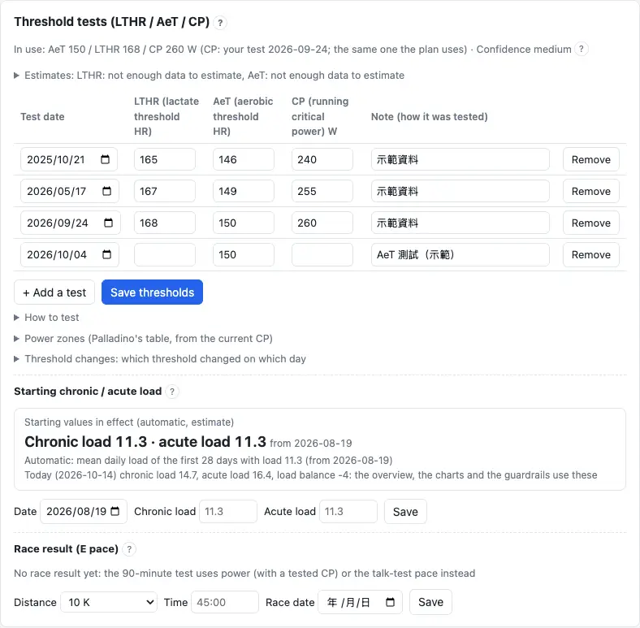

Four things the first time: sign in, enter a few basics, connect your watch's data, check your thresholds. Every step can be changed later.

## First use {#first-run}

Sign in with your Google account; the first time you read the terms, tick to accept, and your account is created. On the overview a window "A few basics first" opens: **sex, age and weight** are required, height and power source can stay empty.

1. Press "Sign in with Google", read the terms, tick to accept, press "Accept and create account".
2. In "A few basics first" enter sex, age and weight, press "Save".
3. Open "More" → "Settings" and connect your watch's data (next part).

:::tip
"Settings" and this "User manual" are in the "More" menu of the top bar; on a phone, in the bar at the bottom of the screen.
:::

:::deep
### Why these three
- **Weight**: power-to-weight (W/kg), running effectiveness, the Race calculator and the pack default (13 % of body weight). Each day uses the newest weight entry on or before it; with no weight, no default is slipped in — the numbers that need it say what is missing.
- **Sex**: the prior of the Anaerobic capacity (women 6.4, men 13.1 kJ) and the energy estimate.
- **Age**: the energy estimate; with no max-HR data at all, also the max HR (208 − 0.7 × age, Tanaka 2001, an estimate; one person can be 10 bpm or more off). It is stored as a birth year, so it goes up by itself every year.

### When it opens
While sex, age or weight is missing and "Later" was not pressed in the last 7 days, the window opens on the overview and on Settings; the other pages show one line at the top ("… is missing: estimates may be off — fill it in Settings →").

### Running experience (optional)
Without 4 complete weeks of running yet (at least 3 days of running or hiking a week), the window adds 4 "running experience" questions. Left empty, the schedule starts at 1.5 hours a week, 3 easy runs, and follows your real volume once you have activities.
:::

## Connecting a data source (COROS / Garmin) {#connect}

The schedule and the analysis are calculated from your watch's activities, so connect one data source first: "Settings" → "Data & sync", choose **COROS** or **Garmin**, sign in with that account and press "Sync now".

1. "Settings" → the "Data & sync" tab.
2. Data source (資料來源): choose COROS or Garmin and save (儲存同步設定).
3. In the box below, enter the watch app's account (email) and password and sign in (登入; for Garmin 連接 Garmin).
4. Press sync now (立即同步). The first sync also fetches your older activities and takes a while (next part).

:::warn
Garmin is a **trial** for now: at most 1 scheduled and 3 manual syncs a day; a long history takes a few days to arrive.
:::

:::deep
### One source at a time
Charts, the overview, the Race calculator, the CP test and every sync use only the chosen source; another source's activities never fill gaps. Switching asks first, and the charts are recalculated from the new source; tags, RPE, pain, pack weight and the schedule matching are tied to the start time and stay.

### How the sign-in is kept
With "remember the password" ticked, the password is stored encrypted on the server: when a COROS sign-in expires (about 24 hours) or is refused, it signs in again once by itself. Without it, sign in again yourself. If Garmin asks for a code, a code field appears (valid 10 minutes). COROS and Garmin are unofficial interfaces: the first connection asks you to accept a notice.

### When it syncs
- When you open the site: if the last sync is older than some hours (6 by default).
- Once a day: at a time you set (off by default).
- The free plan: opening the site does not sync; the daily sync runs at night, between 01:00 and 05:00.

The switches are in "Settings" → "Data & sync".

### No COROS / Garmin account
Use "Import FIT files" on the same tab: choose files or a whole folder. Desktop Chrome and Edge can also keep an automatic import folder, imported whenever you open the site.
:::

## How long the first sync takes {#first-sync}

The first sync fetches everything since 1 January 2020 (or the first-sync date you set). Then the **last 90 days** are calculated first, so the schedule and the charts are soon ready; older activities are filled in in the background, with a progress bar at the top.

1. "Preparing your data…" or "Processing n / N…" at the top: wait for it.
2. Then "Filling in older activities … (the last 90 days are ready)": you can use the app already.
3. "Older activities are in": reload the page to see your whole history.

:::tip
While older activities are filled in, numbers that need the whole history — Chronic load and the like — say "Calculating"; nothing is broken.
:::

:::deep
### Later syncs
Each later sync fetches from 14 days before the last one, so it is quick. Activities that failed to download or import are listed under Advanced › failed downloads, and later syncs retry only those (each at most 5 times or 7 days); a full check compares the platform's activities with these one by one and downloads what is missing.

### Why 90 days first
A whole history can be a thousand FIT files or more; waiting for all of them would make the first visit very long. The schedule and the overview need the recent training most, so 90 days come first and the older files follow one at a time; Chronic load builds up from the whole history, so it shows once that is complete.
:::

## Thresholds (LTHR, AeT, CP) {#thresholds}

Thresholds set the schedule's HR / power targets, the easy-run cap and how Training load is counted. **It works without entering anything**: estimates from your own data come first. After a test, add a row in "Settings" → "Physiology" → "Threshold tests"; it counts from the test day on.

1. "Settings" → "Physiology", find "Threshold tests (LTHR / AeT / CP)".
2. Press "+ Add a test", enter the test day and the values you measured (leave the others empty), press "Save thresholds".
3. Or: read the confidence (high / medium / low) on an automatic estimate card and, when it is good enough, press "Apply".

| Field | What it is | Used for |
|---|---|---|
| LTHR | lactate threshold heart rate | HR load, HR zones, threshold sessions |
| AeT | aerobic threshold heart rate | the easy-run cap (a measured AeT always wins) |
| CP | running critical power (W) | Power load, the intervals' power targets (with Stryd) |

:::deep
### What is used when nothing is entered
- **LTHR**: a test → an estimate from your own data → the watch's value → 90 % of max HR (an estimate; Nuuttila 2025: LT2 at about 90.6 ± 2.5 % of max HR). The day it switches from the estimate to a real value gets a dashed line on the Training load chart, because the HR load's scale changes that day.
- **CP**: without one, the schedule uses the Modelled threshold power from your Stryd power.
- **Easy-run cap** = the top of Z2 of the schedule's HR zones; a measured AeT replaces it.

### Never backwards
Each row counts from its test day; older activities keep the values of their time, so today's change does not rewrite your past Training load. The threshold change history lists every change.

### How to test
"How to test" under the threshold tests explains the AeT, LTHR and CP tests; the schedule also adds tests when needed (an AeT test, for example, only when the estimate is uncertain, after about 6 weeks without a readable run, or after 4 weeks or more without running). Which CP test to schedule is chosen in the schedule's "Plan preferences".
:::

## Max and resting heart rate {#heart-rate}

Max and resting HR are used for the heart-rate-reserve and max-HR zones. Usually you **don't enter them**: the app uses, in this order, your own value, the watch's (COROS account) value, the highest HR of your runs in the last 365 days, and only then an age formula.

1. "Settings" → "Physiology" → "Heart rate" shows the values in use and where they come from.
2. To set them yourself: open its advanced part, enter max / resting HR and save; "back to automatic" returns to the app's values.
3. "Workout HR zones" choose which zones the workouts' HR targets use (default: 6 zones of the lactate threshold HR).

:::deep
### Max HR from your runs
The highest HR held for 5 seconds or more in the last 365 days of running, with the spikes of optical HR filtered out, so one bad reading cannot lift all the zones.

### The schedule's HR zones
They only set the HR targets of the schedule (automatic planning, workout steps, the watch): recovery Z1, easy / long / trail Z2, tempo Z3, threshold Z4, VO2max Z5. Without max or resting HR, lactate-threshold zones are used. The charts choose their own HR zones, unaffected. An entered value counts from today; earlier charts keep the values of their time.
:::

## Weight and basic info {#weight}

Keep your weight **up to date**: after you weigh yourself, change the weight and its date in "Settings" → "Personal" → "Basic info" and save. Each day uses the newest entry on or before it, so old entries stay and past numbers don't change.

.")

1. "Settings" → "Personal" → "Basic info".
2. Change "Weight" and the measurement date, press save (an entry of the same day is replaced).
3. When the COROS account weight differs from your newest entry by 1 kg or more, the overview says "Your watch account's weight differs": press "Update to X kg".

:::deep
### Manual first
A weight you entered by hand wins: the weight sync neither changes it nor replaces it with measurements of that day or earlier.

### Weight from Apple Health
"Settings" → "Data & sync" → "Weight sync (Apple Health)" creates a token that can only send weights, for an iPhone Shortcut or Health Auto Export to send yours every day. The token can read nothing, is shown once when created, and can be revoked at any time.

### Power source
The power source decides which power goes into the power model: only Stryd power does; without Stryd, heart rate is used. The watch's estimated power can be turned on under "Physiology › Power", advanced; its numbers are all estimates.
:::
