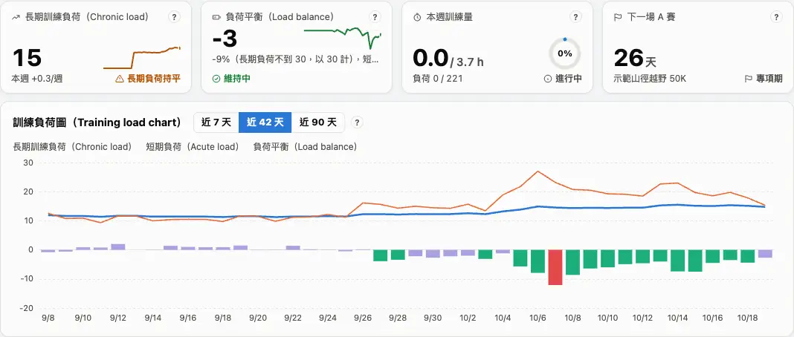
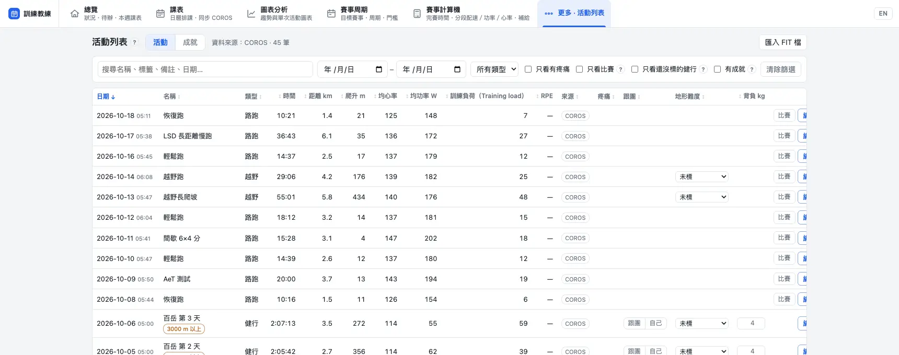
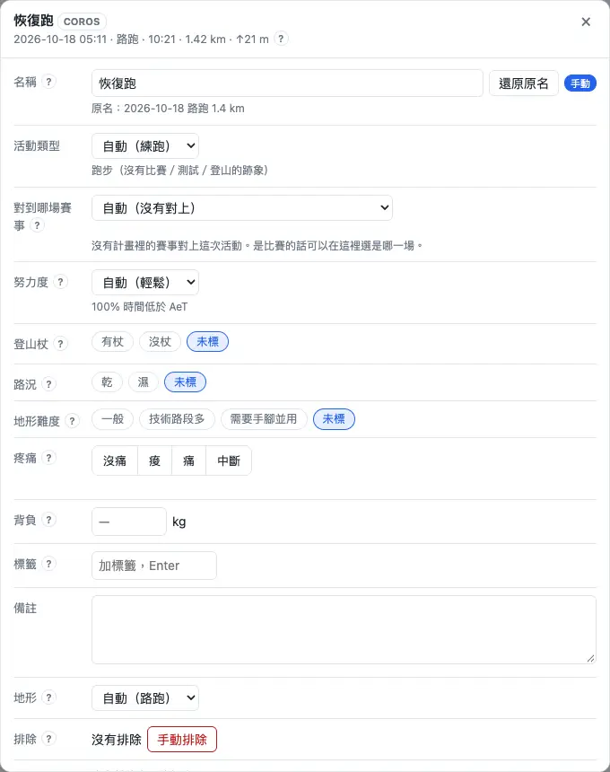
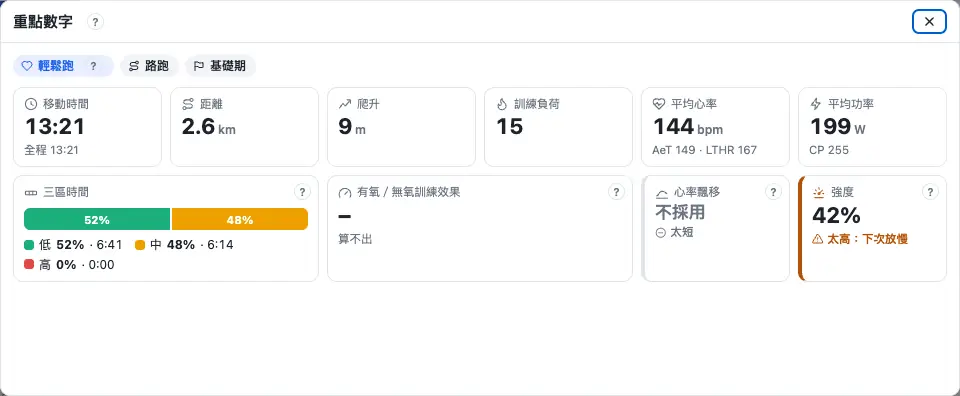

分析在三個地方：**總覽**看「現在狀況好不好、這週練得怎樣」，**活動列表**看每一筆活動並補上標記，**圖表分析**看一段期間的趨勢或一次活動的細節。每張卡片和圖的 `?` 都有那張圖怎麼讀。

## 總覽：狀況四張卡 {#status}

「總覽」最上面四張卡回答四個問題：長期練得夠不夠（長期訓練負荷）、現在累不累（負荷平衡）、這週練了多少（本週訓練量）、離比賽還多久（下一場 A 賽）。每張卡上的字是判讀：良好、注意、要處理、參考、資料不足。

1. 先看判讀：「要處理」和「注意」才需要動作，其他照課表練。
2. 點卡片的 `?`：會寫為什麼這樣判、→ 建議怎麼做、數字從哪裡來。
3. 長期訓練負荷下面的「本週 ±x/週」是這週長期負荷的增減。

:::deep
### 長期訓練負荷怎麼判
看這週的增量（今天的長期訓練負荷 − 7 天前）。注意線＝7 天前的 10 %（至少 3）；上限＝15 %（至少 5、最多 10）。超過上限是「要處理」，超過注意線是「注意」，增加 1 以上是「良好」（可長期維持的增幅）。基礎期、專項期持平或下降算「注意」；減量期、恢復期下降是正常的。剛開始用的前 28 天不判讀。名詞見 [長期訓練負荷](glossary.md#chronic-load)、[長期負荷週增量](glossary.md#ramp)。

### 負荷平衡怎麼判
數字＝昨天的長期訓練負荷 − 昨天的短期負荷，括號是它佔長期負荷的百分比（長期負荷不到 30 時以 30 計）。< −30 %「要處理」（過度訓練風險）、−30～−10 % 良好（有效訓練）、−10～+10 % 良好（維持中）、+10～+35 %「注意」（訓練量不足以進步）、> +35 %「注意」（體能在流失）。A 賽前 3 天內的目標是 +10～+35 %。見 [負荷平衡](glossary.md#load-balance)。

### 本週訓練量
已練時數 ÷ 這週的目標時數（不含肌力），副標是訓練負荷「已做／目標」；負荷用你近 6 週每小時的負荷換算。
:::

## 訓練負荷圖 {#load-chart}

總覽的「訓練負荷圖」把每天的訓練負荷畫成三樣東西：**藍線**是長期訓練負荷（大約最近 6 週的平均）、**橘線**是短期負荷（大約最近 1 週）、**長條**是負荷平衡。可以切近 7、42、90 天。下面這張是同一份程式畫的，拖動滑桿看看連續兩週練多了會怎樣。

:::chart pmc
跟總覽同一份程式畫的；資料是示範用的一個賽季。長條的顏色看負荷平衡佔長期負荷的比例。
:::

:::deep
### 公式與顏色
每天的訓練負荷 x 進來後：長期 ← 長期 + (x − 長期) ÷ 42，短期 ← 短期 + (x − 短期) ÷ 7。長條的顏色：< −30 % 過度疲勞、−30～−10 % 有效訓練、−10～+10 % 持平、+10～+35 % 比賽狀態、> +35 % 休息過久。圖上的虛線是乳酸閾值心率（LTHR）的預設值被你的數字取代的那一天——閾值變了，之後每次活動的負荷也跟著變。

### 起點
長期和短期負荷的起點是設定裡的「起始長期訓練負荷」，沒填就用有訓練負荷的前 28 天平均（見 [每週的量怎麼來](schedule.md#weekly-load)）。顯示「計算中」時見 [常見問題](faq.md#calculating)。
:::

## 做了什麼、指標、本週 {#overview-more}

總覽往下還有三區：**做了什麼**（週／月／年的時間、距離、爬升，跟上一期比）、**指標**（十幾項訓練指標，有問題的排前面）、**本週**（這週的課卡與提醒）。最下面的「待辦」是強度課解鎖條件和該處理的警示。

1. 「做了什麼」：用 ◀ ▶ 換期，點長條切到那一期；滑鼠停在小格上會顯示「平常」（前面各期的平均）。
2. 「指標」：通常只展開「注意」「要處理」，其他收成「其他 N 項正常」；點「詳細」看原因、建議、來源。
3. 「本週」：課卡跟課表頁一樣（見 [課卡怎麼讀](schedule.md#read-card)）；提醒最多直接顯示 3 則。

:::deep
### 強度分配
低＝心率低於有氧閾值（AeT）、中＝AeT～LTHR、高＝LTHR 以上，只算耐力類活動的移動時間。指標「強度分配」看近 4 週的低強度比例：≥ 75 % 良好、65–75 % 注意、< 65 % 要處理（畫面上的目標：底線 75 %、目標 80 %，基礎期 ≥ 90 %）。

### 其他指標
- 每週時數：跑步時間週增 > 20 % 要處理、10–20 % 注意。
- 有氧效率 EF：最近 6 週和之前比，±2 % 以上才算有變化。
- 心率飄移：< 5 % 很穩、5–10 % 有點往上、≥ 10 % 飄很多（見 [心率飄移](glossary.md#drift)）。
- 爬坡速度 VAM：8 週和之前比，±3 %。
- 下坡負荷：近 7 天比近 28 天多 1.5 倍以上要注意。
- 耐久度：長時間後段的飄移 < 5 % 良好、5–15 % 注意、≥ 15 % 要處理。
- 最長單次：專項期要到比賽時間的 70 %；比前 30 天最長那次多 10 % 以上會提醒。

### 展開多少
提示多寡選「完整」全部打開、「標準」只打開注意和要處理、「精簡」只打開要處理；已經在待辦裡的項目會收起來。見 [提示多寡](settings.md#hints)。
:::

## 活動列表 {#activities}

「更多」→「活動列表」是你所有的活動：可以搜尋（名稱、標籤、備註、日期）、篩選（日期、類型、只看比賽、只看有疼痛…）、點欄名排序。健行那幾列可以直接填「跟團」「地形難度」「背負 kg」。

1. 找到那筆活動；手機上按 ＋ 打開跟團、地形、背負。
2. 右邊的按鈕：「比賽」把跑步標成比賽、「編輯」補標記、比較圖示選兩筆比較、圖表圖示「在圖表分析開啟」。
3. 「成就」分頁是爬過的山（百岳、中級山、郊山）和統計。

:::deep
### 欄位
日期、名稱、類型、時間、距離、爬升、均心率、均功率（設定關掉「使用功率」時不顯示）、訓練負荷、RPE、來源、疼痛。來源是虛線框時，表示主要資料來源沒有這筆，是用另一個來源補上的。名稱旁會標「比賽」、成就徽章、「已排除」等。

### 健行列的三格
- 跟團／自己：按一下就存，再按一次取消；淡色加「?」的是系統猜的。
- 地形難度：未標、一般、技術路段多、需要手腳並用；可以沿用路線的設定。
- 背負 kg：0–40；空白時用預設背負（見 [自動估算的參數](settings.md#advanced)）。

### 兩次比較
按一筆的比較圖示當 A，再按另一筆，就打開「兩次活動比較」：總成績（B − A，負數＝B 比較快）、每公里分段、配速／心率／功率走勢、坡度分組配速、兩次都經過的路段；同一條路線時逐點對齊。
:::

## 補上標記 {#mark}

在活動列表按「編輯」可以補上手錶不知道的事：**努力度**、**登山杖**、**路況**、**疼痛**、**背負**、**標籤**、**備註**，或「排除」這筆活動。標記會讓分析和課表更準——例如努力度決定這筆能不能拿來估能力。

- 努力度：全力、有拼但有休息、一般、輕鬆。
- 疼痛：沒痛、痠、痛、中斷；選「痛」或「中斷」會開一筆傷病紀錄（見 [在活動上標疼痛](injury.md#pain)）。
- 排除：這筆不算進訓練負荷圖、功率曲線、比賽功率和圖表（例如忘了關錶坐車）。

:::deep
### 努力度的優先順序
你的標記 > 手錶記錄的 RPE > COROS 跑後自評 > 心率規則。RPE 對照：1–4 輕鬆、5–8 一般、9–10 全力。沒有心率或功率時用 RPE 估訓練負荷，見 [自覺強度](glossary.md#rpe)。

### 其他欄位
- 名稱可以改，按「還原原名」換回手錶的名稱。
- 活動類型：比賽、練跑、爬山、百岳跟團、測試、其他；跑步和健行可以選「對到哪場賽事」。
- 地形：自動、路跑、越野。
- 標籤：每個最多 30 字、最多 20 個，搜尋找得到。
- 重複活動（兩個來源記到同一次）可以拆開或合併。
:::

## 圖表分析 {#charts}

上方選單的「圖表分析」有兩種模式：**趨勢**看一段期間的變化（預設最近 90 天），**單次活動**看某一次的逐秒細節。左邊目錄選頁籤（「我的訓練」「周期化訓練」），右邊「篩選與活動」選日期範圍、活動類型，點一筆活動就切到單次活動。

1. 選頁籤，例如「我的訓練 › 訓練負荷」。
2. 右邊選日期範圍（7 天、42 天、90 天、1 年、今年、全部；也可以往後看到目標賽）。
3. 卡片標題的「⤢ 放大」放大這張圖，網址可以分享；`?` 是這張圖怎麼讀。

:::deep
### 頁籤
- 我的訓練：訓練負荷（訓練負荷圖、每日負荷、長期負荷週增量、負荷平衡、負荷比、有氧／無氧訓練效果）、訓練量、強度、能力。
- 周期化訓練：轉換期、基礎期、專項期、減量期各一頁檢查卡，加上「區間與課表強度」。

### 有些圖為什麼看不到
設定關掉「使用功率」時功率圖不顯示；標了專項的圖只在那個專項出現（上方的「專項」：越野跑、路跑、馬拉松）；有些圖要條件達成才出現，例如「有杖 vs 沒杖」要近一年有杖、沒杖各標滿 5 次。

### 每日負荷與負荷比的顏色
每日負荷跟長期負荷比：灰色低於長期負荷、綠色多 30 以內、黃色多 30–60、紅色多 60 以上。負荷比（7 天：42 天）：< 0.8 灰、0.8–1.3 綠、1.3–1.5 黃、> 1.5 紅（見 [負荷比](glossary.md#load-ratio)）。
:::

## 單次活動判讀 {#review}

打開一筆活動（活動列表的圖表圖示、或圖表分析右邊點一筆），會看到「單次活動判讀」：**本次重點**的「重點數字」回答這次是什麼課、照課表做了多少、有氧穩不穩、後段撐不撐得住；其他頁籤是飄移、間歇、爬坡、配速與耐久、跑姿。

1. 先看課表類型與完成度：符合課表就好。
2. 輕鬆跑、長跑看「飄移」和「強度」：心率有沒有慢慢往上、有沒有跑太快。
3. 間歇看「間歇」頁籤：每一趟有沒有在目標帶裡。

:::deep
### 重點數字
- 完成度：時間和負荷都在計畫 ±20 % 內算符合；強度做到課表的 80 % 以上算做到、50–80 % 強度不足、< 50 % 跑成輕鬆（同 [完成度怎麼判定](schedule.md#read-card)）。
- 三區時間：低＜AeT、中 AeT～LTHR、高 ≥ LTHR。
- 有氧／無氧訓練效果：1–10 分（不是手錶的 0–5），需要功率（見 [有氧／無氧訓練效果](glossary.md#training-effect)）。
- 強度（輕鬆跑、長跑）：心率超過輕鬆跑上限＋3 的時間要在 10 % 以內。
- 耐久：最後 20 % 的時間，同樣心率的功率或速度跟暖身後比：≥ 95 % 撐得住、90–95 % 開始累、< 90 % 要調整補給或配速。

### 飄移
只判讀輕鬆跑、長跑和 AeT 測試。前 10 分鐘不算；每公里爬升 20 m 以上、停頓超過 5 %、功率起伏太大（VI > 1.04）或強度超過 CP 的 90 % 時不採用；暖身後不到 40 分鐘只當參考。< 5 % 穩定、5–10 % 有點飄、> 10 % 飄很多。

:::chart drift
拖動前段心率和上升量，看飄移怎麼算、怎麼判。
:::

### 間歇
每一趟在目標區的時間 ≥ 計畫的 85 % 算達到、60–85 % 部分達到、< 60 % 未達到。「功率、無氧儲備與心率」那張圖看每一趟用掉多少無氧儲備（見 [無氧儲備](glossary.md#anaerobic-reserve)）。
:::

## 能力 {#ability}

「圖表分析 › 我的訓練 › 能力」是**進步的證據**：功率曲線、模型閾值功率與 VO2max 的趨勢、有氧效率、心率飄移、上坡與下坡腳程、爬升密度、耐久度。看的是好幾週的走勢，不是單一次。

1. 跑步功率曲線：黃線是這段期間各時長的最佳平均功率，紅線是模型，橘色區塊是近 14 天創新高的時長。
2. 模型閾值功率與 VO2max 趨勢：每 30 天估一次，看有沒有往上。
3. 越野跑者再看上坡腳程（每小時爬升）和耐久度。

:::chart cp
拖動 CP 和無氧容量，看功率–時間曲線怎麼變：CP 決定長時間撐得住的功率，無氧容量決定短時間衝得多高。
:::

:::deep
### 功率曲線與模型
模型閾值功率是課表用的 CP（右端標數值和日期）；用近 90 天的 Stryd 功率擬合，手錶推估的功率不採用，資料不夠時不畫。VO2max 由模型閾值功率和無氧容量換算（(無氧容量 ÷ 589 + 模型閾值功率) ÷ 84.5 + 0.656 L/min，再除以體重），是推估。見 [臨界功率 CP](glossary.md#cp)、[模型閾值功率](glossary.md#mtp)、[無氧容量](glossary.md#anaerobic-capacity)。

### 其他能力圖
- 有氧效率 EF（輕鬆路跑）：≥ 30 分鐘、平均心率 ≤ AeT＋3 的路跑。
- 輕鬆路跑的心率飄移：綠 < 5 %、橘 5–10 %、紅 > 10 %。
- 上坡腳程：坡度 ≥ 5 %、心率低於 LTHR 時每小時爬升幾公尺（見 [垂直爬升速度](glossary.md#vam)）。
- 耐久度：90 分鐘以上越野跑後段的心率飄移，5 % 灰線、15 % 紅線。
- 閾值本身（LTHR、AeT、CP）在設定填，見 [填閾值](start.md#thresholds)。
:::
