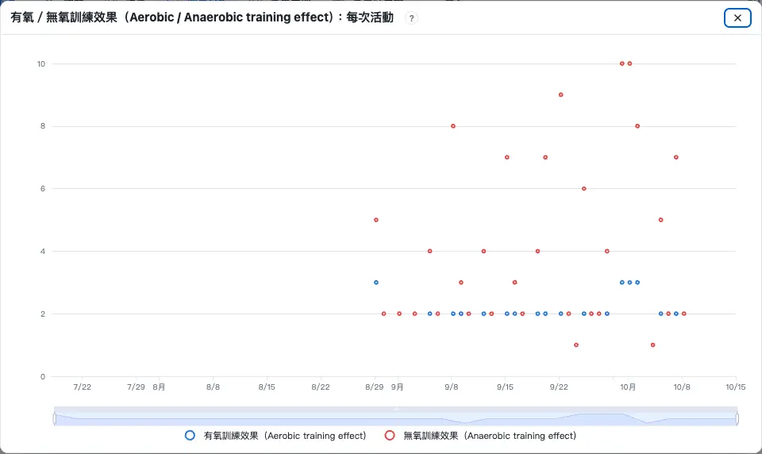
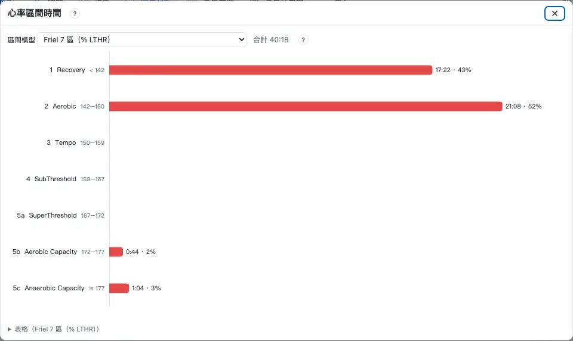
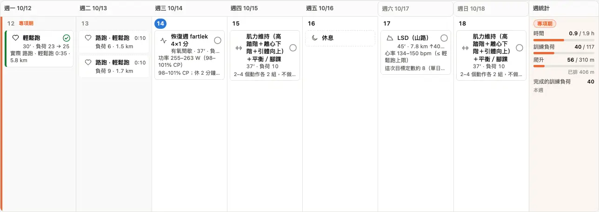

畫面上的 `?` 提到下面這些名詞時，最後一行會有「名詞表：」連到這裡。每個名詞先一句白話和一張圖（大多可以拖動），想看定義、公式和出處，再打開「深入」。

| 類別 | 名詞 |
|---|---|
| 負荷 | [訓練負荷](#training-load)、[長期訓練負荷](#chronic-load)、[短期負荷](#acute-load)、[負荷平衡](#load-balance)、[長期負荷週增量](#ramp)、[負荷比](#load-ratio) |
| 功率 | [加權功率](#weighted-power)、[強度比](#intensity)、[臨界功率 CP](#cp)、[模型閾值功率](#mtp)、[無氧容量](#anaerobic-capacity)、[無氧儲備](#anaerobic-reserve)、[有氧／無氧訓練效果](#training-effect) |
| 心率 | [LTHR](#lthr)、[AeT](#aet)、[儲備心率](#hrr)、[心率區間](#zones)、[區間時間](#time-in-zones)、[心率飄移](#drift)、[RPE](#rpe) |
| 越野 | [GAP](#gap)、[VAM](#vam)、[努力距離 EP](#effort-distance) |
| 周期 | [基礎期、專項期、減量期、恢復期](#phases) |

## 訓練負荷（Training load） {#training-load}

:::terms
訓練負荷
功率負荷
配速負荷
心率負荷
:::

一次訓練「累不累」的分數：**用閾值強度練 1 小時＝100**。練得越久、越接近閾值，分數越高；輕鬆跑 1 小時大約 50–60。下面拖動平均功率和起伏，看同樣的平均功率、起伏越大，訓練負荷越高。

:::chart power
示範：1 小時、每 2 分鐘換一次快慢，CP 250 W。藍線＝30 秒平均功率，灰虛線＝平均功率，橘線＝加權功率。
:::

- 在「總覽」的訓練負荷圖、「課表」課卡的「負荷 計畫 → 實際」、「活動列表」都看得到。
- 跑步有功率時用功率算，沒有就用配速或心率算；都沒有時可以用感覺（[RPE](#rpe)）填。

:::deep
### 定義
每小時的訓練負荷 ＝ [強度比](#intensity)² × 100；一次訓練的負荷 ＝ 秒數 × 強度比² × 100 ÷ 3600。所以在閾值強度（強度比 1.0）1 小時正好是 100。

### 三種算法
- **功率負荷（Power load）**：強度比 ＝ [加權功率](#weighted-power) ÷ 當天生效的 CP（有 CP 測試用測試值，沒有就用[模型閾值功率](#mtp)）。
- **配速負荷（Pace load）**：強度比 ＝ 閾值配速 ÷ 這次的配速（越快越高）。
- **心率負荷（HR load）**：心率時間 × (平均心率 ÷ [LTHR](#lthr))²，LTHR 用當天生效的值。

這裡的負荷只算移動時間，爬升有加成，所以跟其他平台的同類分數大致可以對照，但不會完全一樣。課表的計畫負荷依每一步的目標強度推估。

### 來源
「閾值強度 1 小時＝100、每小時 ＝ 強度比² × 100」是 Coggan 公開的定義（Allen & Coggan，*Training and Racing with a Power Meter*，2010）；用感覺換算是 Foster 等人的課程 RPE 做法（2001）。
:::

## 長期訓練負荷（Chronic load） {#chronic-load}

:::terms
長期訓練負荷
長期負荷
:::

最近大約 6 週每天訓練負荷的平均，可以看成你的「體能底子」：慢慢練它慢慢升，停練它慢慢降。拖動下面兩週的量，看藍線怎麼變。

:::chart pmc
「總覽」上的訓練負荷圖，用同一份程式畫的；資料是示範用的一個賽季。藍線＝長期訓練負荷、橘線＝短期負荷、長條＝負荷平衡。
:::

:::deep
### 公式
每天的訓練負荷 x 進來後：長期訓練負荷 ← 長期 ＋ (x − 長期) ÷ 42。也就是時間常數 42 天的指數加權平均：一天的訓練，42 天後還留大約三分之一的影響。

### 起點
你在「設定 › 生理數據」填了「起始長期訓練負荷」就從那天起算；沒填用有訓練負荷的前 28 天平均每日負荷。補算較舊的活動期間會顯示「計算中」，因為它要從整段歷史累積。

### 來源
把訓練效果看成兩個以不同速度消退的量，源自 Banister 等人的訓練反應模型（Banister et al. 1975，*Australian Journal of Sports Medicine* 7:57–61）；42 天與 7 天的常數是 Coggan 用在功率訓練的常用值。
:::

## 短期負荷（Acute load） {#acute-load}

:::terms
短期負荷
:::

最近大約 1 週的平均負荷，可以看成「最近累積的疲勞」：練得多它很快升，休息兩三天就降下來。圖上的橘線；拖動滑桿，橘線比藍線反應快很多。

:::chart pmc
橘線＝短期負荷（7 天），藍線＝長期訓練負荷（42 天）。同一週練很多，橘線先衝上去。
:::

:::deep
### 公式
短期負荷 ← 短期 ＋ (x − 短期) ÷ 7（時間常數 7 天的指數加權平均）。起點同[長期訓練負荷](#chronic-load)。

### 怎麼看
橘線高過藍線＝最近練得比平常多；這本身不是壞事，課表的加量週都是這樣。要注意的是兩者的差距：見[負荷平衡](#load-balance)。

### 來源
Banister 等人的訓練反應模型（1975）中「疲勞」那一項；常數見[長期訓練負荷](#chronic-load)。
:::

## 負荷平衡（Load balance） {#load-balance}

:::terms
負荷平衡
過度疲勞
比賽狀態
休息過久
:::

**昨天的長期訓練負荷減掉短期負荷**：正的＝有餘裕、比較有精神；負的＝還在累積疲勞。練得很兇它會掉到很負，比賽前減量它會回到正的。

:::chart pmc
長條＝負荷平衡，顏色是它佔長期訓練負荷的比例。拖到連續兩週很多，長條變紅（過度疲勞），課表就會排恢復週。
:::

| 顏色 | 負荷平衡 ÷ 長期訓練負荷 | 名稱 |
|---|---|---|
| 紅 | < −30 % | 過度疲勞 |
| 綠 | −30～−10 % | 有效訓練 |
| 淺紫 | −10～+10 % | 持平 |
| 紫 | +10～+35 % | 比賽狀態 |
| 黃 | > +35 % | 休息過久 |

:::deep
### 公式
負荷平衡（今天）＝ 昨天的長期訓練負荷 − 昨天的短期負荷。用「昨天」是因為今天的訓練還沒做完，早上看到的數字才是你出門時的狀態。

### 課表怎麼用
- 負荷平衡 < 長期訓練負荷的 −30 %：下一週改成恢復週（近 4 週平均的 60 %）。
- 負荷平衡 < 長期訓練負荷的 −20 %：先維持量，不再加。
- 比賽日的目標：A 賽 +10～+35 %、B 賽 −5～+5 %。
- 顏色、課表規則、比賽日目標都看同一個比例；長期訓練負荷不到 30 時以 30 計，免得一點點起伏就被放大。詳見課表章的[每週的量怎麼來](schedule.md#weekly-load)。

### 來源
Banister 模型（1975）的「表現 ＝ 體能 − 疲勞」；五個顏色區間是業界常用的分法（Friel 的經驗法則），只當方向，不是診斷。
:::

## 長期負荷週增量（Chronic load ramp） {#ramp}

:::terms
長期負荷週增量
:::

**長期訓練負荷一週加了多少**。加太快容易受傷生病，所以課表每週加量有上限。拖動下面的滑桿，看「比這週一 +…」那一格就是兩週的增量。

:::chart pmc
右下「比這週一」＝兩週後的長期訓練負荷比這週一多多少；除以 2 就是平均一週的增量。
:::

:::deep
### 課表的上限
- 基礎期：每週長期訓練負荷 +4 %（至少 +2）。
- 專項期：每週 +5 %（至少 +2.5）。
- 週時數最多是參考量的 110 %（或 +0.5 小時）。

「總覽」上的「本週 +x/週」就是這個數。超過上限時課表下一週不加量。

### 來源
每週加多少參考 Palladino：多數跑者每週約 +2～5 % 可以撐幾週到幾個月，課表取上緣；「至少 +2／+2.5」是推估。提醒和擋強度的線參考 Joe Friel 對每週增量的建議（*The Triathlete's Training Bible*），實際的門檻是推估。
:::

## 負荷比（Load ratio） {#load-ratio}

:::terms
負荷比
:::

**短期負荷 ÷ 長期訓練負荷**：1 表示這週練得跟平常一樣多，1.5 表示比平常多一半。下面的圖多一格「負荷比」，拖到很多看它升到多少。

:::chart pmc ratio=1
「負荷比」那一格＝兩週後的短期負荷 ÷ 長期訓練負荷。
:::

| 區間 | 意思 |
|---|---|
| < 0.8 | 偏少（恢復週、減量期正常） |
| 0.8–1.3 | 正常 |
| 1.3–1.5 | 偏多 |
| > 1.5 | 暴增 |

:::deep
### 在哪裡
「圖表分析 › 我的訓練」的負荷比圖，線的顏色就是上面的區間。多日百岳之類的大量活動，它衝高是正常的。

### 只看方向
這個比例常被拿來談受傷風險（Gabbett 2016，*British Journal of Sports Medicine* 50:273–280），但後來的研究指出它在統計上有根本的問題，不支持拿來預測受傷（Impellizzeri et al. 2020，*International Journal of Sports Physiology and Performance*）。所以這裡只拿來看方向，課表不用它決定任何事。

### 來源
區間借自 Runalyze；Gabbett 2016；Impellizzeri et al. 2020。
:::

## 加權功率（Weighted power） {#weighted-power}

:::terms
加權功率
:::

把忽快忽慢的功率換成「等於穩定跑多少瓦」的一個數字。起伏越大，加權功率比平均功率高越多，因為衝的那幾段身體要付比較多的代價。

:::chart power
拖動「起伏」：平均功率不變，起伏越大，橘線（加權功率）離灰虛線（平均功率）越遠。
:::

:::deep
### 公式
1. 先算 30 秒移動平均功率；
2. 每個值取四次方，再平均；
3. 開四次方根。

四次方讓高功率的那幾段影響比較大，接近生理上乳酸、肝醣消耗跟強度的非線性關係。

### 用在哪
[強度比](#intensity)、功率的[訓練負荷](#training-load)、單次活動的 EF（加權功率 ÷ 平均心率）。

### 來源
Coggan 公開的定義（Allen & Coggan，*Training and Racing with a Power Meter*，2010）。
:::

## 強度比（Intensity） {#intensity}

:::terms
強度比
:::

**這次的強度是閾值的幾成**：1.0＝閾值強度，0.75 左右是輕鬆跑。功率的強度比＝加權功率 ÷ CP。

:::chart power
「強度比」那一格＝加權功率 ÷ CP（示範用 250 W）。強度比 0.9 練 1 小時，訓練負荷是 0.9² × 100 ＝ 81。
:::

:::deep
### 公式
- 功率：強度比 ＝ [加權功率](#weighted-power) ÷ 當天生效的 CP。
- 配速：強度比 ＝ 閾值配速 ÷ 這次的配速。
- 用感覺填（[RPE](#rpe)）：每一檔有預設的強度比（輕鬆 0.74、稍累 0.82、累 0.88、很累 0.95、極限 1.10，範圍有出處、取點是推估），之後用你自己有自評的活動校正。

### 來源
Coggan 公開的定義（Allen & Coggan 2010）。
:::

## 臨界功率（CP） {#cp}

:::terms
臨界功率
CP
:::

**可以長時間撐住的最高功率**（大約跑 30–60 分鐘比賽的強度）。高於 CP 每一秒都在花[無氧容量](#anaerobic-capacity)，花完就撐不住。拖動 CP 和無氧容量，看各個時間能撐多少瓦。

:::chart cp
功率–時間曲線：越短的時間能撐越高的功率，越長越接近 CP（橘虛線）。右下是「用 CP 的 110 % 跑能撐多久」。
:::

:::deep
### 模型
P(t) ＝ CP ＋ W′ ÷ t：在功率 P（高於 CP）能撐的時間 t ＝ W′ ÷ (P − CP)。W′ 是高於 CP 可以花的固定一筆功（焦耳），這個 app 叫它[無氧容量](#anaerobic-capacity)。

### 這個 app 的 CP
課表、區間和功率負荷用的 CP：有 CP 測試（「設定 › 生理數據 › 閾值測試紀錄」）就用測試值，從測試那天起生效；沒有就用 Stryd 功率的[模型閾值功率](#mtp)。測試方式在課表偏好選（快速 20 分、標準 12＋3 分、用比賽）。

### 來源
Monod & Scherrer 1965（*Ergonomics* 8:329–338）；跑步與耐力運動的整理見 Jones et al. 2010（*Medicine & Science in Sports & Exercise* 42:1876–1890）。功率區間用 Palladino 的 % CP 分區。
:::

## 模型閾值功率（Modelled threshold power） {#mtp}

:::terms
模型閾值功率
:::

從你**近 90 天各時長的最佳功率**擬合出來的閾值功率。不用特別去測：平常有跑出全力的幾段，模型就會更新。沒有 CP 測試時，課表的 CP 就是它。

:::chart cp
擬合的概念：用曲線貼住各時長的最佳功率，曲線長時間那一端就是模型閾值功率（這張用最簡單的兩參數模型示意）。
:::

:::deep
### 怎麼算
用近 90 天 Stryd 功率的功率曲線（每個時長的最佳平均功率）擬合一條功率–時間（PD）模型曲線：短時間由隨時間遞減的無氧項主導，長時間在閾值附近持平。模型閾值功率、[無氧容量](#anaerobic-capacity)和可持續時間都從這個擬合讀出。每 30 天擬合一次，加上最後一次跑步那天；手錶推估的功率不採用；差 3 W 以上課表才換。

### 為什麼會不準
近 90 天沒有全力跑過的時長，曲線就貼不到真正的上限，模型閾值功率會偏低；做一次 CP 測試或比賽就會修正。

### 來源
這種涵蓋所有時長的功率–時間模型，公開文獻中有同類的模型（例如 Morton 1996 的三參數模型，*Ergonomics* 39:611–619；Peronnet & Thibault 1989，*Journal of Applied Physiology* 67:453–465）。這是推估，不是實驗室量的。
:::

## 無氧容量（Anaerobic capacity） {#anaerobic-capacity}

:::terms
無氧容量
W′
:::

**高於 CP 時可以花的「一筆存款」**（單位 kJ）。衝刺、陡坡、間歇都在花它，花完就只能降到 CP 以下。拖動上面 CP 圖的「無氧容量」，看短時間的功率怎麼跟著變。

:::chart cp
無氧容量越大，曲線左邊（幾分鐘的功率）越高；CP 不變時，長時間的功率幾乎不變。
:::

:::deep
### 定義
就是 CP 模型 P ＝ CP ＋ W′ ÷ t 裡的 W′：高於 CP 可以做的總功。運動科學文獻寫作 W′（W prime）。

### 這個 app 的值
從[模型閾值功率](#mtp)同一個擬合讀出。資料不夠擬合時用先驗值：女性 6.4 kJ、男性 13.1 kJ（所以基本資料要填性別）。

### 來源
Monod & Scherrer 1965；Jones et al. 2010。
:::

## 無氧儲備（Anaerobic reserve） {#anaerobic-reserve}

:::terms
無氧儲備
:::

**無氧容量還剩幾 %**：每一趟高於 CP 的間歇都在扣，休息時慢慢回充。拖動下面的間歇強度和休息時間，看藍線最低掉到哪裡。

:::chart wbal
示範：CP 250 W、無氧容量 15 kJ，熱身 10 分 → 5 趟 3 分鐘 → 緩和。橘色＝功率，藍線＝無氧儲備（右軸 %）。
:::

:::deep
### 這張圖的模型
示意用 Skiba 等人公開的模型：高於 CP 每 1 J 扣 1 J；低於 CP 時，回充速度 ＝ (CP − 功率) × (無氧容量 − 目前) ÷ 無氧容量，所以越空回得越快、休息越輕鬆回得越快（Skiba et al. 2015，*European Journal of Applied Physiology* 115:703–713；早期版本 Skiba et al. 2012，*Medicine & Science in Sports & Exercise* 44:1526–1532）。

### 這個 app 的算法
單次活動「功率、無氧儲備與心率」圖的回充分成快慢兩段（30 % 約 25 秒、70 % 約 300 秒）。跑步上沒有驗證過，是推估。

### 怎麼看
每一趟都掉得差不多、回得來＝目標和休息合適；越到後面掉得越深、回不來＝休息不夠或目標太高。

### 來源
Skiba et al. 2012、2015（見上）；概念出自 CP 模型的 W′（Monod & Scherrer 1965）。
:::

## 有氧／無氧訓練效果（Aerobic / Anaerobic training effect） {#training-effect}

:::terms
有氧／無氧訓練效果
有氧訓練效果
無氧訓練效果
:::

這次訓練對**有氧**和**無氧**兩個能量系統各刺激了多少，1–10 分。長時間、接近閾值的課有氧分數高；超過閾值的間歇、比賽無氧分數才會高。

:::deep
### 怎麼算
以活動當天往前 90 天的[模型閾值功率](#mtp)（算有氧）與[無氧容量](#anaerobic-capacity)（算無氧）為基準，把平滑後的功率逐秒加權累加。無氧分數要功率超過模型閾值功率的 85 % 才會加，輕鬆跑通常是 1。需要功率；沒有功率的活動沒有這個分數。

### 跟手錶的不同
手錶的訓練效果是 0–5，這裡是 1–10，兩個不能直接比。這個分數沒有官方的分級名稱，只看數字、和自己平常的課比。

### 來源
把一次訓練分成有氧、無氧兩種刺激的概念，手錶廠牌的「訓練效果」也有；這裡的分數是推估，沒有公開文獻驗證過。
:::

## 乳酸閾值心率（LTHR） {#lthr}

:::terms
乳酸閾值心率
LTHR
:::

**大約全力跑 1 小時的平均心率**。心率區間、心率負荷和閾值課的目標都從它算。拖動 LTHR，看三種區間怎麼跟著移動。

:::chart zones
課表的三種心率區間（COROS 的分法）：乳酸閾值、儲備心率、最大心率；數字是區間的邊界（bpm）。
:::

:::deep
### 怎麼測
LTHR 測試（Friel）：單獨一人 30 分鐘全力跑，取最後 20 分鐘的平均心率。記在「設定 › 生理數據 › 閾值測試紀錄」，從測試那天起生效。

### 沒測的時候
依序用：你自己資料的估算 → 手錶的值 → 最大心率的 90 %（推估；Nuuttila 2025：第二乳酸閾值約在最大心率的 90.6 ± 2.5 %）。

### 來源
Friel，*The Triathlete's Training Bible*（LTHR 測試與 % LTHR 區間）。
:::

## 有氧閾值（AeT） {#aet}

:::terms
有氧閾值
AeT
:::

**還能只用鼻子呼吸、講完整句子的最高強度**。輕鬆跑和長跑都壓在它以下。測法是固定功率跑 40 分鐘，看後半心率比前半多飄多少；拖動下面的心率上升，看判讀怎麼變。

:::chart drift
AeT 測試：固定 200 W 跑 40 分鐘，比較前 20 分和後 20 分的「功率 ÷ 心率」。
:::

:::deep
### 怎麼測（心率飄移測試）
1. 跑步機 2–3 % 坡度或平路環線，先暖身 10 分鐘。
2. 從你猜的 AeT 心率起跑，固定功率跑 40 分鐘，中途不停、不加速。
3. 比較前 20 分與後 20 分的「功率 ÷ 心率」：飄移 < 3.5 %＝AeT 還可以再高；3.5–5 %＝起跑心率就是 AeT；> 5 %＝設太高。

沒測時用 0.89 × LTHR 估。量過的 AeT 一定當輕鬆跑上限。

### 和 LTHR 的關係
AeT ≈ 第一乳酸閾值（LT1）、第一換氣閾值；LTHR ≈ 第二閾值。有實測 AeT 時，兩者差距（LTHR ÷ AeT − 1）≤ 10 %＝有氧基礎夠了，基礎期可以開始排間歇（課表偏好的「間歇門檻」）。

### 來源
Uphill Athlete（Johnston & House，*Training for the Uphill Athlete*，2019）的心率飄移測試；三區模型見 Seiler & Kjerland 2006（*Scandinavian Journal of Medicine & Science in Sports* 16:49–56）。
:::

## 儲備心率（HRR） {#hrr}

:::terms
儲備心率
HRR
最大心率
靜息心率
:::

**最大心率減靜息心率**，也就是心率能往上加的空間。儲備心率區間用「靜息心率 ＋ 幾成的儲備心率」來分，所以同一個 % 對靜息心率低的人會落在比較低的心率。拖動最大心率和靜息心率試試。

:::chart zones
中間那條＝儲備心率區間；只拖動靜息心率時，上下兩條（乳酸閾值、最大心率）不動，只有它在動。
:::

:::deep
### 公式
儲備心率 ＝ 最大心率 − 靜息心率；某一區的邊界 ＝ 靜息心率 ＋ 比例 × 儲備心率（課表用 59／74／84／88／95 %）。最大心率減靜息心率小於 40 時不算，請檢查設定。

### 最大心率和靜息心率從哪來
最大心率：你填的 → 手錶 → 近 365 天跑步裡 10 秒平均心率的最高值 → 年齡公式 208 − 0.7 × 年齡（推估，個人可以差 10 bpm 以上）。靜息心率：你填的 → 手錶。詳見入門章的[最大心率與靜息心率](start.md#heart-rate)。

### 來源
Karvonen et al. 1957（儲備心率法）；Tanaka et al. 2001（*Journal of the American College of Cardiology* 37:153–156，年齡公式）。
:::

## 心率區間（Zones） {#zones}

:::terms
心率區間
課表心率區間
功率區間
:::

把心率（或功率）分成幾段，每一段對應一種訓練：Z1 恢復、Z2 輕鬆跑和長跑、Z3 節奏、Z4 閾值、Z5 以上是間歇。拖動下面的數字，看三種分法的 Z2 範圍。

:::chart zones
三種分法的六個區間；右下是各分法的 Z2（輕鬆跑、長跑）範圍。
:::

:::deep
### 課表用哪一種
「設定 › 生理數據 › 心率 › 課表心率區間」預設「自動」：LTHR 可信用乳酸閾值區間；否則最大心率和靜息心率可信用儲備心率區間；都不可信用最大心率區間。

| 分法 | Z1／Z2／Z3／Z4／Z5 的上緣 |
|---|---|
| 乳酸閾值（% LTHR） | 80／90／95／102／106 % |
| 儲備心率（% HRR） | 59／74／84／88／95 % |
| 最大心率（% 最大心率） | 50／60／70／80／90 % |

### 圖表的區間
圖表上的心率區間在各張圖自己選，預設 Friel 7 區（% LTHR）；功率區間預設跟著設定的「課表功率區間」（Palladino 的 % CP 分區、Stryd 5 區（Easy 65–80、Moderate 80–90、Threshold 90–100、Interval 100–115、Repetition 115–130 % CP）、經典 7 級（% 閾值功率）或依你的功率–時間模型算的個人化區間），也可以在圖上換別套。課表的功率目標用課表功率區間：每種課對到那一套最接近的一級。

### 來源
Friel（% LTHR）；COROS 心率區間說明；Karvonen 1957（% HRR）；Stryd 說明中心「Power Zones」（Stryd 5 區）；Allen & Coggan《Training and Racing with a Power Meter》（經典 7 級）。同樣的 % 最大心率，每個人的乳酸閾值可以落在 60–90 %（Iannetta et al. 2020），所以最大心率區間最不準。
:::

## 區間時間（Time in zones） {#time-in-zones}

:::terms
區間時間
:::

**每個區間各待了多久**。用來看輕鬆的課是不是真的輕鬆：大部分時間應該在 Z1–Z2。

:::deep
### 怎麼算
只算移動時間，每一秒依當時的心率（或功率）落在哪一區累加。區間的邊界用活動那天生效的 LTHR、CP。

### 在哪裡
單次活動判讀的「心率區間時間」「功率區間時間」；「圖表分析 › 我的訓練 › 強度」看每週各區的小時數和低強度比例。

### 來源
把訓練時間按強度分區、看低強度比例，是 Seiler 等人對耐力運動員強度分配的研究方法（Seiler & Kjerland 2006）。
:::

## 心率飄移（HR drift） {#drift}

:::terms
心率飄移
飄移
:::

**同樣的配速或功率，後半段心率比前半段高多少**。有氧基礎越好、天氣越涼，飄得越少。拖動心率上升，看飄移 % 怎麼變。

:::chart drift
功率固定時，後半段心率每多幾下，飄移就多一點；右下是飄移 %。
:::

:::deep
### 公式
飄移 ＝ (前半的「速度或功率 ÷ 心率」 − 後半的) ÷ 前半的。前 10 分鐘不算。

### 怎麼看
單次活動的「飄移判讀」：綠 < 5 % 穩定、橘 5–10 % 有點飄、紅 > 10 % 飄很多。輕鬆跑、長跑、AeT 測試要在綠色。有坡（每公里爬升 ≥ 20 m）、停太久、配速或功率起伏大、強度太高時不採用；暖身後不到 40 分鐘只當參考。

### 來源
Friel 與 Uphill Athlete 的飄移判讀（5 % 門檻：Uphill Athlete）；長時間運動心率慢慢上升的生理：Coyle & González-Alonso 2001（*Exercise and Sport Sciences Reviews* 29:88–92）。
:::

## 自覺強度（RPE） {#rpe}

:::terms
自覺強度
RPE
:::

**你自己覺得多累**，0–10 分。沒有功率、心率的訓練，或課表裡技術地形、下坡的段，可以用它填訓練負荷。選一檔、拖動分鐘數，看會算成多少負荷。

:::chart rpe
五檔的每小時訓練負荷（預設值）；選的那一檔是橘色。
:::

:::deep
### 五檔
輕鬆／稍累／累／很累／極限，對到 Borg CR-10 的 2／4／5／7／10。每小時負荷 ＝ 這一檔的[強度比](#intensity)² × 100（預設強度比 0.74／0.82／0.88／0.95／1.10，範圍有出處、取點是推估）。

### 用你的資料校正
有手錶記錄的 RPE 或 COROS 跑後自評的活動，會跟實際負荷逐檔擬合：每檔滿 3 筆才開始，資料少時向預設靠攏，高一檔不會比低一檔少。只用來排課，總覽和訓練負荷圖的負荷一律用手錶記錄。

### 來源
Borg CR-10 量表（Borg 1982）；課程 RPE（Foster et al. 2001，*Journal of Strength and Conditioning Research* 15:109–115）；Seiler & Kjerland 2006 用課程 RPE 分三區。
:::

## 坡度調整配速（GAP） {#gap}

:::terms
坡度調整配速
GAP
:::

**把坡上的配速換成平路的等效配速**：上坡 8 分速，可能等於平路 6 分速的力氣。拖動坡度和配速看看。

:::chart grade
曲線＝在這個坡度跑一公尺，要花平路的幾倍力氣（Minetti 公式）；橘點是你選的坡度。
:::

:::deep
### 公式
能量成本 Cr(i) ＝ 155.4 i⁵ − 30.4 i⁴ − 43.3 i³ + 46.3 i² + 19.5 i + 3.6（J/kg/m，i ＝ 坡度），坡度限在 ±45 %。GAP ＝ 實際配速 ÷ (Cr(i) ÷ Cr(0))。下坡最多只算快 10 %，因為實際上煞車、落地衝擊讓人跑不出曲線說的速度。

### 只當參考
合併 674 筆資料的研究顯示 Minetti 在上坡的誤差最大，而且所有坡度公式都沒有技術地形的資料（Looney 2025）；陡坡、下坡、技術路段都不準。

### 來源
Minetti et al. 2002（*Journal of Applied Physiology* 93:1039–1046）。
:::

## 垂直爬升速度（VAM） {#vam}

:::terms
VAM
:::

**每小時爬升多少公尺**（m/h）。爬坡比配速更能看出爬升能力：同一條坡，VAM 越高爬得越快。上面 GAP 那張圖的「VAM」格，就是你選的坡度和配速換算出來的。

:::chart grade
VAM ＝ 水平速度 × 坡度；同樣的配速，坡越陡 VAM 越高。
:::

:::deep
### 這個 app 怎麼算
單次活動的爬坡分析用 60 秒滾動視窗算 VAM（推估）；爬坡段＝連續爬升 ≥ 80 m、坡度 ≥ 3 %。「圖表分析」還有 VAM ÷ 心率（每下心跳換到多少爬升），只比同一條路線。

### 來源
VAM（velocità ascensionale media）是自行車界常用的爬坡指標，由 Michele Ferrari 推廣；VAM ÷ 心率是推估。
:::

## 努力距離（EP） {#effort-distance}

:::terms
努力距離
EP
:::

**把爬升換算成距離**：每爬 100 m 算多 1 km。越野、登山和路跑可以放在一起比總量。

:::chart grade
「每公里的努力距離」：坡度 10 % 時每水平公里爬 100 m，算 2 km。
:::

:::deep
### 公式
EP ＝ 距離（km）＋ 爬升（m）÷ 100。下降不算。

### 用在哪
「圖表分析 › 我的訓練」的每週努力距離；有 GPX 時把時間換算成路線距離，越野也用努力距離（推估）。

### 來源
健行筆記、ITRA 的算法。
:::

## 周期（基礎期、專項期、減量期、恢復期） {#phases}

:::terms
基礎期
專項期
減量期
恢復期
恢復週
:::

一個賽季分成幾段，每段練的重點不同：**基礎期**打有氧底子、**專項期**照比賽練、**減量期**比賽前減量讓身體回來、**恢復期**比賽後休息。課表每一週左邊的色條就是周期。

:::deep
### 課表怎麼排
- 周期在「賽事周期」頁，依你的 A 賽日期往回排。
- 基礎期每練 3 週排 1 週恢復週（前 3 週平均的 70 %）；專項期從比賽往回算，最多 6 週一定有一次恢復週。
- 另外[負荷平衡](#load-balance) < 長期訓練負荷的 −30 % 時也會改成恢復週。
- A 賽前 10 天是減量期（研究說 8–14 天最好，取中間；路跑全馬、超馬可以在課表偏好拉長到 21 天，2–3 天的百岳 7 天）：賽前 8–10 天量剩平常的一半，比賽週剩 40 %，強度課保留但縮短。減量期多半從比賽前一週的週中開始，那一週只有後半週減量。

### 來源
周期化訓練的概念見 Bompa & Haff，*Periodization*（2009）；Friel 的 3＋1 週期。減量長度：Bosquet 2007、Wang 2023 統合分析。
:::
