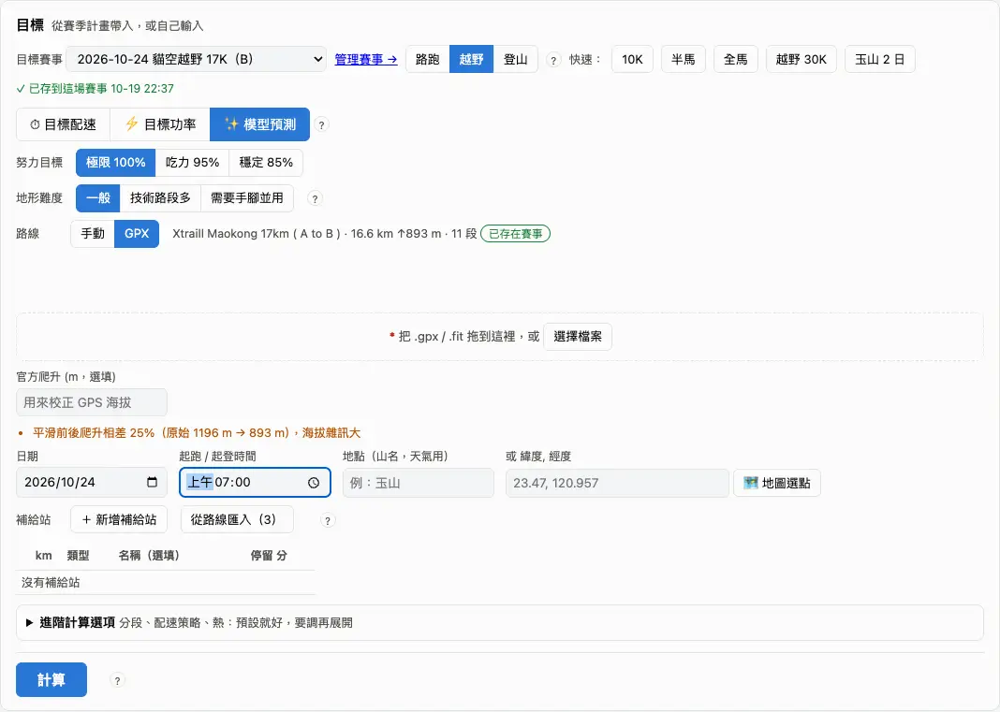
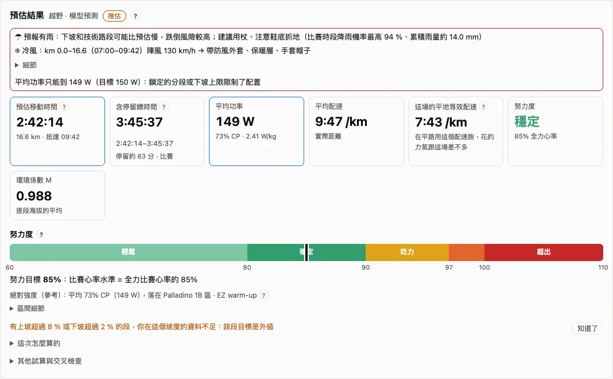
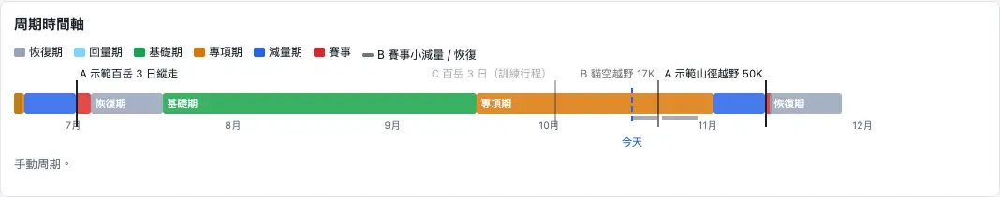

**賽事計算機**回答「這場要跑多久、每一段怎麼跑、要吃喝多少」；**賽季計畫**（賽事周期）決定周期怎麼排、離比賽還來不來得及練；**賽事管理**放每一場比賽的資料、GPX 和成績。三頁都在上方選單（賽事管理在「更多」）。

## 計算機：開始算一場 {#calculator}

打開「賽事計算機」，最快的方法是在「目標賽事」選賽季計畫裡的一場：距離、爬升、日期、GPX 都會帶進來，紅色 * 的欄位填齊就會自動算，之後每改一個欄位都會重算。沒有排進計畫的比賽，選「手動輸入」再填距離和爬升，或按 10K、半馬、全馬、越野 30K 這些快速預設。

1. 「目標賽事」選一場，或「手動輸入」。
2. 「類型」：路跑、越野、登山（郊山、中級山、百岳都算登山）。
3. 目標：「模型預測」（預設）、「目標配速／時間」或「目標功率」。
4. 路線：手動填距離、爬升，或拖進 GPX；有 GPX 才有逐段的坡度。
5. 看下面的「預估結果」。

:::tip
新增賽事、換 GPX、團的時間表都在「賽事管理」（計算機上的「管理賽事 →」）。計算機這裡上傳的 GPX 只用在這次計算。
:::

:::deep
### 還沒填的欄位
缺什麼會寫「還缺：…」。沒有體重時，登山能力、熱量和補給、W/kg 算不出來，路跑和越野改用速度照樣能算。主要訓練項目是「路跑」時，越野、登山兩個類型和越野預設會藏起來。

### 手動路線和 GPX 的差別
手動路線沒有坡度，整場用一個模型算；GPX 會切成坡段（依坡段、每公里或不分段，最多 15 段），每段各有目標。GPX 可以填「官方爬升」校正 GPS 海拔。只有 GPX 會查沿線的路面（OpenStreetMap 60 m 內的路，分成土徑、人工、不確定），查不到不影響計算。

### 準確度分頁
「準確度」拿你過去的比賽回測：每一場只用那場以前的資料，看預估跟實際差多少。重新回測要付費方案。
:::

## 目標與努力度 {#goal}

計算機有三種目標：**模型預測**（照你的能力算你跑得多快，選「極限 100 %」「吃力 95 %」「穩定 85 %」）、**目標配速／時間**（你想跑多快）、**目標功率**（平均功率或 %CP）。結果卡的**努力度**告訴你這個目標對你有多吃力：輕鬆、穩定、吃力、極限、超出。

1. 想知道「我大概跑多久」：用模型預測，努力目標選穩定或吃力。
2. 心裡有目標時間：切到目標配速，看努力度是不是落在「超出」。
3. 模型預測時可以直接拖結果裡的努力度條（60–105 %）。

:::deep
### 努力度五級
- 輕鬆 < 80 %、穩定 80–90 %、吃力 90–97 %、極限 97–100 %、超出 > 100 %（切點是推估）。
- 路跑、目標配速、目標功率：比的是平均功率 ÷「你能撐這麼久的功率」（Riegel 公式和 CP），淡色帶是 CP ±3 % 的不確定範圍；下面一句「這個強度你大約可以撐 N × 目標時間」。
- 越野用模型預測時：比的是比賽心率 ÷ 你的全力比賽心率。
- 只有模型預測能拖動努力度條；其他模式那條是結果，灰色。

### 目標太快的提醒
目標比模型預測（100 %）快 3 % 以上：「可能撐不住」；快 8 % 以上：「很可能撐不住」；慢 10 % 以上：「很保守」（推估）。

### 絕對強度那一行
努力度下面寫平均功率落在幾 % CP、Palladino 第幾區（或心率區間）——那是參考；比賽要看的是努力度。用「以訓練條件功率輸入」時，填的功率會再乘上環境係數 M（例如 250 W、M 0.96 → 比賽日 240 W）。見 [臨界功率 CP](glossary.md#cp)。
:::

## 路線、補給站與天氣 {#course}

結果準不準，靠的是路線和條件。**起跑時間**有填才有每段的預計到達時間（ETA）、天黑提醒和逐時熱修正；**補給站**的停留時間會算進總時間；**日期**和**地點**用來查天氣。

1. 填日期和起跑時間。
2. 加補給站：km、類型（水站、補給站、大補給站、醫護站、自備補給點）、停留分鐘；GPX 的航點像補給站時可以「從路線匯入」。
3. 越野：有標過乾／濕的資料時可以選「路況」；「地形難度」選一般、技術路段多、需要手腳並用。
4. 「環境」自動帶入訓練時和比賽日的海拔、溫濕度，按 ✎ 可以自己改。

:::deep
### 補給站預設停留
水站 0.5 分、補給站 2 分、大補給站 5 分、醫護站 0 分（水要從上一站帶夠）、自備補給點 2 分；連續賽制的多日賽另有睡眠點（預估 < 36 小時每次 20 分、36–60 小時 30 分、> 60 小時 90 分）。km 要在全長內、不能重複，不然那一列不算。

### 地形難度
一般 × 1.00、技術路段多 × 1.15、需要手腳並用 × 1.35，乘在越野心率模型的努力距離上；你在活動上標過地形難度，就改用你自己的資料（往預設值收縮，預設值相當於 2 筆標記）。

### 天氣與環境係數 M
比賽日的天氣依序用中央氣象署預報、Open-Meteo；超過 16 天用近 10 年同月平均。M = 1 −（海拔係數差）−（熱懲罰差 ÷ 100），海拔用氣壓換算、熱用 Hadley 熱指數；GPX 每段的溫度依海拔換算（每升 100 m 約低 0.65 °C）。熱適應、高度適應都是自動判斷，不用設定（見 [熱適應](faq.md#heat)）。

### 進階計算選項
分段方式、配速策略（均速／前慢後快／前快後慢，幅度 0–5 %）、坡道彈性、逐段熱修正（預設開，推估）、夜間減速（預設 0 %）、越野的努力距離公式（預設用你的擬合 km + 爬升 ÷ 153）。預設就好，要調再展開。
:::

## 結果與分段目標 {#segments}

「預估結果」最上面是**預估移動時間**和**含停留總時間**（中位數，旁邊小字是 25–75 % 的範圍），下面是平均功率、平均配速、越野的「平地等效配速」、努力度和環境係數。再往下的「分段目標」把每一段該看的數字畫在海拔圖上。

1. 「分段目標」切配速／功率／心率；黃底是走路段、深色底是天黑的段、圖釘是補給站。
2. 下面的表每段一列：坡度、配速、功率、心率、累計時間與 ETA、補給。
3. 選了賽事時可以「📅 匯出至課表」：比賽日變成一堂能送到手錶的課（再匯出會覆蓋）。

:::deep
### 每段看什麼
- 可跑的爬坡（3–8 %）：看功率，帶寬 ±3 %。
- 陡坡（> 8 %，或用走的）：看心率上限和每小時爬升（VAM），功率只當參考。
- 下坡（≤ −3 %）：不設功率也不設心率。
- 平路：看功率；沒有 CP 時看心率。
心率上限：有越野心率模型就用模型的比賽心率；否則 3 小時內用 LTHR、超過 3 小時壓在 AeT。

### 平地等效配速
各段的坡度調整配速依時間加權，下坡最多算快 10 %（見 [坡度調整配速](glossary.md#gap)）。

:::chart grade
拖動坡度和配速，看坡度調整配速、垂直爬升速度怎麼算。
:::

### 含停留總時間
停留佔移動時間的比例隨時間變長，2.5 小時後不再增加；比賽、自主長程、登山各有一套（先驗 30 %、40 %、60 %，再用你的資料校正）。有填補給站分鐘就用你填的；只列補給站沒填分鐘，用站數 × 你過去每次停留的中位數。

### 全部欄位
「全部欄位」可以在目標功率欄改數字鎖定一段，其他段重新分配；還看得到每段的 M、溫度與熱懲罰。
:::

## 補給 {#fuel}

「🍽 補給」是建議值，自己準備：依這場的長度給每小時的**碳水、水、鈉**，加上總熱量、賽前補碳和預估脫水，並排出一張補給時間表——盡量排在走路或爬坡，不排在陡下坡，附近有補給站就改在站上吃。

1. 看分級（短、半馬級、長、超馬、登山）和每小時的建議量。
2. 補給站之間要帶多少水：每小時水量 × 時間 × 1.2。
3. 預估脫水超過體重 2 % 會警告：多帶水或多停補給站。

:::deep
### 建議量
| 分級 | 碳水 g/h | 水 ml/h | 鈉 mg/h |
|---|---|---|---|
| 短（< 1.25 h） | 0–30 | 口渴再喝 | 不必另外補 |
| 半馬級 | 30–60 | 口渴再喝（≥ 25 °C 改計畫性喝水） | 不必另外補 |
| 長（越野 2–6 h、路跑 > 25 km） | 60–90，葡萄糖＋果糖 | 400–800 | 300–600 |
| 超馬（越野 > 6 h） | 30–90 | 450–750 | 300–600 |
| 登山 | 30–50 | 每 kcal 0.7–0.8 ml | 200–300 |

碳水上限 90 g/h；水量依氣溫 10–30 °C 在範圍內移動。

### 熱量
功率法：功率 × 時間 ÷（22.1 % × 4.184），陡坡、走路、下坡改用 Minetti 的能量成本；登山用 Pandolf 公式。範圍約 ±10–15 %。賽前補碳：比賽超過 90 分鐘時，前一天每公斤體重 10–12 g；否則一般高碳水 6 g/kg。
:::

## 登山 {#hike}

類型選「登山」時，計算機改用**步行能力**：看你過去登山每小時的努力距離（EP/h）、背負和海拔。必選「**跟團**」或「**自己走**」——兩種的休息和步調差很多。

1. 「行程」選跟團或自己走；天數、逐日行程（手動路線）或 GPX。
2. 背負留空就用預設背負（單日 4 kg、多日 9 kg，或你自己記過的中位數）。
3. 看「能力時間」與「跟團時間」，以及每天的表。

:::deep
### 兩個時間
- 能力時間：你在 AeT 的步行能力，範圍 p10–p90。
- 跟團時間：過去跟團日的速度換算的時間（要 3 天以上的跟團紀錄），範圍 p25–p75。選跟團時主數字是跟團時間。
「跟團對照」把每段標成會等人（< 80 %）、輕鬆、剛好、吃力、跟不上（超過上限或比團慢 10 %）。

### 停留依路線最高點分三級
郊山 < 1500 m、中級山 1500–2999 m、百岳 ≥ 3000 m；用你過去同一級的登山估停留。某一級不到 3 趟或 5 天時，退回「3000 m 以上／以下」兩級，再不夠用全部登山；結果會寫用到哪一級、幾趟。總時間＝每天的移動時間＋停留，不含過夜。

### 背負與積雪
預設背負的順序：設定的手動值 > 你記過的同類背負滿 3 趟用中位數 > 單日 4 kg、多日 9 kg（見 [自動估算的參數](settings.md#advanced)）。多日行程第 2 天起每天少 0.7 kg（吃掉的糧食，推估）。積雪：有踏跡 × 1.5、無踏跡 × 2–3，只乘爬升段。
:::

## 賽季計畫：A／B／C 與周期 {#season}

「賽事周期」頁是你這一季的比賽和周期：時間軸上看得到基礎期、專項期、減量期、賽事、恢復期，今天在哪裡。比賽的**優先級**決定周期怎麼排：**A** 是主要目標，周期從它往回排；**B** 小減量、不改周期；**C** 當一次訓練。

1. 新增或修改賽事：按「到賽事管理 →」。
2. 回到這頁看周期時間軸；課表每一週左邊的色條就是這裡的周期。
3. 想自己調周期：周期表「改成手動調整」，要回自動按「恢復自動排程」。

:::deep
### 周期的順序
基礎期 → 專項期（8 週）→ 減量期 → 賽事 → 恢復期 → 轉換期 →（回量期）→ 基礎期。超過 24 週沒有 A 賽時，基礎期改成「維持期」；兩場 A 賽相隔不到 12 週會提醒。名詞見 [周期](glossary.md#phases)。

### 減量期與賽後恢復
- 減量期預設 10 天；2–3 天的登山行程 7 天。
- 賽後恢復看比賽大小（依預估時間，先用計算機算的，再用你填的）：短、中 7 天；馬拉松級 7 天＋回量 1 週；超馬級 14 天；100 英里級 14 天＋回量 2 週。比賽的下坡遠超過近 6 週練過的，恢復再多一級。

### B 和 C
- B（有 A 賽時）：賽前 5 天內不排間歇、4 天內不排節奏跑和長跑，賽後依大小恢復，不改周期。沒有 A 賽時，B 賽有 4 週輕量準備加 7 天減量（推估）。
- C：取代那週一堂強度課或長跑，不改周期。
:::

## 賽事評估 {#feasibility}

賽季計畫頁的「賽事評估」每場 A／B 賽一張卡，回答兩件事：**來不來得及練**（來得及、有點趕、太難了、時間不夠）和**現在練得夠不夠**（準備好了、差一點、還不夠）。只是建議，不會改計畫。

1. 看卡片的結論，點「詳細」看每一項和依據。
2. 「有點趕」通常是週量或爬升還不夠；「太難了」通常是跨級太多或預估超過關門。
3. 距比賽不到 21 天會寫「時間不夠」：這時重點是減量和比賽策略。

:::deep
### 來不來得及練
- 週量：把最近 4 週照每週 +10 %、每 4 週休一週推到賽前 3 週，跟比賽最難那天的努力距離比；長賽（多日或 6 小時以上）要 90 %，較短的 100 %。
- 爬升：同樣推算，不到 50 % 算有點趕。
- 跨級：近 24 個月最長一天的 ITRA 等級，跳 2 級以上算太難了。
- 超馬時數（Koop）：50 km 起每週 6 小時連 3 週、100 km 起 9 小時連 6 週。
- 關門：預測完賽 ÷ 關門時間 ≤ 90 % 沒問題、≤ 100 % 有點趕、超過算太難了。
- 登山另看撤退時間、爬坡速度。

### 現在練得夠不夠
最長一次到比賽的 80 % 算夠、70 % 差一點；需要連續兩天長距離的比賽，近 10 週要有 2 次以上。賽前完備程度的看板在圖表分析的專項期、減量期頁（見 [圖表分析](analysis.md#charts)）。
:::

## 賽事管理 {#races}

「更多」→「賽事管理」列出每一場比賽：賽季計畫裡的賽事，加上你標成比賽、但還沒進計畫的活動。可以新增、編輯、上傳 GPX、看比完的成績和當天數據，或勾兩場比較。

1. 「＋ 新增賽事」：名稱、日期、類型、優先級、天數、距離、爬升、預估時間、關門時間（登山是撤退時間），以及 GPX。
2. 點一場比完的比賽：當天數據、預估 vs 實際、海拔與走勢、每公里分段。
3. 勾兩場比完的比賽，按「比較兩場」。

:::deep
### 編輯器的其他欄位
- 賽制：2 天以上的越野賽問「分站／連續」。
- 進階：土徑比 %（≥ 50 % 時專項期每週排一堂技術地形課）、行程背包 kg、會用登山杖。
- 跟團時間表：勾「這是登山社／團排好的時間表」，計算機每天的出發時刻會帶入。
- 也可以從疊石 Cairn 匯入或推到 Cairn（見 [疊石 Cairn](race.md#cairn)）。

### 預估 vs 實際
差距是正數＝比預估慢。比完的 A 賽會顯示以比賽前一天為準的賽前完備程度。比較兩場時，時間、配速的負數＝B 比較快；同一條路線會連到完整比較（見 [活動列表](analysis.md#activities)）。
:::

## 疊石 Cairn {#cairn}

**疊石 Cairn** 是我們另一個登山行程服務，跟 TrailRunCoach 互補：TrailRunCoach 管出發前的練習和「這趟要走多久、怎麼配速、吃多少」；Cairn 管行程本身——每天走到哪、住哪裡排成時間軸，看 3D 地形與鋪面，出發後把即時位置分享給留在山下的家人，也可以揪團。Cairn 用 Google 帳號登入就自動免費註冊。

1. 把 Cairn 的行程帶進來：賽事管理 →「＋ 新增賽事」或編輯一場 →「從 Cairn 匯入 GPX」貼上 Cairn 行程的分享連結。路線和每天的終點（Cairn 標的過夜點）存成這場的 GPX，距離、爬升、天數跟著改；日期不改。
2. 從 Cairn 帶著路線過來（網址帶著分享連結）：登入後會打開填好的「新增賽事」，確認日期按「儲存」，路線就匯入，接著打開賽事計算機算這一場。
3. 把算好的推到 Cairn：在賽事管理編輯那一場，按「推到 Cairn」，會推 GPX、計算機存的配速曲線和每晚的過夜點。要先連結 Cairn 帳號，而且是付費方案的功能。
4. 計算機天氣區的「在疊石 Cairn 看這條路線的行程與即時天氣圖層 ↗」直接打開同一條路線。

:::tip
排多日行程時（賽事管理裡 2 天以上的賽事、計算機的多日結果），下面會有一張「把這趟排進疊石 Cairn」的小卡。按「不用了」兩個地方都不再出現，可以在 [提示多寡](settings.md#hints) 下面那一行重新顯示；提示設成「精簡」、或已經連結 Cairn 時不會出現。
:::

:::deep
### 帳號連結
同一個 Google 帳號在兩邊是同一個人，但**不會自動連結**：要你自己在「設定 › 疊石 Cairn」連結，或第一次要推資料時才會問。連結後 Cairn 只讀得到列出的項目，每一項各自打勾，不讀活動、心率或其他健康資料；隨時可以解除連結，解除後 Cairn 立刻讀不到。用 email 註冊的帳號暫時不能連結，要連結請改用 Google 帳號登入。

### 沒有 TrailRunCoach 帳號時
從 Cairn 過來的人要先用 Google 帳號登入並同意條款，回來後路線照樣帶入；不會沒登入就先算。網站人數已滿時，登入會把你排進候補名單，畫面會說明，那條路線在 Cairn 的時刻推估照樣可以用。

### 分享連結
匯入只用分享連結讀一次 Cairn，分享碼不會被存起來。Cairn 那邊停止或重新產生分享後，舊連結就讀不到，要重新複製。拿到分享連結的人都看得到那條路線，給別人之前想一下。
:::
