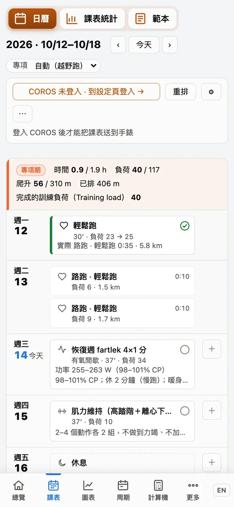
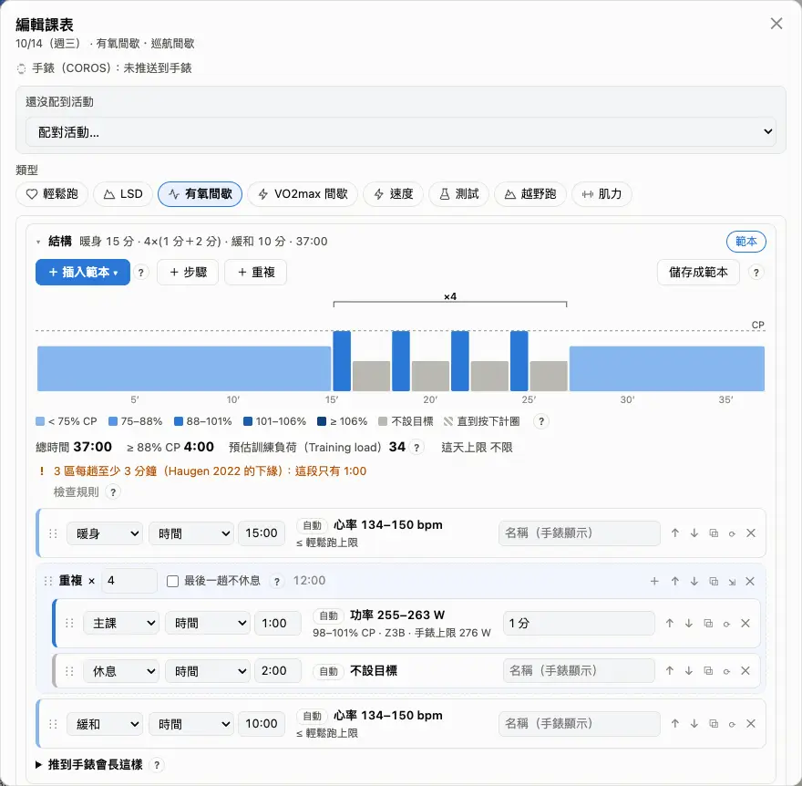
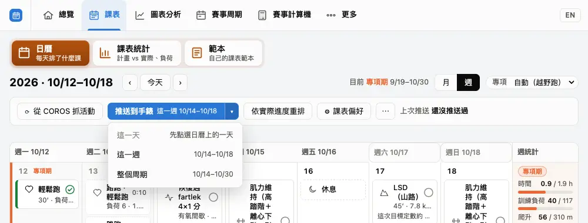

課表會依你的賽事、周期和最近的訓練自動排好；你可以隨時改，改過的課系統會記得是你的。

## 課表頁一覽 {#overview}

上方選單的「課表」：電腦上可以切「月」或「週」，手機上是一週一週往下捲的清單。每一週左邊的色條是周期（基礎期、專項期、減量期、恢復期），右邊的「週統計」是這週做了多少、還剩多少。

1. 用 ‹ › 換週（或月），「今天」跳回本週。
2. 點一張課卡看內容；點空白處新增一堂課（只有今天以後）。
3. 上面那一排按鈕：抓活動、推送到手錶、依實際進度重排、⚙ 課表偏好、⋯ 更多。

:::deep
### 週統計怎麼算
「時間」是完成／計畫的小時數，「訓練負荷（Training load）」是完成／計畫的負荷；越野跑者還有「爬升」。本週之後還沒定案的週會標「暫定（重排時會依進度調整）」。

把滑鼠停在週統計最上面的周期名稱（手機點一下）會列出這週為什麼這樣排：週量怎麼算、為什麼是恢復週或減量週、哪些比例是推估。本週和已經排好的未來週都有；提示多寡選「精簡」時，這些原因收在上方提醒列的「詳細」裡。

### 周期標記
每個周期第一天（或週一）會寫周期名稱，上方「目前」顯示現在在哪一期、到哪一天。A 賽當天的比賽標記會取代「賽事」周期名稱。周期本身在「賽事周期」頁排定。
:::

## 課卡怎麼讀 {#read-card}

一張課卡回答四件事：**是什麼課**（左邊方塊的圖示）、**做了沒**（外框或左側色條）、**做得怎樣**（右邊的圓圈）、**要練多少**（分鐘、距離、爬升、訓練負荷）。

- 第一行：類型圖示、課名、完成度圓圈。
- 第二行：分鐘′ · 公里 ↑爬升 · 負荷 N；做完後變成「負荷 計畫 → 實際」。
- 第三行：目標（例如心率區間），做完後換成實際做了什麼。
- 方塊角落的 ↻＝系統調整過，✎＝你改過。

:::tip
電腦上把滑鼠停在課卡上，可以看完整說明：完成情況、目標、怎麼練、調整原因、手錶狀態。
:::

:::deep
### 完成度怎麼判定
有活動配到這堂課才算「做了」——系統會依日期和類型自動配對，也可以在課的視窗裡「配對活動…」或「改配到…」自己指定。沒有「手動打勾完成」這種按鈕。

- **完成**：時間和訓練負荷都在計畫 ±20 % 內，強度做到 80 % 以上。
- **部分**：時間或負荷偏離 20 % 以上、強度只做到 50–80 %，或跑反強度；圓圈填滿的比例＝實際 ÷ 計畫。
- **換了課**：換成走跑以外的運動，或跑反強度而且時間或負荷也偏離。
- **跳過**：那天沒有對應的活動。

強度的判定：有課表分類時，取 Zone 3 時間（門檻 10 分）和等效 T@VO2max（門檻 4 分）比較高的那個；沒有分類時，用閾值以上的時間。80 %、50 % 這些門檻是推估；時間和負荷都對就算「部分」也是推估（intervals.icu、TrainingPeaks 也用負荷／時間算完成度）。
:::

## 顏色與符號 {#colors}

**圖示說是什麼課，顏色說做得怎樣**：類型圖示永遠不上色；綠色是完成、黃色是部分或換了課、灰色是跳過。整個課表上唯一的紅色是「推送到手錶失敗」。下面這張圖例就是課表頁上「? 圖例」的同一份程式畫的。

:::legend
課表頁的「? 圖例」：類型、完成度、其他符號。
:::

:::deep
### 為什麼這樣配色
每個問題只用一個視覺管道：類型＝圖示、偏離多少＝色條和圓圈的顏色、發生了什麼＝圓圈的形狀、做了沒＝外框或色條。完成度同時有顏色和形狀（✓、扇形、斜線、空心），色弱也分得出來（WCAG 2.2 SC 1.4.1）。紅色只留給推送失敗，所以一眼就能找到要處理的課。

### 其他標記
- 點線外框的卡：沒排課的活動（點一下看摘要、配對到課表）。
- 小圓點：輕鬆跑偏強；⚠：輕鬆跑跑成了強度課。
- 「≥ X% 走」：這堂課有很多走路。
- 45° 斜紋：不排課日期；淡綠底：休息日。
:::

## 改一堂課 {#edit}

點一下課卡打開它，改類型、日期、分鐘、目標或「結構」，按「儲存」。也可以直接**拖曳**課卡到別天，拖到另一張課卡上就是兩堂交換。改過的課會標 ✎，之後的自動調整不會改它的內容。

1. 點課卡（或右鍵／手機長按 →「編輯」）。
2. 改內容後按「儲存」；不想要這堂課就按「刪除」（按兩次確認）。
3. 改壞了：右鍵 →「還原成自動」，換回系統排的版本。
4. 新增一堂：點今天以後的空白處，或按那天的 ＋。

:::deep
### 結構與目標
「結構」編輯器可以插入範本、加步驟、加重複；每一步的目標可以是自動、功率、心率、配速、RPE＋爬升或無，用區間、% CP 或自訂數字填。有結構時分鐘數由結構算出來。只有真的改了結構才存，存了就算你的修改。強度課可以按「換一個」挑同等的課（不影響進階）或不同等的課；長跑可以「換成長爬坡有氧（同樣時間）」。

### 你改過的課會怎樣
自動調整和重排都不會改它的內容，但有兩個例外：CP 改了時，功率數字會照新的 CP 重算；如果那一週被重排成恢復週、減量週或比賽週，而這種週不該有長跑／強度課／測試，你改過的那堂還是會被拿掉。刪掉一堂自動排的課之後它不會再自動出現，直到你選「還原成自動」。

### 已送到手錶的課
改、移動、刪除一堂已經送到手錶的課，手錶上的版本會馬上跟著更新。
:::

## 重排與自動調整 {#replan}

錯過課、生病、多跑了，都不用自己一堂一堂改：按「依實際進度重排」，系統會**先給你看會改哪些課**，你同意才套用。另外每次同步到新活動，「自動調整」會自己做小的減量；大的變動會先等你同意。

1. 按「依實際進度重排」。
2. 看預覽清單：錯過的課標成跳過，之後還沒改過的課依目前狀況重排。
3. 想連你改過的課一起換回自動，勾「也重置我改過的課」（你自己新增的課和已完成的課不會動）。
4. 按「套用 N 項變動」。

:::deep
### 自動調整做什麼
同步進來至少一筆新活動後執行：減量（疲勞保護、沒跑的課不補、輕鬆跑偏強後縮短）直接套用並推送；你改過的課、自己加的課、不排課日期都不會動。輕鬆跑或長跑後在 COROS 自評很累（RPE ≥ 7），而且 48 小時內有強度課或測試，那堂強度課會延到下一個空日，沒有空日就降一階。

### 哪些變動要先等你同意
- 一週的計畫負荷比上次推送的版本多 20 % 以上；
- A 賽前 14 天拿掉長跑、強度課或測試，或在這段時間移動強度課；
- 周期改變；
- 推送範圍內超過 3 堂不是減量的變動。

這時課表上會出現「課表待確認」，按「同意，套用並推送」或「拒絕，維持原本的課」。每一次自動調整都記在「自動調整紀錄」，可以按「復原」。

### 不排課日期與休息日
出差、旅行：⋯ →「設定不排課日期」，那幾天不排任何課，該週的目標時數跟著減少（最多 62 天）。「休息日」不一樣：只是把那天空出來，這週的量移到其他天。
:::

## 每週的量怎麼來 {#weekly-load}

課表每週加多少量，看的是你的**長期訓練負荷（Chronic load）**和**負荷平衡（Load balance）**。拖動下面兩個滑桿（這週和下週的量）試試：連續兩週練太多，負荷平衡掉到長期訓練負荷的 −30 % 以下，課表就會自動排一個恢復週。

:::chart pmc
這張是「總覽」上的訓練負荷圖，用同一份程式畫的；資料是示範用的一個賽季。藍線＝長期訓練負荷、橘線＝短期負荷、長條＝負荷平衡（顏色是它佔長期負荷的比例）。
:::

:::deep
### 公式
每天的訓練負荷 x 進來後：

- 長期訓練負荷 ← 長期 + (x − 長期) ÷ 42
- 短期負荷 ← 短期 + (x − 短期) ÷ 7
- 負荷平衡（今天）＝ 昨天的長期訓練負荷 − 昨天的短期負荷

起點是你填的值（設定 › 生理數據 ›「起始長期訓練負荷」，從填的日期起算），沒填就用有訓練負荷的前 28 天平均每日負荷。

### 課表怎麼用它
- 負荷平衡 < 長期訓練負荷的 −30 %：改成恢復週，量是近 4 週平均的 60 %（排了 B2B 的週例外）。
- 負荷平衡 < 長期訓練負荷的 −20 %：先維持量，不加。
- 基礎期每練 3 週排 1 週恢復週（前 3 週平均的 70 %）；專項期從比賽往回算，最多 6 週一定有一次恢復週。
- 加量的上限（長期負荷週增量）：基礎期每週長期訓練負荷 +4 %（至少 +2），專項期 +5 %（至少 +2.5）；週時數最多是參考量的 110 %（或 +0.5 小時）。

### 顏色的區間
長條的顏色看負荷平衡 ÷ 昨天的長期訓練負荷：< −30 % 過度疲勞、−30～−10 % 有效訓練、−10～+10 % 持平、+10～+35 % 比賽狀態、> +35 % 休息過久（業界常用的區間）。恢復週、維持量的規則和比賽日目標看的也是這個百分比；長期訓練負荷不到 30 時以 30 計。
:::

## 課表送到手錶 {#push}

課表可以送到 **COROS** 手錶的行事曆：按「推送到手錶」推這一週；按旁邊的 ▾ 可以選「這一天」「這一週」或「整個周期」。推之前會先跳出預覽，告訴你會推幾堂、哪些不推。

1. 先在「設定」→「資料同步」登入 COROS（課表推送目前只支援 COROS）。
2. 按「推送到手錶」（或 ▾ 選範圍）。
3. 看預覽，確認後推送；手錶 App 同步後就會出現在行事曆。

:::tip
課表偏好裡打開「自動推送到手錶」，自動調整之後會自己推送最近 N 天（預設 7 天）。
:::

:::deep
### 推什麼
每堂課的結構（熱身、主課、緩和），每一步一個目標；跑步功率用絕對瓦數。不推：肌力課（COROS 的肌力課要從動作庫挑動作）、休息、沒有步驟的比賽。錯過的課會從手錶上移除。

### 從手錶移除
⋯ →「從 COROS 移除」可以選這一天、這一週或整個周期；只會移除這裡推過去的課，手錶上已經完成的不會動。

### 狀態
課卡上的手錶圖示只在「需要更新」或「推送失敗」時出現；推送失敗是課表上唯一的紅色。課表推送到哪一個平台在「設定」→「資料同步」→「進階設定」→「課表推送到」選，Garmin 和 intervals.icu 還沒開放。
:::

## 行事曆訂閱 {#calendar}

想在 Google 日曆或 iPhone 行事曆看到課表：到「設定」→「資料同步」→「課表訂閱」，按「產生訂閱網址」，把網址加到行事曆 App 的「訂閱」。之後課表改了，行事曆會自己更新。

1. 「設定」→「資料同步」→「課表訂閱（Google 日曆／iPhone）」。
2. 按「產生訂閱網址」。
3. Google 日曆（電腦版）：左側「其他日曆」旁的 ＋ ›「從網址新增」，貼上「訂閱網址」。iPhone：在 iPhone 上直接點「iPhone／Mac 用」那個網址。

:::warn
網址就是鑰匙：拿到網址的人都看得到你的課表。不小心分享出去，按「重設網址」，舊網址馬上失效；不用了就按「停用」。
:::

:::deep
### 行事曆裡有什麼
每堂課一個全天事件，範圍是兩週前到八週後；完成的課標 ✓、跳過的標 ✗。事件內容有時間、負荷、距離／爬升、目標、結構、備註，還有一個打開那堂課的連結。不會出現：休息日、不排課日期、「課表待確認」通知、刪掉的課。

### 多久更新一次
訂閱內容就是課表目前存的樣子（不會因為被讀取而重排）。檔案建議行事曆每小時更新；實際上 Google 日曆要幾小時到一天，iPhone 約 5–15 分鐘（「擷取」設每 15 分鐘時）。
:::

## 課表偏好 {#prefs}

課表要配合你的生活：哪幾天能練、每週幾小時、長跑排哪天，都在「⚙ 課表偏好」設定。存檔後會先預覽會改哪些課，再套用。

1. 按「⚙ 課表偏好」。設定分成五個頁籤：日期與時間、課表內容、肌力、賽事與測試、自動調整；下次打開會停在你上次看的頁籤。
2. 「日期與時間」頁籤的「每週時間」：可練日、每週跑步次數、每週時數、平日和長跑日的單次上限。
3. 同一頁的「偏好的星期」：想固定 LSD、間歇、測試或休息日在哪幾天就加一列。
4. 按「儲存並預覽重排」，看過變動再套用。五個頁籤的設定一起存；有設定填錯時，那個頁籤會有紅點，按儲存會跳過去。

:::deep
### 自動的意思
- 每週跑步次數「自動」：跟著週量走（一次輕鬆跑約 50 分），最多 6 天、至少留 1 天休息；沒排到的可練日就是休息日，放在長跑隔天、強度課之間。
- 每週時數「自動」：照長期負荷週增量的規則加量（見「每週的量怎麼來」）。
- 超過上限時：「盡量不超過」把放不下的量先加在長跑日；「絕對不超過」這週就少練，會提醒你。

偏好只影響系統排的課；你改過或自己加的課不會因為改偏好而變。

### 減量期的肌力
A 賽事的減量期，「每週肌力」和「肌力排在」不照平常排：

- 減量期開始 3 天內只留 1 堂短的維持課：20 分內、平常做過的 2–3 個動作、不做到力竭、不加新動作、不做大量離心（慢速下放、跳下、下台階）。那 3 天沒有排到肌力時，會把這週減量期裡的一堂移到其中一天的輕鬆跑日。
- 賽前 7 天起不排肌力（平衡／腳踝小課照排）。減量期只有 7 天（2–3 天的百岳）時整段都不排。
- B、C 賽事照平常排。

依據：Bompa & Buzzichelli 的減量章「第 1 週 2 堂短課、第 2 週停」；Berryman 2020，中距離跑者停 4 週肌力，跑步經濟性的進步還在，所以少一堂也安全。只留 1 堂、20 分是推估——跑步本身就有很多離心，比賽前痠痛的風險比少練一堂大。
:::
