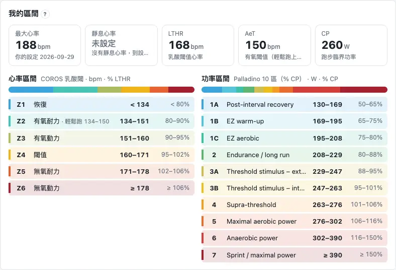
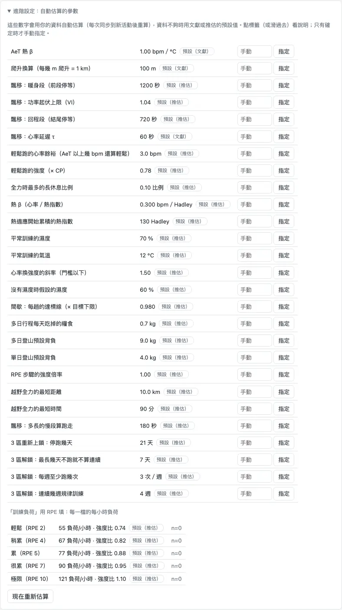

「更多」→「設定」分成五個分頁：**個人資料**、**偏好設定**、**生理數據**、**資料同步**、**進階設定**（登入版另有「疊石 Cairn」）。大部分欄位都有「自動」：不確定就留著自動，只有你比系統更清楚的時候才手動填。示範版沒有設定頁。

## 個人資料 {#personal}

「個人資料」是你這個人的基本資料和主要訓練項目。一定要填的只有**性別、年齡、體重**；其他都可以留空或用自動。

1. 「基本資料」：性別、身高、年齡、功率來源、體重與量測日期，按「儲存」。
2. 「主要訓練項目」：自動、越野跑、路跑、馬拉松——建議留「自動」。

外觀（配色）和地圖的預設在「偏好設定」分頁。

:::deep
### 每個欄位用在哪
- 性別：無氧容量的預設值（女性 6.4、男性 13.1 kJ）和熱量估算。
- 身高（100–250 cm）：熱量估算。
- 年齡（10–100 歲）：熱量估算；沒有任何最大心率資料時估最大心率（208 − 0.7 × 年齡）。存的是出生年，每年自動加一歲。
- 功率來源：自動、Stryd、手錶推估功率、沒有功率計。自動＝近 90 天有 5 次以上 Stryd 跑步就算 Stryd，否則看有沒有手錶功率。只有 Stryd 的功率進功率模型。
- 體重（25–250 kg）：每一天用「當天或之前最近的一筆」；這裡改的是最新一筆，同一天的會被取代，舊紀錄留著。手動填的優先，體重同步不會蓋掉它（見 [體重保持最新](start.md#weight)）。

### 跑步經驗
還沒有 4 週以上的跑步紀錄時，基本資料下面會有「跑步經驗」4 題（一週幾次幾分鐘、最長一次、能不能連續跑 30 分鐘、近一年比賽成績）。都不填，課表從每週 1.5 小時、3 次輕鬆跑開始。

### 主要訓練項目
自動＝先看接下來的 A 賽，沒有再看 B 賽；都沒有時看近 12 週越野＋登山時間，佔 25 % 以上算越野跑（C 賽不算）。它決定圖表分析顯示哪些圖、課表排不排陡坡健走和連續兩天長跑、專項期長跑加不加馬拉松配速、賽事計算機的預設。

### 不再建議的測試
按過「不要」的 CP／AeT 測試建議會列在這裡，按「恢復」就會再建議。
:::

## 提示多寡 {#hints}

「個人資料 › 基本資料」最下面的「提示多寡」決定頁面上直接顯示多少說明和提醒：**完整**（每個數字怎麼來的都說明）、**標準**（說明只在符合條件時出現，多數人用這個）、**精簡**（只留會改變做法或跟安全有關的）。沒選時是自動，自動的那張是虛線框。

1. 點一張卡就存：完整、標準或精簡。
2. 想交回系統決定，按「改回自動」。
3. 頁面上覺得提醒太多，也可以按提醒列下面的「提示太多？」直接到這裡。

:::tip
疼痛紅燈、課表待確認、關門時間這類會改變做法或跟安全有關的提示，三種都會顯示。
:::

:::deep
### 自動怎麼選
還沒有 4 週跑步紀錄、而且跑步經驗看起來是剛開始（沒填問卷、不能連續跑 30 分鐘、每週少於 3 次，或最長一次不到 60 分鐘）→ 完整；其他人一律標準。自動永遠不會選精簡。有跑步紀錄、近一年有比賽成績、近 12 週跑過 2 小時以上時，會問一次「要改成精簡嗎？」，按「不要」就不再問。

### 每一則提示怎麼過濾
1. 會改變做法或跟安全有關的：三種都顯示，也不佔名額。
2. 其他提示照等級：顯示、條件成立才顯示、收進「詳細」、或不顯示。
3. 按過「知道了」的收進「詳細」；條件變了會再出現。
4. 每頁最多直接顯示 3 則，其他收成「還有 N 則提醒」。

套用在總覽、課表、賽季計畫的評估卡、賽事計算機、活動列表、圖表分析和設定頁本身；傷病紀錄不跟著等級變。設定頁上：分頁說明只在完整顯示；標準和精簡把固定的說明文字收進 `?`。更多見 [提示太多](faq.md#too-many-hints)。

### 疊石 Cairn 的介紹
多日行程那一步的「把這趟排進疊石 Cairn」小卡按了「不用了」之後，這裡最下面那一行「疊石 Cairn 的介紹：已關閉」按「重新顯示」就會回來（見 [疊石 Cairn](race.md#cairn)）。
:::

## 偏好設定 {#prefs}

「偏好設定」是網站怎麼顯示，跟你這個人無關，也不影響任何計算：

1. 「外觀」：配色，有 Trig 米白、Trig 深綠、經典（跟隨系統）、經典深色。選了立刻套用，不用按儲存。
2. 「地圖」：單次活動路線地圖一開始用的底圖和疊圖，改完按「儲存地圖設定」。

:::deep
### 外觀存在哪
配色存在這台瀏覽器，換電腦或手機要各自選。還沒選過時：手機或電腦是淺色就用 Trig 米白，深色就用經典深色。

### 地圖的預設和臨時切換
在地圖右上角可以臨時換底圖或疊圖，這台瀏覽器會記住；這裡的預設改了之後，會回到新的預設。魯地圖和等高線的主機有時不回應，地圖載不出來時換個底圖就好。

### 舊連結
以前連到「個人資料」裡外觀或地圖那一塊的連結（網址結尾 `#appearance`、`#map`），現在會打開「偏好設定」的那一塊。
:::

## 生理數據 {#body}

「生理數據」是你的心率、閾值和區間：**我的區間**（只顯示）、**心率**、**閾值測試紀錄**（含起始長期訓練負荷、比賽成績）、**功率**。課表的目標和每一次活動的訓練負荷都從這裡來。

1. 先看「我的區間」：這是系統現在用的數字。
2. 做過測試就在「閾值測試紀錄」加一列（見 [填閾值](start.md#thresholds)）；每一列從測試那天起生效，不往回套。
3. 最大心率、靜息心率一般不用填；手錶的值明顯不對時才在「心率 › 進階設定」填。

:::deep
### 心率
- 最大心率：你填的值 > 手錶帳號的值 > 近 365 天跑步中 10 秒平均心率的最高值 > 208 − 0.7 × 年齡（推估）。
- 靜息心率：你填的值，沒有就用手錶的值。
- 課表心率區間：自動（看哪個數字可信）、乳酸閾值心率、儲備心率、最大心率（都是 COROS 的 6 區）。自動＝LTHR 可信就用乳酸閾值區間，否則最大和靜息心率都可信就用儲備心率，再否則用最大心率；換了會通知一次。只影響課表的心率目標。
- 「我的區間」下面有 app 和手錶數字的對照，差 5 bpm 以上才展開（見 [數字跟手錶對不上](faq.md#watch-numbers)）。

### 閾值與功率區間
- 自動估算卡有「套用」按鈕；可信度低而且有強訊號時會出現紅框。
- 課表功率區間：Palladino 10 區（預設）、Stryd 5 區、經典 7 級、個人化區間（要有近 90 天的 Stryd 跑步）。

### 起始長期訓練負荷
只在「資料只有幾週、但你在別的平台知道當時的長期／短期負荷」時才填：從填的日期重新起算；沒填就用有訓練負荷的前 28 天平均（見 [每週的量怎麼來](schedule.md#weekly-load)）。

### 比賽成績（E 配速）
只用來算 90 分鐘測試的 E 配速；超過 180 天不用、越野賽不算。填最近一場路跑或田徑場的全力比賽。

### 功率
「使用功率」預設自動：有 Stryd 就打開；關掉只會藏起功率相關的圖和卡片，計算本身不變。「進階設定 › 功率模型也採用手錶推估功率」預設關，建議維持關閉——手錶功率擬合出的 CP 可能高很多；想用手錶功率練，就自己加一筆用手錶功率做的 CP 測試（見 [沒有功率計](faq.md#no-power)）。
:::

## 資料同步 {#data}

「資料同步」是活動怎麼進來、存多久：資料來源與登入（見 [連接資料來源](start.md#connect)）、什麼時候同步、體重同步、運動紀錄保留、這台裝置的離線資料、課表訂閱（見 [行事曆訂閱](schedule.md#calendar)）。

1. 「資料同步」：每天固定時間同步（預設關）、打開網站時同步（預設開，距離上次超過 6 小時）、背景同步（有新活動時，預設開）。
2. 改完按「儲存同步設定」。
3. 「運動紀錄保留」：選保留最近幾年的原始檔（預設 3 年）。

:::deep
### 同步選項
- 每天固定時間同步：填時間並勾「啟用」。
- 打開網站時同步：距離上次 1–168 小時。
- 背景同步：大約每 30 分鐘檢查一次新活動（見 [背景同步](faq.md#background-sync)）。
- 「進階設定」摺疊區：時區（空白＝自動）、地區（自動／台灣／台灣以外）、課表推送到哪個平台、RPE 換算負荷的數字、下載失敗的活動、完整檢查（見 [少了活動](faq.md#missing-activity)）。

### 體重同步（Apple 健康）
產生一組網址與 token（只顯示一次），用 iPhone 的捷徑或 Health Auto Export 每天送體重。每天凌晨 3 點整理一次，同一天取最後一筆；差 0.5 kg 以上，或離上一筆滿 7 天，才新增一筆紀錄。手動填的體重優先。

### 運動紀錄保留
可選 2、3、5、10 年（免費方案上限 1 年）。每月 1 號凌晨移除超過期限的 FIT 原始檔，摘要和長期圖表會留著；「下載我的全部 FIT」可以先備份。從較長的期限縮短前，至少提前 28 天通知。

### 這台裝置的離線資料
顯示這台裝置存了多少離線資料、是不是持久儲存；iPhone 加到主畫面的方法也在這裡。
:::

## 進階設定：自動估算的參數 {#advanced}

「進階設定 › 自動估算的參數」是計算裡用到的係數：每一列寫目前的值和來源（**本人 n=…** 是從你的資料估的、**手動**、**預設（文獻）**、**預設（推估）**）。平常不用動；**只有確定時才手動指定**，按「改回自動」就回到自動。

1. 打開「進階設定」分頁，展開「自動估算的參數」。
2. 要改的那一列填數字，按「指定」。
3. 想交回系統，按那一列的「改回自動」；「現在重新估算」立刻重估一次。

:::deep
### 幾個常用的
- 單日／多日登山預設背負：計算機背負留空、過去健行沒記背負時用的值。順序：這裡手動填的 > 你記過的同類背負滿 3 趟用中位數（推估）> 單日 4 kg、多日 9 kg。建議留空：記滿 3 趟後會自動改用你自己的數字。
- 多日行程每天吃掉的糧食：預設 0.7 kg（第 2 天起每天背包少這麼多）。
- 3 區解鎖：連續幾週規律訓練（預設 4 週）、每週至少跑幾次（3 次）、最長幾天不跑就不算連續（7 天）；3 區重新上鎖：停跑幾天（21 天，Coyle 1984）。重新上鎖天數不能短於最長不跑天數。改了課表會重排。
- 熱適應開始累積的熱指數：預設 130（Hadley）。熱適應本身不用設定，見 [熱適應](faq.md#heat)。
- 爬升換算：每幾公尺爬升算 1 公里（預設 100 m）。
- 輕鬆跑的強度（× CP，預設 0.78）、輕鬆跑的心率餘裕（AeT 以上幾 bpm 還算輕鬆，預設 3）。

### 其他
表格下方是「用 RPE 填負荷：每一檔的每小時負荷」（只顯示，每檔附次數和來源；見 [自覺強度](glossary.md#rpe)）。來源標籤的意思見 [推估](faq.md#estimate)。只能手動的列（例如飄移的心率延遲、3 區解鎖）不會自動重估。
:::

## 進階設定：資料校正與計算模式 {#fixes}

「進階設定」下面還有兩區：**資料校正**修正壞掉的資料（功率壞點、疑似坐車或騎車的活動檔），**計算模式**選「我的算式」或「對照模式」。兩者都不改原始檔。

1. 功率壞點：按「掃描壞點」，勾要修的，按「套用」；已套用的可以撤銷。
2. 排除壞掉的活動檔：預設自動排除疑似交通工具或騎車的活動；個別活動可以按「這筆是正常的，不要排除」。
3. 計算模式：平常用「我的算式」。

:::deep
### 怎麼判斷是壞掉的活動檔
持續 1 分鐘以上比同時間的世界紀錄均速快 15 %，或平均功率超過 10 W/kg（推估）。被排除的活動不算進訓練負荷、功率曲線、比賽計算和圖表；也可以在活動列表手動「排除」單筆（見 [補上標記](analysis.md#mark)）。

### 計算模式
「對照模式」不套用資料校正和你的測試值，是用來跟其他平台的算法比對的；登入版只有管理員看得到，而且只影響管理員自己的畫面。功率壞點修正只在「我的算式」生效。
:::

## 帳號 {#account}

登入版的「個人資料 › 帳號」：**下載我的資料**、跨使用者分析的同意或撤回、已連結的服務，以及**刪除帳號**。單機版沒有這一區。

1. 下載我的資料：一個 zip，含設定、賽季計畫、課表、標註、傷病紀錄、GPX、活動與 FIT、帳號與同意紀錄（不含登入憑證）。
2. 刪除帳號：先用 Google 再確認身分（10 分鐘內有效），再輸入「刪除」。
3. 「疊石 Cairn」分頁：連結狀態、Cairn 能讀或寫哪些資料（每一項各自打勾）。

:::warn
刪除帳號會先中斷 COROS、Garmin、TrainingPeaks 的連接，資料無法復原；要留資料請先下載。
:::

:::deep
### 匯出與保留
下載我的資料是整個帳號；只想要活動原始檔，用「資料同步 › 運動紀錄保留 › 下載我的全部 FIT」（見 [匯入或匯出檔案](faq.md#import-export)）。站主的帳號不能從網頁刪除。

### 跨使用者分析與已連結的服務
註冊時同意條款，也一併同意把資料去識別化後用在改進演算法的跨使用者分析；隨時可以撤回（目前還沒有任何跨使用者分析在使用資料）。「已連結的服務」是用同一個 Google 帳號登入的其他服務：對方只讀得到列出的內容，不讀你的活動、心率或其他健康資料，隨時可以解除連結。
:::
