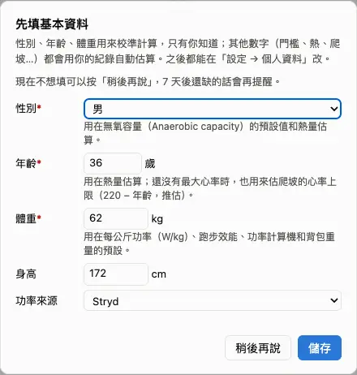
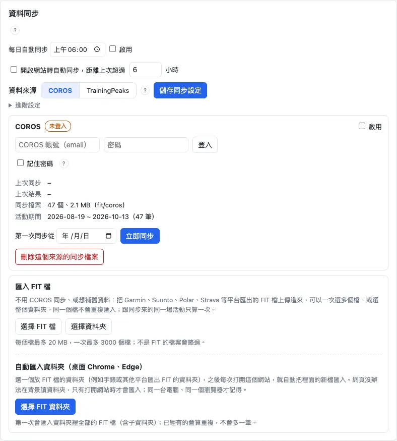
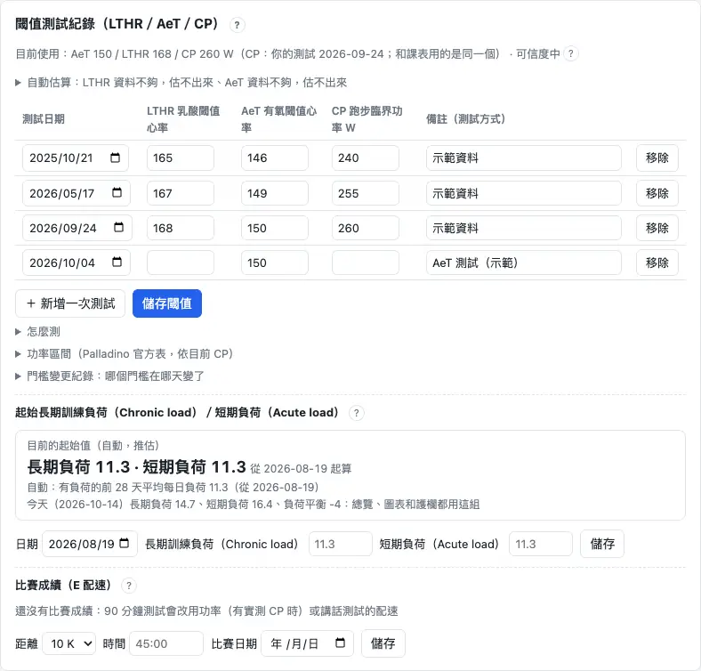
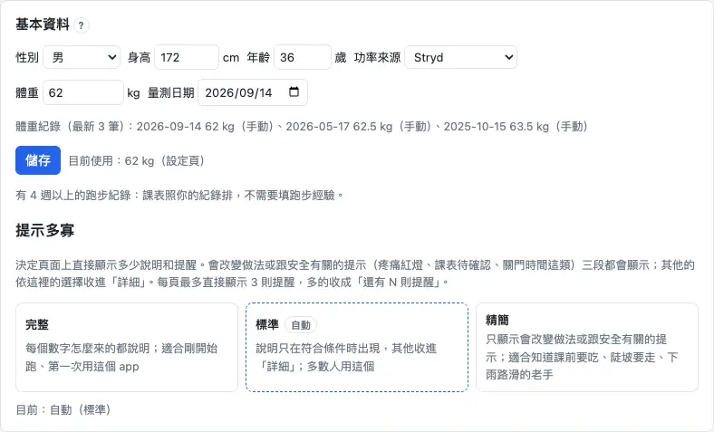

第一次用只要做四件事：登入、填基本資料、接上手錶的資料、確認閾值。每一步都可以之後再改。

## 第一次使用 {#first-run}

用 Google 帳號登入，第一次會先看條款、打勾同意，帳號就建好了。進到「總覽」後會跳出「先填基本資料」：**性別、年齡、體重**一定要填，身高和功率來源可以空著。

1. 按「用 Google 帳號登入」，看完條款、勾選同意，按「同意並建立帳號」。
2. 在「先填基本資料」填性別、年齡、體重，按「儲存」。
3. 打開「更多」→「設定」，接上你的手錶資料（下一段）。

:::tip
「設定」和這本「操作手冊」都在上方選單的「更多」裡；手機版在畫面最下面那一排。
:::

:::deep
### 為什麼一定要這三項
- **體重**：功率體重比（W/kg）、跑步效能、賽事計算機和背包預設（體重 × 13 %）都要用。每一天用「當天或之前最近的一筆」體重紀錄；沒有體重時，不會偷偷套一個預設值，需要體重的數字會直接說缺什麼。
- **性別**：決定無氧容量（Anaerobic capacity）的先驗值（女性 6.4、男性 13.1 kJ）和熱量估算。
- **年齡**：熱量估算；沒有任何最大心率資料時，也用來估最大心率（208 − 0.7 × 年齡，Tanaka 2001，推估，個人可以差 10 bpm 以上）。存的是出生年，所以每年自動加一歲。

### 什麼時候會跳出來
缺性別、年齡或體重其中一項，而且 7 天內沒按過「稍後再說」時，「總覽」和「設定」會跳出這個視窗；其他頁只在上方顯示一行「還缺…：估算可能不準，到設定填 →」。

### 跑步經驗（可以不填）
還沒有 4 週完整的跑步紀錄（每週至少 3 天跑步或健行）時，視窗下面會多出「跑步經驗」4 題。都不填的話，課表從每週 1.5 小時、3 次輕鬆跑開始，有了紀錄之後照你的實際量走。
:::

## 連接資料來源（COROS／Garmin） {#connect}

課表和分析都從你手錶的活動算出來，所以要先接上一個資料來源：到「設定」→「資料同步」，選 **COROS** 或 **Garmin**，輸入帳號密碼登入，再按「立即同步」。

1. 「設定」→「資料同步」分頁。
2. 「資料來源」選 COROS 或 Garmin，按「儲存同步設定」。
3. 在下面的方塊輸入手錶 App 的帳號（email）和密碼，按「登入」（Garmin 是「連接 Garmin」）。
4. 按「立即同步」。第一次會把舊活動一起抓下來，要等一下（下一段）。

:::warn
Garmin 目前是**試運行**：每天最多自動同步 1 次、手動 3 次，長的歷史要分幾天抓完。
:::

:::deep
### 一次一個來源
圖表、總覽、賽事計算機、CP 測試和自動同步都只用你選的那個來源；另一個來源的活動不會拿來補。切換時會先跳出確認，圖表會用新來源重新計算；活動的標籤、RPE、疼痛、背包重量和課表配對是用開始時間對應的，切換後都還在。

### 登入資料怎麼保存
勾「記住密碼」時，密碼加密後存在伺服器：COROS 登入過期（約 24 小時）或被拒時會自動重新登入一次。沒勾的話，過期了要自己再登入。Garmin 若要求驗證碼，會多一個「驗證碼」欄位（10 分鐘內有效）。COROS 和 Garmin 都是非官方介面，第一次連接時要先勾選同意說明。

### 自動同步
- 「開啟網站時自動同步」：距離上次超過幾小時（預設 6）就在打開網站時同步。
- 「每日自動同步」：每天固定時間同步（預設關閉）。
- 免費方案：開網站不會自動同步；每日自動同步會排在凌晨 1–5 點之間。

### 沒有 COROS／Garmin 帳號
可以在同一頁的「匯入 FIT 檔」選檔案或整個資料夾上傳；桌面版 Chrome、Edge 還可以設「自動匯入資料夾」，每次打開網站就匯入新檔。
:::

## 第一次同步要等多久 {#first-sync}

第一次同步會從 2020 年 1 月 1 日（或你填的「第一次同步從」日期）開始抓。抓完後先算**最近 90 天**，所以很快就能看課表和圖表；更舊的活動在背景慢慢補，上方會有一條進度列。

1. 上方出現「正在準備資料…」或「正在處理第 n／N 筆…」：先等它跑完。
2. 接著變成「正在補算較舊的活動…（近 90 天的資料已可使用）」：這時已經可以用了。
3. 出現「較舊的活動已補齊」：重新整理頁面，就會看到全部歷史。

:::tip
補算期間，長期訓練負荷（Chronic load）這類要看完整歷史的數字會顯示「計算中」，不是壞掉。
:::

:::deep
### 之後的同步
之後每次同步只抓「上次同步往前 14 天」以後的活動，所以很快。下載或匯入失敗的活動會記在「進階設定 › 下載失敗的活動」，之後的同步只重試這幾筆（每筆最多 5 次或 7 天）；「完整檢查」會把平台上的活動和這裡逐筆比對，缺的可以補下載。

### 為什麼先算 90 天
完整歷史可能有上千筆 FIT 檔，全部解析完才開放會讓第一次使用等很久。課表和總覽最需要的是最近的訓練，所以先做 90 天，舊資料在背景一次一筆補上；長期訓練負荷要從整段歷史累積，所以等補齊才顯示。
:::

## 填閾值（LTHR、AeT、CP） {#thresholds}

閾值決定課表的心率／功率目標、輕鬆跑上限和訓練負荷的算法。**什麼都不填也能用**：系統會先用你自己資料的估算；你做過測試，就在「設定」→「生理數據」→「閾值測試紀錄」加一列，從測試那天起生效。

1. 「設定」→「生理數據」，找到「閾值測試紀錄（LTHR／AeT／CP）」。
2. 按「＋ 新增一次測試」，填測試日期和量到的值（不知道的欄位留空），按「儲存閾值」。
3. 或者：在「自動估算」卡上看可信度（高／中／低），可信度夠就按「套用」。

| 欄位 | 是什麼 | 用在哪 |
|---|---|---|
| LTHR | 乳酸閾值心率 | 心率負荷、心率區間、閾值課 |
| AeT | 有氧閾值心率 | 輕鬆跑上限（量過的 AeT 一定優先） |
| CP | 跑步臨界功率（W） | 功率負荷、間歇的功率目標（有 Stryd 時） |

:::deep
### 沒填的時候用什麼
- **LTHR**：測試 → 你自己資料的估算 → 手錶的值 → 最大心率的 90 %（推估；Nuuttila 2025：LT2 約在 90.6 ± 2.5 % 最大心率）。從推估換成真的值那天，訓練負荷圖上會畫一條虛線，因為心率負荷的量尺在那天變了。
- **CP**：沒填時，課表用 Stryd 功率的模型閾值功率（Modelled threshold power）。
- **輕鬆跑上限**＝課表心率區間的 Z2 上緣；有實測 AeT 時改用實測值。

### 不往回套
每一列從測試那天起生效，之前的活動照當時的值算，所以舊的訓練負荷不會因為你今天改閾值而變。改錯了可以在「門檻變更紀錄」看每一次變動。

### 怎麼測
「閾值測試紀錄」下面的「怎麼測」有 AeT、LTHR、CP 的測試方式；課表也會在需要時自動排測試（例如 AeT 測試只在估計不準、約 6 週沒有可判讀的跑步，或停跑 4 週以上時才排）。要排哪一種 CP 測試，在課表的「課表偏好」裡選。
:::

## 最大心率與靜息心率 {#heart-rate}

最大心率和靜息心率用在儲備心率和最大心率區間。一般**不用填**：系統依序用你填的值、手錶（COROS 帳號）的值、近 365 天跑步裡的最高心率，最後才用年齡公式估。

1. 「設定」→「生理數據」→「心率」可以看到目前用的值和來源。
2. 要自己填：打開「進階設定」，填最大心率／靜息心率，按「儲存」；想改回系統的值就按「改回自動」。
3. 「課表心率區間」決定課表的心率目標用哪一種區間（預設：乳酸閾值心率的 6 區）。

:::deep
### 跑步資料怎麼估最大心率
取近 365 天跑步中「持續 5 秒以上」的最高心率，並濾掉光學心率常見的尖刺，避免一個錯誤讀數把區間整個拉高。

### 課表心率區間
只影響課表（自動排課、課表步驟、推到手錶）的心率目標：恢復跑 Z1、輕鬆跑／長跑／越野 Z2、節奏 Z3、閾值 Z4、VO2max Z5。缺最大心率或靜息心率時，改用乳酸閾值區間。圖表上的心率區間在各張圖自己選，不受這裡影響。填的值從今天起生效，之前的圖表照當時的值。
:::

## 體重與基本資料 {#weight}

體重要**保持最新**：每次量完就到「設定」→「個人資料」→「基本資料」改體重和量測日期，按「儲存」。每一天會用當天或之前最近的一筆，所以舊的紀錄會留著、歷史數字不會亂掉。

1. 「設定」→「個人資料」→「基本資料」。
2. 改「體重」和「量測日期」，按「儲存」（同一天的那筆會被取代）。
3. COROS 帳號的體重和最新一筆差 1 公斤以上時，總覽會問你「要更新嗎？」，按「更新成 X kg」就好。

:::deep
### 手動優先
你手動填的體重優先：體重同步不會改它，也不會用那天和之前的量測蓋掉它。

### 從 Apple 健康自動送體重
「設定」→「資料同步」→「體重同步（Apple 健康）」可以產生一組只能送體重的 token，搭配 iPhone「捷徑」或 Health Auto Export 每天自動送進來。這組 token 不能讀任何資料，只在產生時顯示一次，隨時可以撤銷。

### 功率來源
「功率來源」決定功率模型用哪一種功率：只有 Stryd 的功率會進功率模型；沒有 Stryd 就用心率。手錶推估的功率要到「生理數據 › 功率」的進階設定自己打開，數字都當推估。
:::
